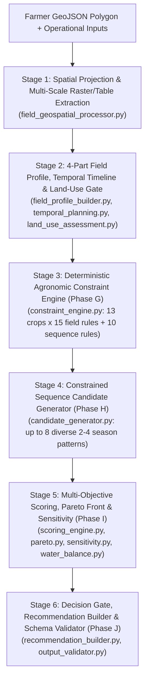

# Technical Decision / AI Model Architecture Report — Field Shift (`FieldShift-PhaseFJ-1.1.0`)

This technical report explains how the Field Shift crop rotation decision model works internally, which algorithms and mathematical rules it executes from polygon submission to final ranked recommendation, and exactly which datasets it reads at runtime versus during historical validation.

All descriptions below reflect code, JSON knowledge bases, schemas, and validation reports directly verified in `/home/lokman/Desktop/FeildShit-SI-Model`.

---

## 1. Model Paradigm: Hybrid Knowledge + Constraint + Multi-Objective Decision Engine (Why No Supervised ML)

Field Shift (`DECISION_ENGINE_VERSION = "FieldShift-PhaseFJ-1.1.0"`) is **not** a black-box supervised machine-learning or deep-learning model (`scikit-learn`, `XGBoost`, `LightGBM`, `PyTorch`, `TensorFlow`, `PuLP`, and `OR-Tools` are absent from the inference codebase).

As formally justified in [`candidate_model_comparison.md`](file:///home/lokman/Desktop/FeildShit-SI-Model/docs/phaseE/candidate_model_comparison.md) and [`scientific_validation_report.md`](file:///home/lokman/Desktop/FeildShit-SI-Model/docs/phaseK/scientific_validation_report.md):
1. **Zero Labeled Ground-Truth Targets (`Y`):** The repository contains zero verified plot-level crop-type polygons, zero observed parcel/commune harvest yields (`t/ha` or `qx/ha`), and zero farm management/rotation outcome logs ([`Guelma_Annual_Seasonal_Crop_Analysis.csv`](file:///home/lokman/Desktop/FeildShit-SI-Model/data/tables/Guelma_Annual_Seasonal_Crop_Analysis.csv) is only an `NDVI > 0.4` regional greenness area summary).
2. **Prohibition Against Circular Synthetic Labels:** Generating heuristic suitability labels via rules and training XGBoost/RF to mimic those rules was rejected to avoid adding opacity with zero empirical validity.
3. **Chosen Architecture ([`proposed_model_architecture.md`](file:///home/lokman/Desktop/FeildShit-SI-Model/docs/phaseE/proposed_model_architecture.md)):** A **Hybrid Physics-Informed Knowledge + Deterministic Constraint Engine + Pattern-Constrained Sequence Generator + Multi-Objective Weighted & Pareto Optimizer + Sensitivity & Decision-Gate Uncertainty Engine**, orchestrated end-to-end in [`pipeline_service.py`](file:///home/lokman/Desktop/FeildShit-SI-Model/src/api/pipeline_service.py).

---

## 2. End-to-End Inference Pipeline (`Phases F → G → H → I → J`)

When `run_field_analysis_pipeline()` in [`pipeline_service.py`](file:///home/lokman/Desktop/FeildShit-SI-Model/src/api/pipeline_service.py) runs on a submitted farm polygon and operational preferences, it executes six deterministic stages:

---

## 3. Stage-by-Stage Algorithmic Mechanics

### 3.1 Stage 1 — Polygon Validation & Area-Weighted Extraction ([`field_geospatial_processor.py`](file:///home/lokman/Desktop/FeildShit-SI-Model/field_geospatial_processor.py))
- **Geometry Validation:** Accepts a single non-empty, valid GeoJSON `Polygon` (no MultiPolygons or self-intersections), reprojects it to `EPSG:32632`, verifies `> 0%` overlap with the Guelma Wilaya boundary, and computes commune intersections (`primary_commune`, `commune_overlaps`).
- **Exact Polygon–Pixel Weighting (`_compute_window_area_weights` + `_extract_weighted_raster_window`):** Instead of nearest-centroid sampling, every touched pixel box inside the polygon window is weighted by its **exact geometric intersection area** with the field polygon (`area_weights`). For SoilGrids, `_depth_weighted_soil_profile()` additionally weights bands across horizon thicknesses (`SOIL_DEPTH_THICKNESS_CM`: `0-5cm: 5.0`, `5-15cm: 10.0`, `15-30cm: 15.0` for `0_30cm`; `30-60cm: 30.0`, `60-100cm: 40.0` for `30_100cm`).
- **Coarse Climate Overlap:** `11 km` GPM/SMAP cells and `NASA POWER` `AG`/`RE` cells are weighted by their geometric intersection area with the polygon; daily `NASA POWER` meteorological seasons with `< 80` days (partial `Winter 2016` and `Winter 2026`) are dropped before seasonal averages.
- **Explicit Exclusions & Placeholders:**
  - `soilgrids_v6.nitrogen_0_30cm` is unconditionally quarantined as `UNVALIDATED_EXCLUDED` due to the Phase D `N > SOC` subsoil anomaly audit.
  - `terrain_dem` (`dem_elevation_m`, `dem_slope_pct`) returns `UNAVAILABLE_NOT_INTEGRATED` (`SRTM 30 m planned`) rather than fabricating elevation/slope.

### 3.2 Stage 2 — Farmer Input Normalization, Temporal Chronology & Land-Use Gate
- **Minimal Input Contract ([`field_profile_builder.py`](file:///home/lokman/Desktop/FeildShit-SI-Model/field_profile_builder.py)):** Enforces `field_input_schema.json` and rejects `FORBIDDEN_TECHNICAL_KEYS` (`soil_ph`, `clay`, `soc`, `ndvi`, `rainfall_mm`, `elevation_m`, etc.) so technical data always comes from verified geospatial datasets or lab modules rather than manual guesswork.
- **Multilingual Crop Aliasing & Tri-State Missingness:** Maps `CROP_ALIASES` (English, French, and Algerian Arabic transliterations) onto the 13 canonical crop IDs, validates non-intersecting `target_crop_ids` vs. `excluded_crop_ids`, and preserves `null` (`NOT_PROVIDED`) separately from `[]` (`EXPLICITLY_CONFIRMED_EMPTY`).
- **Chronological Season Indexing ([`temporal_planning.py`](file:///home/lokman/Desktop/FeildShit-SI-Model/src/agronomic/temporal_planning.py)):** Computes monotonic ordinal indices `year * 4 + season_index` (`SEASON_ORDER = ("Winter", "Spring", "Summer", "Autumn")`) to identify immediate chronological predecessors (`T-1` within gap `1..4` seasons, `T-2` within `1..16` seasons) strictly prior to `(start_year, start_season)`.
- **Multi-Signal Land-Use Gate ([`land_use_assessment.py`](file:///home/lokman/Desktop/FeildShit-SI-Model/src/agronomic/land_use_assessment.py)):** Cross-checks ESA `10 m` `crop_frequency_2021_2025` (`>= 0.40` or `share>=0.5 >= 40%` supported; `< 0.05` very low), SoilGrids `250 m` coverage (`< 25.0%` masked/urban suspected), Sentinel-2/MODIS NDVI (`< 0.24` low, `>= 0.40` high), and farmer cropping history to classify the polygon into:
  `LAND_USE_SUPPORTED`, `LAND_USE_LOW_EVIDENCE`, `LAND_USE_UNVERIFIED`, `LAND_USE_CONFLICTING_EVIDENCE`, or `LAND_USE_DATA_UNAVAILABLE`. The `UNVERIFIED` and `CONFLICTING_EVIDENCE` classes set `is_provisional = True` (`EXPLORATORY_ONLY` gating).

### 3.3 Stage 3 — Deterministic Agronomic Constraint Engine (`Phase G`, [`constraint_engine.py`](file:///home/lokman/Desktop/FeildShit-SI-Model/src/agronomic/constraint_engine.py))
Reads three structured JSON files under [`agronomic_knowledge/`](file:///home/lokman/Desktop/FeildShit-SI-Model/agronomic_knowledge/):
- **[`crop_profiles.json`](file:///home/lokman/Desktop/FeildShit-SI-Model/agronomic_knowledge/crop_profiles.json):** 13 crop/land-use profiles (`DURUM_WHEAT`, `SOFT_WHEAT`, `BARLEY`, `FABA_BEAN`, `CHICKPEA_WINTER`, `CHICKPEA_SPRING`, `LENTIL`, `VETCH_OAT`, `TOMATO_IND`, `POTATO`, `SUNFLOWER`, `OLIVE`, `BARE_FALLOW`). `OLIVE` has `in_annual_rotation_scope = False`.
- **[`constraint_rules.json`](file:///home/lokman/Desktop/FeildShit-SI-Model/agronomic_knowledge/constraint_rules.json):** **15 deterministic single-crop evaluation rules**:
  - `HARD_CONSTRAINT` (`3`): `RULE_PERENNIAL_EXCLUSION`, `RULE_PLANTING_SEASON_COMPATIBILITY`, `RULE_WATER_IRRIGATION_GATE` (blocks rainfed `TOMATO_IND`/`POTATO`; yields `UNKNOWN` if irrigation status is `"unknown"`).
  - `SOFT_CONSTRAINT` (`9`): `RULE_PRECIPITATION_REGIME`, `RULE_THERMAL_HEAT_FROST`, `RULE_ROOTZONE_SOIL_MOISTURE_CONTEXT`, `RULE_SOIL_TEXTURE_WORKABILITY`, `RULE_SOIL_PH_SUITABILITY`, `RULE_SOIL_SOC_PRIORITY`, `RULE_CROPLAND_VEG_CONTEXT`, `RULE_HYPOTHESIS_LOCAL_EVIDENCE_STATUS` (flags `POTATO`, `SUNFLOWER` as `HYPOTHESIS_NEEDS_DSA_CHECK`), `RULE_EQUIPMENT_CONSTRAINT_CHECK`.
  - `EXPERT_ASSUMPTION` (`2`): `RULE_DEM_DRAINAGE_UNCERTAINTY`, `RULE_FORAGE_REQUIREMENT_ALIGNMENT`.
  - `UNKNOWN` (`1`): `RULE_SALINITY_UNMEASURED_IRRIGATION` (`ECe`/`ECw` unmeasured locally).
- **[`sequence_compatibility.json`](file:///home/lokman/Desktop/FeildShit-SI-Model/agronomic_knowledge/sequence_compatibility.json):** **10 transition & break-interval rules** evaluated across `[T-2, T-1, S1..Sk]`:
  - Hard breaks (`FAIL`): `SEQ_01_PERENNIAL_GUARD`, `SEQ_02_CEREAL_REPETITION` (`>= 3` consecutive cereals; `2` triggers `WARNING`), `SEQ_03_SOLANACEAE_BREAK` (`< 3` yr gap for Tomato/Potato), `SEQ_04_PULSE_BROOMRAPE_BREAK` (`< 3` seasons for same pulse or `FABA_BEAN <-> LENTIL` due to *Orobanche crenata* / *Ascochyta*; cross-genus `< 3` seasons emits `WARNING`), `SEQ_05_SUNFLOWER_BREAK` (`< 3` yr break), `SEQ_08_BARE_FALLOW_COVER` (consecutive `BARE_FALLOW -> BARE_FALLOW`).
  - Soft/Assumption/Uncertainty rules: `SEQ_06_VETCH_OAT_ROLE_AND_REPEAT`, `SEQ_07_LEGUME_CEREAL_SYNERGY`, `SEQ_09_WATER_COMPETITION_AND_CALENDAR` (Sunflower before rainfed cereal, or Autumn Potato overlapping Winter cereal sowing), `SEQ_10_UNKNOWN_PREDECESSOR_GUARD` (emits `UNKNOWN` if `T-1` history is absent).
- **Fail-Closed Verdict Aggregation:**
  Any `HARD_CONSTRAINT` `FAIL` → `INFEASIBLE_HARD_CONSTRAINT`; any `HARD_CONSTRAINT` `UNKNOWN` → `UNVERIFIED_HARD_UNKNOWN`; any non-hard `FAIL` → `INFEASIBLE_CONSTRAINT`; otherwise any `WARNING` or `UNKNOWN` → `CONDITIONALLY_FEASIBLE_WITH_WARNINGS_OR_UNKNOWNS`; zero warnings/unknowns → `FEASIBLE_PASS`. Unknowns are **never** silently promoted to `PASS`.

### 3.4 Stage 4 — Constrained Rotation Candidate Generator (`Phase H`, [`candidate_generator.py`](file:///home/lokman/Desktop/FeildShit-SI-Model/src/rotation/candidate_generator.py))
Instead of unconstrained brute-force enumeration over $13^4$ combinations, `generate_rotation_candidates()` uses **Deterministic Pattern-Based Sequence Synthesis + Cache-Assisted Slot Construction** over `horizon_seasons` (`2–4` seasons), capped at `max_candidates = 8`:
1. Caches single-crop rule evaluations per key season (`start_season`, `Winter`, `Spring`, `Autumn`) via `evaluate_all_crops_for_field()`.
2. Calls `_construct_pattern_sequences()` and `_build_cycle()` to synthesize up to 7 diverse structural rotation archetypes while strictly avoiding excluded crops and back-to-back cereal/same-pulse traps at `T-1 -> S1`:
   - `STRAT_CEREAL_LEGUME` (`DURUM_WHEAT` or `BARLEY` if `GPM < 460 mm`, paired with food legumes; shifts break pool toward `["FABA_BEAN", "CHICKPEA_WINTER", "CHICKPEA_SPRING", "VETCH_OAT"]` when `clay >= 35%`).
   - `STRAT_CEREAL_FORAGE` (cereal paired with Algerian `VETCH_OAT` hay mix).
   - `STRAT_SOIL_IMPROVEMENT` (high-biomass `FABA_BEAN` / `VETCH_OAT` / `CHICKPEA_WINTER` emphasis addressing `SOC < 18 g/kg`).
   - `STRAT_WATER_CONSCIOUS` (`BARLEY`, `CHICKPEA_*`, `LENTIL`, `VETCH_OAT`).
   - `STRAT_IRRIGATED_CASH` (adds `TOMATO_IND` if irrigated or targeted; marked `SELECTED_INFEASIBLE_COUNTERFACTUAL` if irrigation gate is unsatisfied/unknown).
   - `STRAT_TARGET_<CROP>` / `STRAT_REQUESTED_<CROP>` (explicitly integrates or tests farmer `target_crop_ids`, preserving counterfactual rejection e.g. for perennial `OLIVE`).
   - `STRAT_EXISTING_BASELINE` (only when `>= 2` resolved `crop_history` entries exist; projects observed historical cycle forward).
3. Assigns chronologically consistent `(calendar_year, agricultural_season)` slots via `_slot_calendar_sequence()`, deduplicates identical tuples, and evaluates every surviving candidate with `evaluate_crop_sequence()`.

### 3.5 Stage 5 — Multi-Objective Scoring, Pareto Front & Sensitivity (`Phase I`)

#### A. Eight Evaluation Objectives ([`scoring_engine.py`](file:///home/lokman/Desktop/FeildShit-SI-Model/src/optimization/scoring_engine.py))
| Objective ID | Formula / Scoring Basis | Range & Data Status Policy |
|---|---|---|
| `water_efficiency` | Ordinal regime compatibility (`[0, 1]`): `STRICTLY_IRRIGATED` scores `0.0` rainfed, `0.40` drip, `0.30` sprinkler, `0.20` surface; rainfed crops score `clip01(0.40 + headroom + cat_bonus + irrig_buf)` where `headroom = clip((P - P_min)/300, -0.35, 0.45)`, `cat_bonus` adds up to `+0.10` below `600 mm` for semi-arid tolerant crops, `BARE_FALLOW = 0.60`. Evaluated on conservative **GPM**, plus parallel **NASA POWER** score. | **`SCORED`** / **`PARTIAL`**; becomes **`UNKNOWN`** if water gate is unresolved on a strictly irrigated rotation. Explicitly **not** volumetric FAO-56 (`water_balance.py` audits `ET0`/`ETc` readiness and finds `WS2M`, DEM slope/elevation, lab FC/PWP, and monthly rainfall missing). |
| `soil_improvement` | Mean of qualitative `_SOM_DIRECTION_SCORES` (`0.15` Bare Fallow to `0.95` Vetch-Oat) across slots + `0.05` bonus if `>= 2` distinct rooting depth classes (`_root_depth_class`). | Always computed (`SCORED` or `PARTIAL` if SoilGrids `soc_0_30cm` or `clay_0_30cm` missing locally). |
| `nitrogen_contribution` | `clip01(0.10 + 0.90 * mean(n_slots) + min(0.12, 0.06 * len(SEQ_07 transitions)))` where `FABA_BEAN = 0.95` (`100–200 kg N/ha`), other pulses = `0.72`, `VETCH_OAT = 0.68`, `BARE_FALLOW = 0.05`, others = `0.0`. Quarantined SoilGrids Nitrogen is excluded. | **`SCORED`** (if only Faba Bean/non-legumes) or **`PARTIAL`** (when unquantified pulses/vetch-oat appear). |
| `pest_disease_disruption` | `clip01(0.30 + 0.70 * trans_ratio - warn_penalty - fail_penalty)` over `[T-1->S1, S1->S2, ...]`, where cross-family switch = `1.0`, `Mixed_Fabaceae_Poaceae` switch = `0.75`, repeat = `0.0`; subtracts `0.12` (or `0.04` for 2-yr Vetch-Oat cycle) per `WARNING` and `0.45` per sanitary `FAIL`. | **`SCORED`** when `T-1` known (`SEQ_10 == PASS`), **`PARTIAL`** when `T-1` missing. |
| `erosion_protection` | `clip01(mean(_EROSION_COVER_SCORES) - seq08_penalty + slope_adj)`, favoring dense winter cereals/vetch-oat (`0.90`) over tomato (`0.40`), potato (`0.25`), and fallow (`0.15`), minus `0.20`/`0.10` for `SEQ_08` fail/warning and `-0.10` if DEM `slope >= 8%` with low cover. | **`PARTIAL`** while local DEM slope is `UNAVAILABLE_NOT_INTEGRATED`. |
| `income_potential` | Linear normalization `0.10 + 0.90 * ((margin - m_min)/span)` across supplied `net_margin_per_ha` or `yield * price - cost`. | Strictly **`UNKNOWN`** (`score = None`) and excluded from ranking unless caller supplies local economic budgets (`_QUALITATIVE_INCOME_TIERS` returned descriptively). |
| `forage_value` | Mean of `_FORAGE_VALUE_SCORES` (`VETCH_OAT = 1.00`, `BARLEY = 0.55`, `FABA_BEAN = 0.25`, wheat = `0.20`, etc.). | **`NOT_APPLICABLE`** when `forage_value_weight` is `null` or `0.0`; **`SCORED`** only when `forage_value_weight > 0`. |
| `farmer_priority_fit` | `0.50 * target_hit_ratio` (default `0.45` if no targets) `+ 0.50 * mean(slot_ops)` combining `RULE_WATER_IRRIGATION_GATE` and `RULE_EQUIPMENT_CONSTRAINT_CHECK`; `0.0` if any `excluded_crop_ids` appears. | **`PARTIAL`** if `equipment_constraints` is `null` or contains unsupported tags; **`SCORED`** when confirmed. |

#### B. Weight Resolution & Active Normalization
Five farmer weights (`DEFAULT_FARMER_WEIGHTS`: `water_saving_weight = 0.25`, `soil_improvement_weight = 0.30`, `income_weight = 0.20`, `risk_reduction_weight = 0.25`, `forage_value_weight = None`) map onto the 8 objectives:
- `water_efficiency = w_water`
- `soil_improvement = 0.50 * w_soil`, `nitrogen_contribution = 0.25 * w_soil`, `erosion_protection = 0.25 * w_soil`
- `pest_disease_disruption = 0.65 * w_risk`, `farmer_priority_fit = 0.35 * w_risk`
- `income_potential = w_inc`, `forage_value = w_forage`

When only `forage_value_weight` is supplied, core weights stay at `DEFAULT_FARMER_WEIGHTS`. Critically, weights are **normalized strictly over `active_weighted_objs`** (objectives that are `SCORED` or `PARTIAL` across **all** eligible candidates AND have positive weight `> 0.0`), so inactive `income_potential` or `forage_value` (`None`) do not artificially depress composite scores.

#### C. Pareto Dominance & Deterministic Sorting ([`pareto.py`](file:///home/lokman/Desktop/FeildShit-SI-Model/src/optimization/pareto.py))
- Only feasible strategies (`FEASIBLE_PASS` or `CONDITIONALLY_FEASIBLE_WITH_WARNINGS_OR_UNKNOWNS`) enter ranking; infeasible strategies become `EXCLUDED_INFEASIBLE`.
- Pairwise dominance checks (`check_dominance`, tolerance `eps = 1e-9`) operate solely on `active_pareto_objectives` (common `SCORED`/`PARTIAL` subset across eligible candidates), labeling each candidate `NON_DOMINATED_PARETO_FRONT` or `DOMINATED`.
- Eligible strategies sort deterministically by:
  `(-round(weighted_score, 9), is_non_front, -pass_rule_count, strategy_id)`.

#### D. Sensitivity, Climate Envelope & Margin Gating ([`sensitivity.py`](file:///home/lokman/Desktop/FeildShit-SI-Model/src/optimization/sensitivity.py))
- **Weight Perturbations:** Runs `EQUAL_ACTIVE_WEIGHTS`, One-At-A-Time `±25%` perturbations (`OAT_*_PLUS_25PCT`, `OAT_*_MINUS_25PCT`), and `0.65` single-objective emphasis templates (`FOCUS_*`) across active objectives (`19` scenarios when 6 objectives active; `22` when `forage_value` is also active), reporting `stability_index` (top-1 retention fraction, explicitly documented as model sensitivity—not yield confidence).
- **Margin Classification:** Separates rank #1 vs #2 gaps via `MarginThresholds`: `NEAR_TIE` (`<= 0.015` abs or `<= 2.5%` rel), `NARROW_MARGIN` (`<= 0.04` abs or `<= 6.0%` rel), or `CLEAR_MARGIN`, listing close runners-up in `plausible_alternatives`.
- **Climate Envelope Stress:** Compares winners under **GPM** (`water_efficiency`) vs. **NASA POWER** (`power_water_scores`), **conservative dry bound** (`min(gpm, power) - 0.08`, floored at `0.05`), and **source-disagreement stress** (penalizing spread when `precip_spread_mm > 100.0 mm`), emitting `ROBUST_GPM_AND_POWER` vs. `PRECIP_SENSITIVE_RANK_SHIFT`.

### 3.6 Stage 6 — Decision Gating, Output Assembly & Schema Validation (`Phase J`)
[`recommendation_builder.py`](file:///home/lokman/Desktop/FeildShit-SI-Model/src/output/recommendation_builder.py) and [`output_validator.py`](file:///home/lokman/Desktop/FeildShit-SI-Model/src/output/output_validator.py) enforce strict epistemic separation:
- **Catalog `completeness_score` vs. `critical_data_adequacy`:** Counts populated catalog inputs separately from decision-critical adequacy (`NOT_ASSESSABLE`, `INSUFFICIENT`, `PARTIAL`, `ADEQUATE`)—so high raster completeness (`~0.88`) never masks missing DEM slope, unmeasured irrigation `ECe`/`ECw`, quarantined SoilGrids N, short crop history, or missing enterprise budgets.
- **`decision_gate.decision_status`:** Emits `INFEASIBLE`, `NO_RECOMMENDATION`, `EXPLORATORY_ONLY` (`endorsed_recommendation_id = None` if land use is unverified/conflicting), `REQUIRES_LOCAL_VERIFICATION`, `CONDITIONALLY_FEASIBLE`, or `FEASIBLE_PASS`.
- **Draft 2020-12 & Semantic Validation:** Checks conformance against [`final_recommendation_output.schema.json`](file:///home/lokman/Desktop/FeildShit-SI-Model/schemas/final_recommendation_output.schema.json) and enforces rank, weight, and provenance invariants before returning any API response.

---

## 4. Exact Datasets Used by the AI / Decision Model (vs. Unused Package Tables)

A key architectural distinction exists between **runtime polygon extraction** (`field_geospatial_processor.py`), **agronomic knowledge bases**, **Phase K historical backtesting**, and **Phase D summary tables** (such as `guelma_environmental_spatiotemporal_dataset_2016_2025.csv`):

| Role in System | Exact Files Read | Purpose & Resolution |
|---|---|---|
| **Runtime Live Inference — Vector Boundaries** ([`field_geospatial_processor.py`](file:///home/lokman/Desktop/FeildShit-SI-Model/field_geospatial_processor.py)) | [`guelma_wilaya_utm32n.gpkg`](file:///home/lokman/Desktop/FeildShit-SI-Model/data/INTEGRATED/canonical/spatial_reference/guelma_wilaya_utm32n.gpkg), [`guelma_communes_utm32n.gpkg`](file:///home/lokman/Desktop/FeildShit-SI-Model/data/INTEGRATED/canonical/spatial_reference/guelma_communes_utm32n.gpkg), [`nasa_power_AG_intersections.gpkg`](file:///home/lokman/Desktop/FeildShit-SI-Model/data/NASA_POWER_REGIONAL/processed/spatial/nasa_power_AG_intersections.gpkg), [`nasa_power_RE_intersections.gpkg`](file:///home/lokman/Desktop/FeildShit-SI-Model/data/NASA_POWER_REGIONAL/processed/spatial/nasa_power_RE_intersections.gpkg) | Polygon boundary validation, Wilaya overlap check, commune mapping, and NASA POWER cell area intersection weights (`EPSG:32632`). |
| **Runtime Live Inference — Fine/Medium Rasters** ([`field_geospatial_processor.py`](file:///home/lokman/Desktop/FeildShit-SI-Model/field_geospatial_processor.py)) | [`guelma_soilgrids_V6_complete_package.zip`](file:///home/lokman/Desktop/FeildShit-SI-Model/data/SoilGrids/guelma_soilgrids_V6_complete_package.zip) (`guelma_soilgrids_42bands_250m_V6_MERGED.tif`), [`guelma_USDA_texture_classes_6depths_250m.tif`](file:///home/lokman/Desktop/FeildShit-SI-Model/data/SoilGrids/guelma_USDA_texture_classes_6depths_250m.tif), [`guelma_crop_frequency_2021_2025_aligned_s2_10m.tif`](file:///home/lokman/Desktop/FeildShit-SI-Model/data/INTEGRATED/spatial/guelma_crop_frequency_2021_2025_aligned_s2_10m.tif), [`sentinel2_2024_03_indices_10m.tif`](file:///home/lokman/Desktop/FeildShit-SI-Model/data/SENTINEL2/raw/phaseA_2024_03/sentinel2_2024_03_indices_10m.tif) & `20m.tif` (+ `valid_obs` TIFFs), `data/seasonal/guelma_modis_seasonal_2016_2025_analysis/guelma_modis_seasonal_2016..2025.tif` (10 annual multi-band GeoTIFFs) | Exact polygon–pixel area-weighted extraction of `0–30 cm` & `30–100 cm` soil (`250 m`), USDA texture (`250 m`), 2021–2025 crop frequency (`10 m`), March 2024 Sentinel-2 snapshot (`10 m`/`20 m`), and 10-year seasonal MODIS climatologies (`250 m`). |
| **Runtime Live Inference — Coarse Climate & Fallback Tables** ([`field_geospatial_processor.py`](file:///home/lokman/Desktop/FeildShit-SI-Model/field_geospatial_processor.py)) | [`grid_11km_utm32n_master.csv`](file:///home/lokman/Desktop/FeildShit-SI-Model/data/INTEGRATED/canonical/spatial_reference/grid_11km_utm32n_master.csv), [`gpm_seasonal_11km_canonical.csv`](file:///home/lokman/Desktop/FeildShit-SI-Model/data/INTEGRATED/canonical/precipitation_observations/gpm_seasonal_11km_canonical.csv), [`smap_seasonal_11km_canonical.csv`](file:///home/lokman/Desktop/FeildShit-SI-Model/data/INTEGRATED/canonical/soil_moisture_observations/smap_seasonal_11km_canonical.csv), [`nasa_power_daily_cell_values.csv`](file:///home/lokman/Desktop/FeildShit-SI-Model/data/NASA_POWER_REGIONAL/processed/daily/nasa_power_daily_cell_values.csv), and [`wilaya_monthly_panel_2016_2025.csv`](file:///home/lokman/Desktop/FeildShit-SI-Model/data/INTEGRATED/features/wilaya_monthly_panel_2016_2025.csv) | Exact `11 km` polygon-weighted seasonal/annual GPM precipitation & SMAP soil moisture; daily/seasonal NASA POWER temp/RH/radiation/precip (`AG` & `RE`); and 2017–2025 Spring Sentinel-2 Wilaya median climatology fallback. |
| **Agronomic Knowledge Base & Dictionaries** ([`constraint_engine.py`](file:///home/lokman/Desktop/FeildShit-SI-Model/src/agronomic/constraint_engine.py), [`field_profile_builder.py`](file:///home/lokman/Desktop/FeildShit-SI-Model/field_profile_builder.py)) | [`crop_profiles.json`](file:///home/lokman/Desktop/FeildShit-SI-Model/agronomic_knowledge/crop_profiles.json), [`constraint_rules.json`](file:///home/lokman/Desktop/FeildShit-SI-Model/agronomic_knowledge/constraint_rules.json), [`sequence_compatibility.json`](file:///home/lokman/Desktop/FeildShit-SI-Model/agronomic_knowledge/sequence_compatibility.json), [`crop_system_inventory.csv`](file:///home/lokman/Desktop/FeildShit-SI-Model/docs/phaseE/crop_system_inventory.csv), [`agronomic_constraints_framework.csv`](file:///home/lokman/Desktop/FeildShit-SI-Model/docs/phaseE/agronomic_constraints_framework.csv) | Crop traits (`FAO-56 Kc`, rainfed precipitation thresholds, break intervals), 15 deterministic field constraint rules, 10 sequence transition rules, and Phase F descriptive diagnostic thresholds. |
| **Historical Backtesting & Regime Validation (`Phase K`)** ([`historical_backtesting_report.md`](file:///home/lokman/Desktop/FeildShit-SI-Model/docs/phaseK/historical_backtesting_report.md)) | Antecedent slices of GPM/SMAP/MODIS/NASA POWER (`2017–2018`, `2017–2021`, `2019` wet peak, `2022` drought) + [`guelma_environmental_annual_dataset_2016_2025.csv`](file:///home/lokman/Desktop/FeildShit-SI-Model/data/tables/guelma_environmental_annual_dataset_2016_2025.csv) | Tests causal temporal firewalls (`crop_freq_21_25` & `s2_2024_03` masked to `null` for pre-2021/pre-2024 backtests) and drought/wet rank shifts across Boumahra/Belkheir (`PRECIP_SENSITIVE_RANK_SHIFT` in `2022`) and Tamlouka. |
| **NOT Read Directly by Live Model Inference** | [`guelma_environmental_spatiotemporal_dataset_2016_2025.csv`](file:///home/lokman/Desktop/FeildShit-SI-Model/data/tables/dataset/guelma_environmental_spatiotemporal_dataset_2016_2025.csv), [`commune_static_soil_and_land_features.csv`](file:///home/lokman/Desktop/FeildShit-SI-Model/data/INTEGRATED/features/commune_static_soil_and_land_features.csv), [`commune_seasonal_panel_2016_2025.csv`](file:///home/lokman/Desktop/FeildShit-SI-Model/data/INTEGRATED/features/commune_seasonal_panel_2016_2025.csv), [`landscape_250m_static_features.csv`](file:///home/lokman/Desktop/FeildShit-SI-Model/data/INTEGRATED/features/landscape_250m_static_features.csv) | Pre-built/Phase D analytical tables for commune, `11 km`, and `250 m` exploratory analysis; live API predictions instead perform exact polygon-weighted extraction over canonical GeoTIFFs and canonical seasonal/daily source tables. |

---

## 5. Known Scientific Limitations Verified in [`validation_scorecard.csv`](file:///home/lokman/Desktop/FeildShit-SI-Model/docs/phaseK/validation_scorecard.csv)

- **Empirical Yield / Accuracy (`NOT_VALIDATABLE`):** Zero labeled plot yield or historical farm-sequence datasets exist locally (`RMSE`, `R²`, and field classification accuracy cannot be computed yet).
- **Ordinal Water & SOM Indices:** `water_efficiency` is an ordinal rainfall/irrigation suitability score rather than a volumetric Penman–Monteith $ET_c - P_{\text{eff}}$ balance (`WS2M`, DEM elevation/slope, and soil FC/PWP are absent); `soil_improvement` relies on qualitative KB residue directions rather than measured soil carbon change ($\text{t C ha}^{-1}\text{ yr}^{-1}$).
- **Unquantified Non-Faba Legume N & Missing Economics:** Only `FABA_BEAN` has a quantified N-fixation range (`100–200 kg N/ha`), keeping `nitrogen_contribution` at `PARTIAL` for chickpea/lentil/vetch-oat rotations; `income_potential` remains `UNKNOWN` until local market yields, prices, and budgets are connected.
- **Unverified Crop Hypotheses & Missing Local Telemetry:** `POTATO` and `SUNFLOWER` remain flagged `HYPOTHESIS_NEEDS_DSA_CHECK`, and SoilGrids (`250 m`) and GPM/SMAP/NASA POWER (`11–111 km`) do not replace field laboratory tests (`ECe`/`ECw`, pH, N/P/K) or drainage checks—which is why verified predictions carry explicit `CONDITIONAL_RECOMMENDATION_REQUIRES_LOCAL_VERIFICATION` or `EXPLORATORY_ONLY` decision gates.
