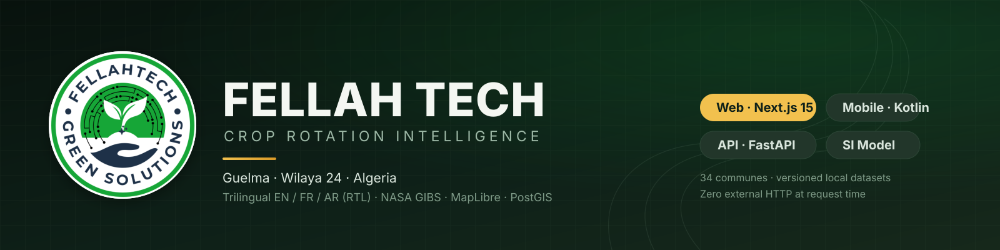
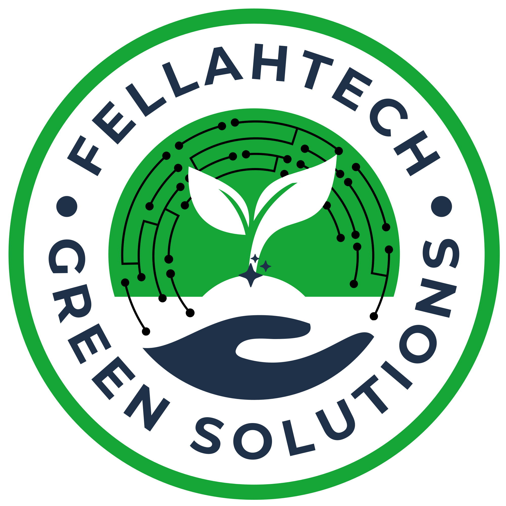
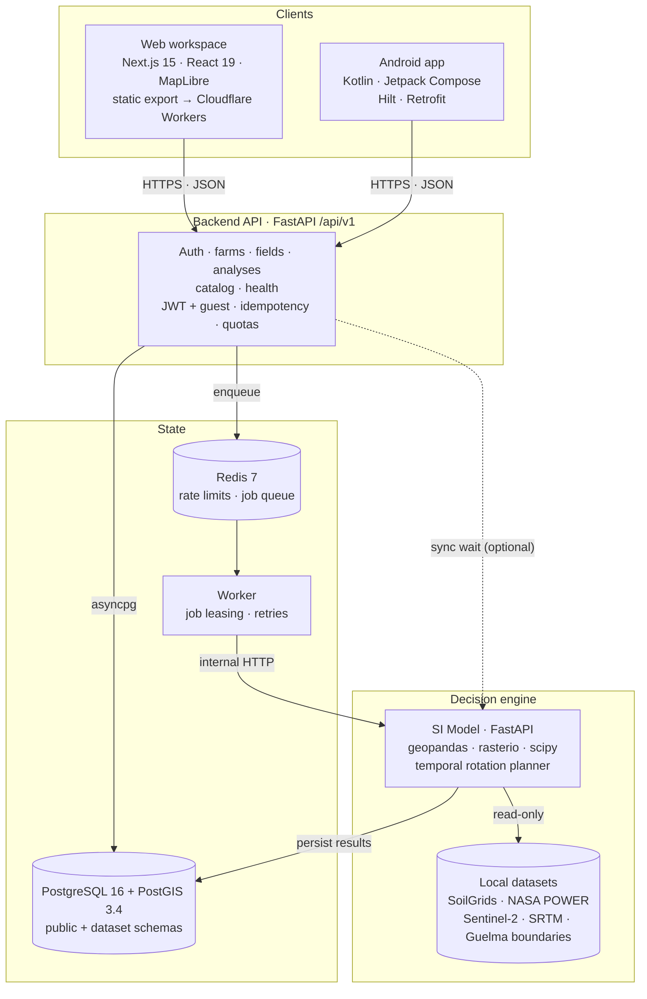
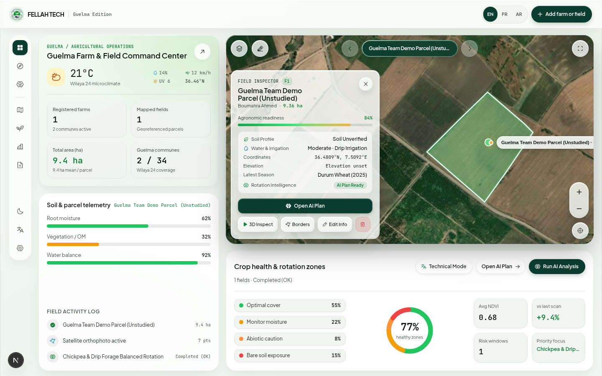
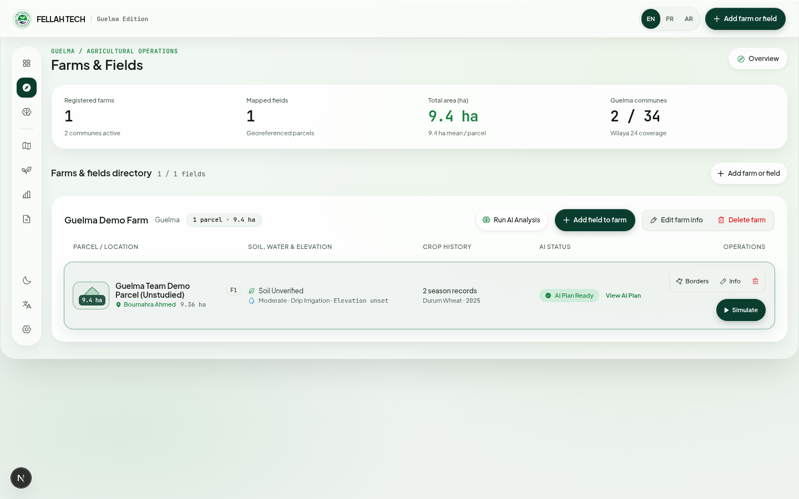
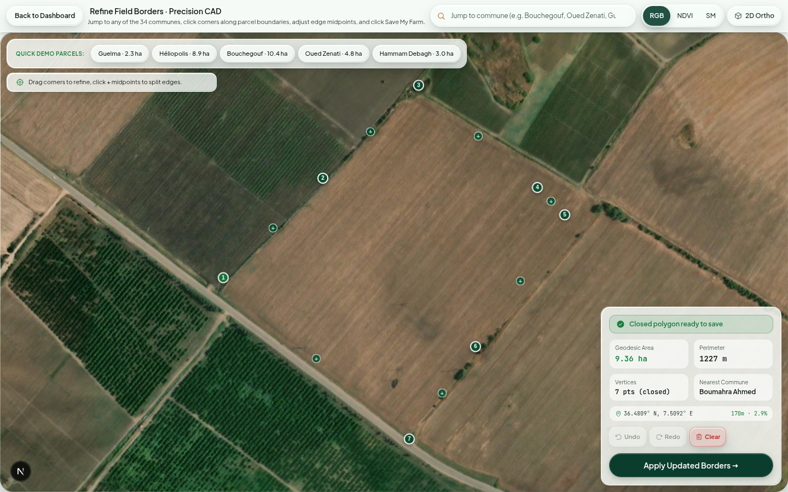
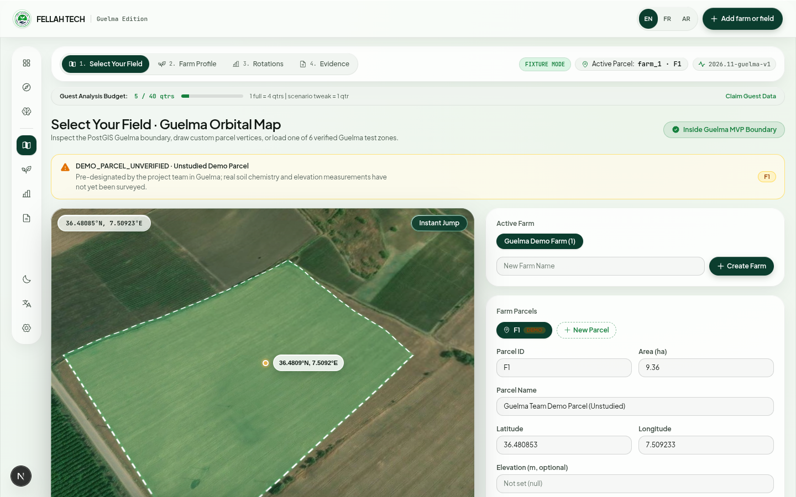
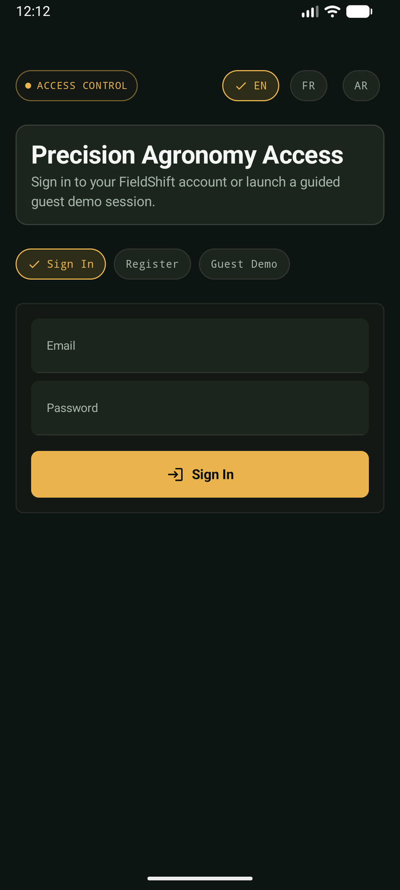
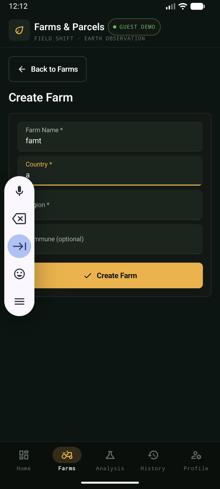
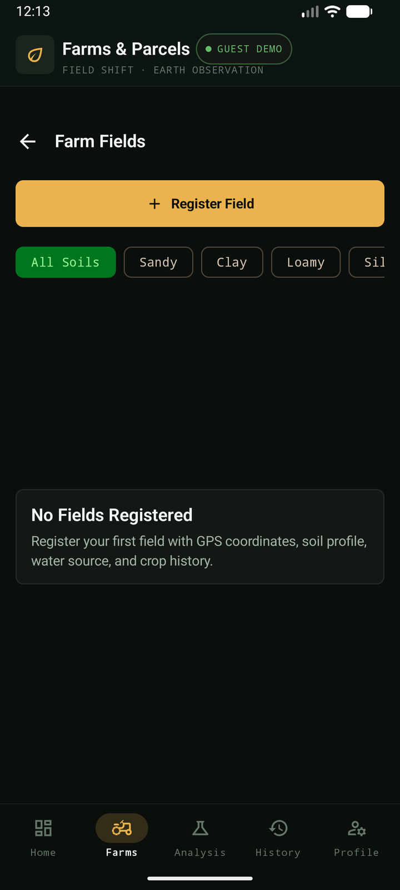

<p align="center">
  
</p>

<h1 align="center">FELLAH TECH</h1>

<p align="center">
  
</p>

<p align="center">
  <em>Climate-resilient crop-rotation intelligence for Guelma, Algeria.</em>
</p>

<p align="center">
  
  
  
  
  
  <br />
  
  
  
  
  
  <br />
  
  
  
  <br />
  
  
  
  
</p>

<p align="center">
  <a href="https://fieldshift-planner.sidalidjeghbal.workers.dev/"></a>
  <a href="docs/README.md"></a>
  <a href="SYSTEM%20DESGIN/SYSTEM%20DESGIN.md"></a>
</p>

---

**FELLAH TECH** is a trilingual (**EN / FR / AR with RTL**) agricultural decision-support platform for the **Wilaya of Guelma (34 communes)**. Farmers trace a parcel on satellite imagery; the platform resolves soil, climate, terrain and crop-history context **from versioned local datasets**, then an agronomic engine returns a multi-season rotation plan with explicit readiness and provenance.

It ships as four cooperating deliverables:

| Module | Stack | Purpose |
| --- | --- | --- |
| [`frontend/`](frontend/) | Next.js 15 · React 19 · MapLibre GL · Turf.js | Farmer workspace: GIS border editor, 3D terrain, dashboards, AI intelligence views |
| [`backend/`](backend/) | FastAPI · PostgreSQL/PostGIS · Redis · Alembic | Contract-first REST API (`/api/v1`): auth, farms, fields, async analyses, catalog |
| [`Feild-Shift-SI-Model/`](Feild-Shift-SI-Model/) | FastAPI · geopandas · rasterio · scipy | Agronomic engine: temporal rotation planner, validation, evidence bundles |
| [`mobile/`](mobile/) | Kotlin · Jetpack Compose · Hilt · Retrofit | Android companion for field capture and analysis on the go |

> **Design constraint:** zero external HTTP calls at request time. Soil, weather, DEM and Sentinel-2 context is baked into local, versioned snapshots (ADR-1 / ADR-9).

---

## System Architecture



**Analysis flow:** client submits a minimal farmer contract (`field.geometry`, `water`, `planning`, optional `crop_history`) → API validates against the strict intake schema, hashes the payload for idempotency, enqueues a job → worker calls the SI model → the model resolves the polygon against Guelma boundaries, soil and climate layers, runs the temporal planner → the API persists an `ANAL_*` analysis with provenance and readiness flags → the client polls or receives the completed result.

---

## Screenshots

### Web workspace

<p align="center">
  
  
</p>
<p align="center">
  
  
</p>

### Android app

<p align="center">
  
  
  
</p>

---

## Feature Highlights

**Geospatial workspace**
- Satellite CAD border editor with draggable vertices/midpoints, undo/redo, geodesic area & perimeter, self-intersection checks and Wilaya-24 containment validation
- NASA GIBS WMTS overlays (NDVI, soil moisture), 3D Terrarium terrain, 22-month timeline scrubber
- 34-commune searchable fly-to index, demo parcels and sample loader

**Agronomic intelligence**
- Multi-season rotation plans with plain-language and scientific modes
- Data-completeness meters, missing-input warnings, `DEMO_PARCEL_UNVERIFIED` provenance banners
- Strategy comparison: 7-axis radar, 12-month stress calendar, climate what-if sliders, printable brief
- 13 crops, 15 crop rules, 10 sequence-compatibility rules, 7 `SEM` validation rules

**Platform**
- 34 `/api/v1` routes in an OpenAPI 3.1 contract; JWT access/refresh + guest sessions
- Idempotent analysis submission, async job polling with cancellation, cursor-paginated catalog
- Redis-backed rate limiting and circuit breaker; 19 normative error codes
- 40 normative environment variables + 7 companion settings, fully documented

---

## Repository Structure

```
fieldshift-planner/
├── frontend/                 # Next.js 15 web workspace (static export → Cloudflare Workers)
│   ├── src/app/              # routes: /, /dashboard, /comparison, /evidence, /farm-profile, /select-field
│   ├── src/lib/api/          # typed /api/v1 client + SI model bridge (Zod validated)
│   ├── src/components/       # GIS editor, charts, intelligence studio
│   ├── tests/                # Vitest unit tests
│   └── wrangler.jsonc        # Workers static-assets deployment
├── backend/                  # FastAPI service
│   ├── app/api/              # routers: auth, demo, farms, fields, analysis, catalog, health
│   ├── app/models/           # SQLAlchemy models + Alembic migrations
│   ├── app/services/         # domain logic, quotas, idempotency
│   ├── app/ml_client/        # SI model client + mock server
│   └── tests/                # contract, golden, integration, concurrency suites
├── Feild-Shift-SI-Model/     # Agronomic decision engine
│   ├── src/api/              # FastAPI app (/api/v1/health, /fields/analyze, …)
│   ├── src/agronomic/        # temporal planner + rule engine
│   ├── fieldshift_integration/  # canonical layers, feature engineering, validation
│   ├── data/                 # versioned spatial & tabular datasets
│   └── agronomic_knowledge/  # crop profiles and constraint rules
├── mobile/                   # Android app (Kotlin, Compose, Hilt, Retrofit)
│   └── app/src/main/java/com/example/myapplication/
├── docs/                     # engineering docs, screenshots, assets
├── SYSTEM DESGIN/            # architecture blueprint, ADRs, OpenAPI, ML schema
├── docker-compose.yml        # db · redis · migrate · api · worker · mock-ml
└── README.md
```

---

## Quickstart

### 1. Backend stack (Docker Compose)

```bash
cp .env.example .env          # set DB_PASSWORD, ML_READER_PASSWORD, JWT_SECRET_KEY, ML_SERVICE_API_KEY
docker compose --profile dev up -d --build db redis migrate api mock-ml worker
```

| Endpoint | URL |
| --- | --- |
| API | `http://127.0.0.1:8000/api/v1` |
| Swagger / ReDoc | `http://127.0.0.1:8000/docs` · `/redoc` |
| Mock ML | `http://127.0.0.1:8090` |
| Readiness | `GET /api/v1/health?check=ready` |

For a fully local run set `APP_ENV=development`, `ML_PROVIDER_MODE=mock`, `ML_SERVICE_URL=http://mock-ml:8090` (mock mode is rejected when `APP_ENV=production`).

### 2. Web frontend

```bash
cd frontend
npm install
npm run dev          # http://localhost:3000, proxies /api/v1 → localhost:8000
```

Production build (static export) and deploy:

```bash
NEXT_OUTPUT_EXPORT=true NEXT_PUBLIC_API_BASE_URL=https://<api-host> npm run build
npx wrangler deploy
```

Set `NEXT_PUBLIC_API_MODE=live` to talk to the API, or leave it unset for the offline fixture sandbox.

### 3. SI model

```bash
cd Feild-Shift-SI-Model
python3 -m venv .venv && ./.venv/bin/pip install -r requirements.txt
./.venv/bin/uvicorn src.api.app:app --host 0.0.0.0 --port 8000
```

```bash
curl -X POST http://127.0.0.1:8000/api/v1/fields/analyze \
  -H 'Content-Type: application/json' \
  -d '{"field":{"field_id":"F1","geometry":{"type":"Polygon","coordinates":[[[7.50648,36.48051],[7.50786,36.48162],[7.50919,36.48266],[7.51084,36.48152],[7.51122,36.48121],[7.50998,36.47974],[7.50906,36.47871],[7.50648,36.48051]]]}},"water":{"availability":"moderate","source":"river","irrigation_system":"drip"},"planning":{"start_season":"Autumn","start_year":2026,"horizon_seasons":3}}'
```

Or run it locally and expose it publicly with one command: `./serve_public.sh` (see [`DEPLOY_HF.md`](Feild-Shift-SI-Model/DEPLOY_HF.md) for hosting notes).

### 4. Android app

```properties
# mobile/local.properties
sdk.dir=/path/to/Android/Sdk
fieldshift.api.baseUrl=http://10.0.2.2:8000/api/v1/
```

```bash
cd mobile
./gradlew :app:installDebug
adb shell am start -n com.example.myapplication/.MainActivity
```

`10.0.2.2` is the host loopback as seen from the Android emulator. The debug build falls back to that URL when the property is absent.

---

## API Surface (`/api/v1`)

| Area | Routes |
| --- | --- |
| Auth | `POST /auth/register`, `POST /auth/login`, `POST /auth/refresh`, `POST /auth/logout`, `GET/DELETE /auth/me`, `POST /auth/guest`, `GET /auth/me/export` |
| Demo | `GET /demo/locations`, `GET /demo/locations/{id}/boundary`, `GET/DELETE /demo/session`, `POST /demo/session/claim` |
| Farms | `GET/POST /farms`, `GET/PUT/PATCH/DELETE /farms/{farm_id}` |
| Fields | `GET/POST /farms/{farm_id}/fields`, `GET/PUT/PATCH/DELETE /farms/{farm_id}/fields/{field_id}` |
| Analysis | `POST /analysis`, `GET /analysis/requests/{id}`, `DELETE /analysis/requests/{id}`, `GET /analysis/{id}`, `PUT /analysis/{id}/selection`, `GET /farms/{farm_id}/analyses` |
| Catalog | `GET /catalog` (cursor paginated) |
| Health | `GET /health` |

The machine-readable contract lives in [`SYSTEM DESGIN/.../openapi.yaml`](SYSTEM%20DESGIN/SYSTEM%20DESGIN/System%20Architecture%20Blueprint/openapi.yaml); the ML wire schema in [`schema-v5.0.json`](SYSTEM%20DESGIN/SYSTEM%20DESGIN/System%20Architecture%20Blueprint/schema-v5.0.json).

---

## Testing

```bash
cd frontend  && npm run typecheck && npm test        # Vitest (37 tests)
cd backend   && pytest                               # contract, golden, integration, concurrency
cd mobile    && ./gradlew :app:testDebugUnitTest
```

CI-style checks used across the repo: TypeScript strict typecheck, Vitest, Pytest with golden 15-scenario fixtures, OpenAPI contract diffing, and a Docker Compose end-to-end readiness probe.

---

## Documentation

| Document | Contents |
| --- | --- |
| [`docs/README.md`](docs/README.md) | Documentation index, module map, deployment matrix |
| [`SYSTEM DESGIN/SYSTEM DESGIN.md`](SYSTEM%20DESGIN/SYSTEM%20DESGIN.md) | Master index: blueprint, ADRs, endpoints & DB spec, visual I/O |
| [`docs/impl/00-spec-digest.md`](docs/impl/00-spec-digest.md) | Normative digest: 34 routes, 13 tables, 19 errors, 40+7 settings |
| [`docs/impl/02-implementation-plan.md`](docs/impl/02-implementation-plan.md) | Milestone plan M0–M13, 8-layer test strategy |
| [`docs/impl/TRACEABILITY.md`](docs/impl/TRACEABILITY.md) | Requirement → code → test matrix |
| [`docs/impl/RUNBOOK.md`](docs/impl/RUNBOOK.md) | Deployment, secret rotation, backup/restore |
| [`frontend/docs.md`](frontend/docs.md) | Frontend submission notes and stack inventory |
| [`mobile/docs/`](mobile/docs/) | API/UI integration map, backend integration audit, ML contract |
| [`Feild-Shift-SI-Model/docs/`](Feild-Shift-SI-Model/docs/) | Technical AI model and data integration reports |

---

## Deployment

| Piece | Target | Notes |
| --- | --- | --- |
| Web | **Cloudflare Workers** (static assets) | `NEXT_OUTPUT_EXPORT=true npm run build && npx wrangler deploy` — live at [fieldshift-planner](https://fieldshift-planner.sidalidjeghbal.workers.dev/) |
| Backend | Docker host / compose | PostGIS + Redis required; `api`, `worker`, `migrate` services |
| SI model | Docker or any Python host | See [`Feild-Shift-SI-Model/DEPLOY_HF.md`](Feild-Shift-SI-Model/DEPLOY_HF.md); free tunnels supported via `serve_public.sh` |
| Mobile | Android (APK) | `./gradlew :app:assembleDebug` |

---

<p align="center"><sub>Built for the Guelma agricultural community · NASA Space Apps Challenge</sub></p>
