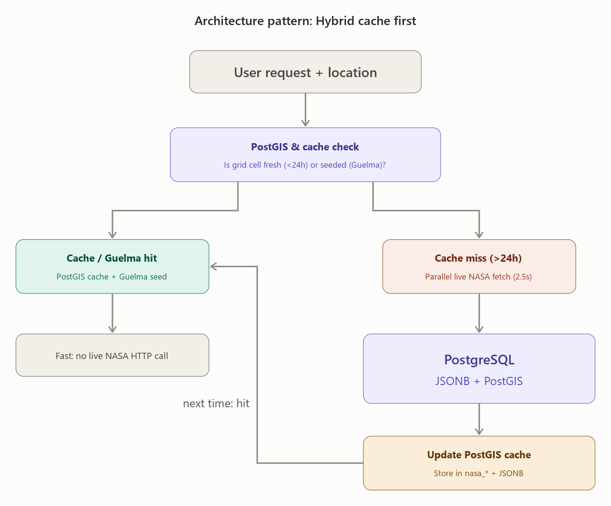
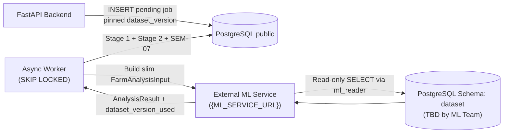
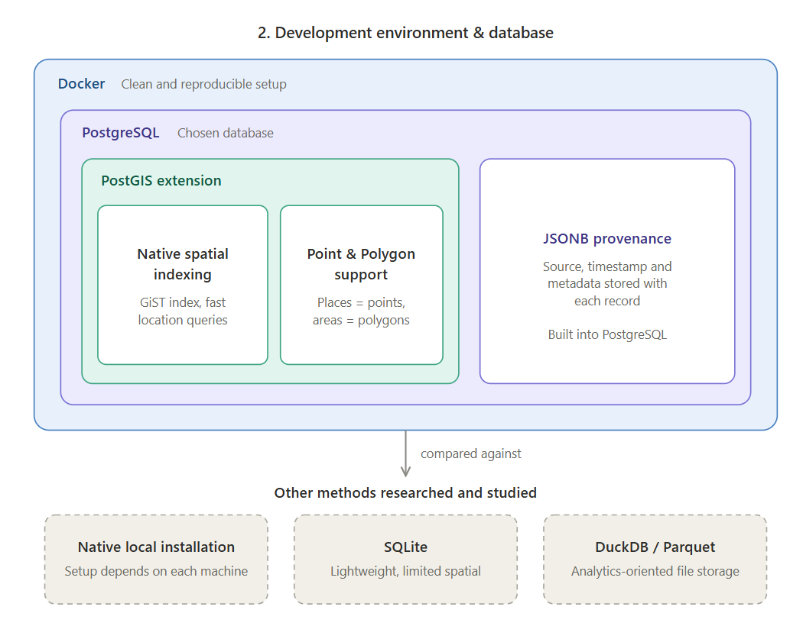
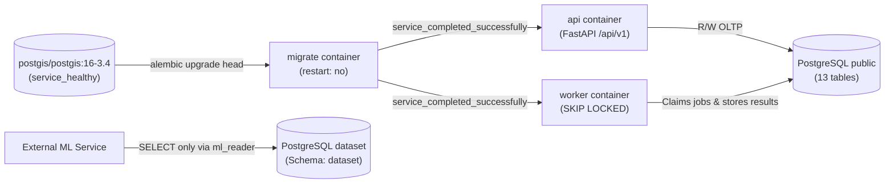
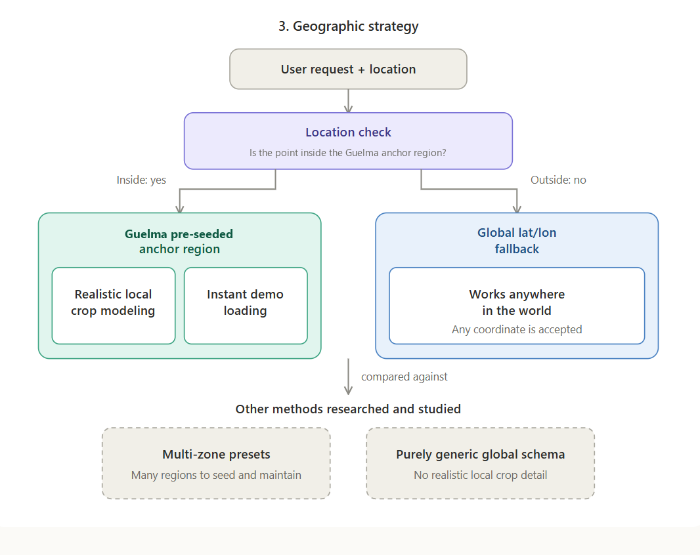
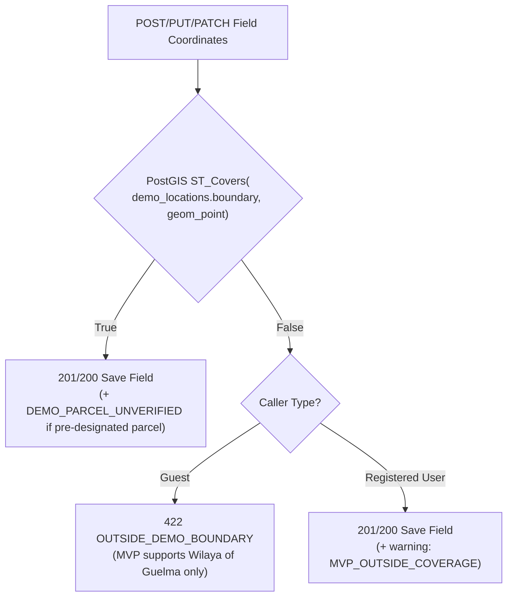
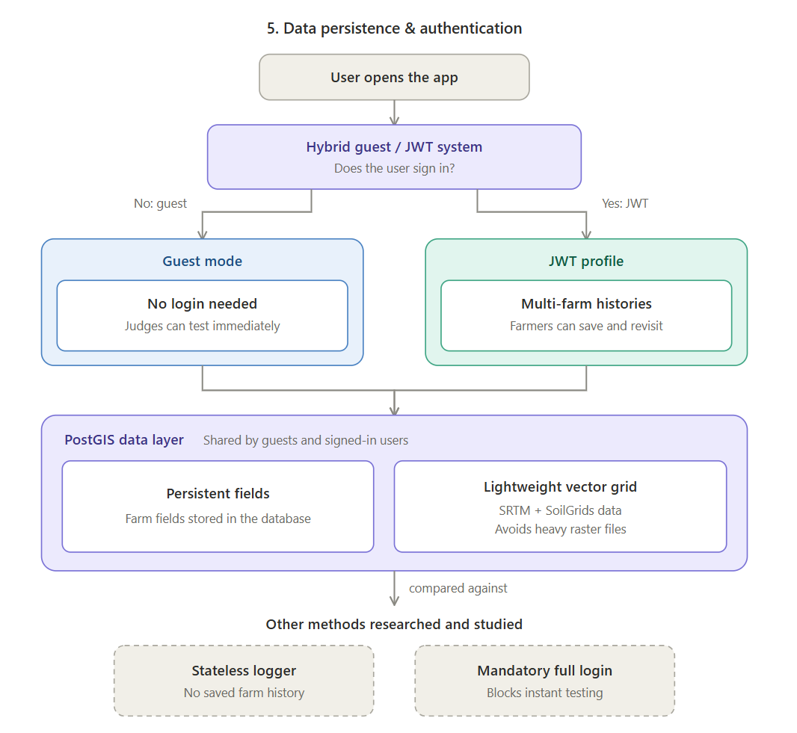
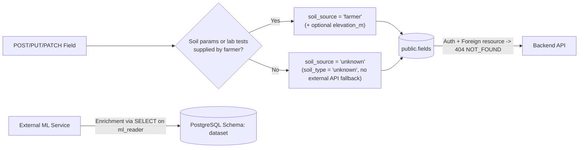
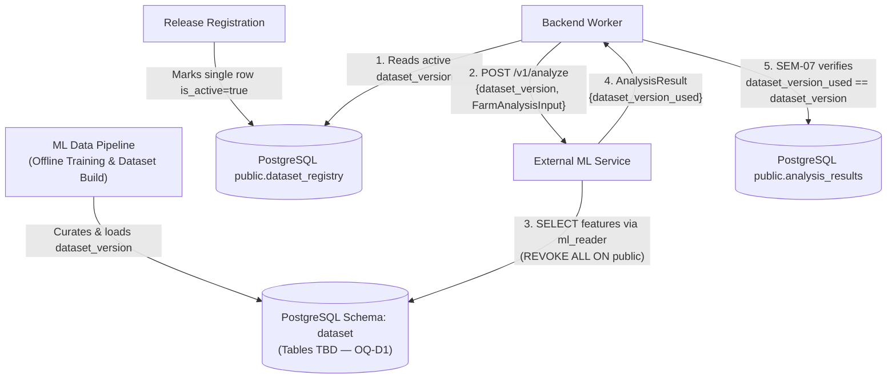

# Architecture Decision Records (ADR)

**Version:** `v3.2` (Local Dataset-Driven Architecture)  
**Related Specs:** [System Architecture Blueprint](System%20Architecture%20Blueprint.md) · [ENDPOINTS API & Database Specification](System%20Architecture%20Blueprint/FieldShift%20Planner%20—%20ENDPOINTS%20api%20&%20Database%20Specification.md) · [OpenAPI 3.1.0 Spec](System%20Architecture%20Blueprint/openapi.yaml) · [ML JSON Schema Draft 2020-12](System%20Architecture%20Blueprint/schema-v5.0.json)

---

## Contents

- `ADR-0:` v1 In-Backend Synchronous Agro-Pipeline *(Superseded)*
- `ADR-1:` PostgreSQL-First Asynchronous Architecture *(Accepted — Data Sourcing Updated by ADR-9)*
- `ADR-2:` Development Environment, Dedicated `migrate` Job & PostgreSQL/PostGIS `(public + dataset)`
- `ADR-3:` Geographic Strategy — PostGIS Wilaya of Guelma Boundary & Unstudied Demo Parcel
- `ADR-4:` Backend Orchestrator & External ML Service Split *(Supersedes ADR-0)*
- `ADR-5:` Soil Provenance (`farmer` / `unknown`), Optional Farmer Elevation & Authentication
- `ADR-6:` Durable PostgreSQL Job Leasing, Rotating `refresh_tokens` & Unknown Field Policy (`schema-v5.0.json`)
- `ADR-7:` REST API Contract (`openapi.yaml`), Additive `/api/v1` Versioning & Deprecation Policy *(Proposed)*
- `ADR-8:` Shared PostgreSQL ML Resilience State (`ml_breaker_state`) & Honest Degraded Mode *(Proposed)*
- `ADR-9:` Local PostgreSQL `Schema: dataset`, `dataset_registry`, and Read-Only Role `ml_reader` *(Proposed)*

---

## `ADR-0`: v1 In-Backend Synchronous Agro-Pipeline

- **Status:** Superseded by `ADR-4`
- **Date:** `TBD` *(original standalone v1 document location not in repository archive — see Blueprint Open Question `OQ-5`)*

### Context & Historical Decision
As documented in `ADR-4`, the original v1 backend computed `FAO-56 ET0`, `30-Year Z-Score Anomalies`, and a `3-Season Crop Optimizer` synchronously inside FastAPI using internal backend tables `crops`, `crop_rotation_rules`, and `recommendation_runs`.

### Consequences
- Tightly coupled HTTP API handlers to heavy agronomic computation and prevented independent ML model evolution.
- Superseded completely by `ADR-4` (Backend Orchestrator ↔ External ML black-box split) and database replacement across the `13`-table `public` schema.

---

## `ADR-1`: PostgreSQL-First Asynchronous Architecture *(Updated by `ADR-9`)*

- **Status:** Accepted *(external environmental fetching superseded by `ADR-9`)*
- **Date:** `2026-11-14`

### Context
FieldShift Planner must deliver predictable `< 300 ms` submission responses for multi-field rotation analysis without overloading FastAPI request workers or blocking clients behind ML inference latency.

### Decision
1. Requests enqueue durable jobs in PostgreSQL (`public.analysis_requests`, `202 Accepted`) processed asynchronously by `worker` containers.
2. External HTTP calls to NASA POWER, ORNL MODIS, ISRIC SoilGrids, and elevation services are **completely removed**; curated local environmental datasets live inside PostgreSQL `Schema: dataset` (`ADR-9`), pinned per job via `public.dataset_registry`.

> [!WARNING]
> **Diagram Note:** The legacy PNG above still illustrates removed external environmental HTTP APIs/caches and omits PostgreSQL `Schema: dataset`, `dataset_registry`, and worker cancellation. It must be redrawn when graphic assets are regenerated. The authoritative workflow below supersedes it:

### Consequences
- Zero runtime dependence on external weather, satellite, soil, or elevation APIs.
- Reproducible predictions backed by `dataset_version` pinning and gzipped `input_snapshot_gz`.

---

## `ADR-2`: Development Environment, `migrate` Service & PostGIS 16/3.4 Topology

- **Status:** Accepted
- **Date:** `2026-11-14`

### Context
Spatially bounded parcels, MultiPolygon containment (`ST_Covers`), transactional job queues (`SKIP LOCKED`), and separated OLTP (`public`) vs ML feature (`dataset`) schemas require consistent containerized local tooling and clean schema migration sequencing.

### Decision
- Standardize on `postgis/postgis:16-3.4` inside Docker Compose (`Blueprint §6.1`).
- Execute `alembic upgrade head` inside a dedicated one-shot `migrate` service (`restart: "no"`) gated via `service_completed_successfully` before `api` or `worker` containers become healthy, preventing multi-container migration races.

*(Diagram Note: `docker-compose.yml` adds the explicit one-shot `migrate` service and container healthchecks shown in `Blueprint §6.1`.)*

### Consequences
- Deterministic database startup across developer laptops and staging hosts.
- Production deployments still require external TLS termination and automated `pg_dump`/PITR backups (`OQ-7`).

---

## `ADR-3`: Geographic Strategy — PostGIS Wilaya of Guelma Boundary & Unstudied Demo Parcel

- **Status:** Accepted
- **Date:** `2026-11-14`

### Context
The MVP demo targets Wilaya of Guelma, Algeria (`~36.46° N, 7.43° E`; team demo parcel centroid `36.52° N, 7.52° E` — see `OQ-9`), while allowing registered farmers outside Guelma to store farms without blocking them, and never falsely presenting unstudied demo plots as surveyed ground truth.

### Decision
1. **100% PostGIS Boundary Enforcement:** `public.demo_locations.boundary` stores Guelma's `MultiPolygon` (`SRID 4326`, seeded by `seed_demo_locations.py` — shapefile verification tracked in `OQ-D7`). No external NASA or geocoding API is called.
2. **Pre-Designated Unstudied Demo Parcel:** `POST /auth/guest` provides the team's pre-designated parcel (`F1` at `36.52° N, 7.52° E`, `is_unverified_demo_parcel: true`) carrying warning `DEMO_PARCEL_UNVERIFIED` stating real field measurements have **not yet been studied** (`OQ-D8`).
3. **Guest vs Registered Enforcement:**
   - **Guests** creating fields inside Guelma (`ST_Covers(boundary, geom_point)`) succeed; coordinates outside Guelma return **`422 OUTSIDE_DEMO_BOUNDARY`** (*"The current MVP version supports the Wilaya of Guelma only..."*).
   - **Registered Users** outside Guelma succeed with non-blocking warning `MVP_OUTSIDE_COVERAGE`.

> [!WARNING]
> **Diagram Note:** The legacy PNG above implies global coordinates are uniformly accepted and depicts external data APIs. It must be redrawn to show PostGIS-only `ST_Covers`, guest `422 OUTSIDE_DEMO_BOUNDARY` rejection, and `DEMO_PARCEL_UNVERIFIED` on the unstudied demo parcel:

### Consequences
- Clear geographic MVP guardrails with zero third-party API dependency and full scientific honesty around the unstudied demo parcel.

---

## `ADR-4`: Backend Orchestrator & External ML Service Split

- **Status:** Accepted *(Supersedes `ADR-0`)*
- **Date:** `2026-11-14`

### Context
Decoupling user state, quotas, spatial validation, and job orchestration from specialized crop-rotation ML modeling lets both services iterate on independent stacks.

### Decision
- **Backend Owns:** Auth, PostGIS checks, `INPUT-01..03`, `dataset_version` resolution, job scheduling, Stage 1 + Stage 2 verification (`SEM-01..07`), and `analysis_selections`.
- **External ML (`{ML_SERVICE_URL}`) Owns:** Reading `Schema: dataset` through `ml_reader`, running agronomic prediction (`POST /v1/analyze`), publishing `GET /v1/catalog` and `GET /v1/health`, and returning `AnalysisResult` + `dataset_version_used` (without minting `analysis_id`).
- Worker handles timeouts (`ML_TIMEOUT_SECONDS=60`), single-retry transport resilience, cluster-wide bulkhead/breaker coordination (`ADR-8`), and cooperative cancellation (`POST /analysis/requests/{request_id}/cancel`).

### Consequences
- Clean separation of concerns validated via machine-readable `openapi.yaml` and `schema-v5.0.json`.

---

## `ADR-5`: Soil Provenance (`farmer` / `unknown`), Optional Farmer Elevation & Authentication

- **Status:** Accepted
- **Date:** `2026-11-14`

### Context
Previously the backend attempted fallback estimates via external SoilGrids and elevation APIs and derived unverified organic matter values. In the local-dataset architecture, Backend must record only what the farmer actually provides or explicitly mark metadata `unknown` while External ML queries `Schema: dataset` when needed.

### Decision
1. **Soil Provenance:** `public.fields.soil_source` accepts strictly `'farmer'` (soil type or lab tests supplied by user) or `'unknown'`. External SoilGrids and elevation API fallbacks are removed. `fields.elevation_m` is optional and farmer-supplied (`null` if omitted).
2. **USDA Texture Precedence Reference:** Where dataset ingestion or farmer lab percentages map texture classes internally, the classification order remains `1. clay (clay >= 400 g/kg) -> 2. silty (silt >= 500 g/kg) -> 3. sandy (sand >= 700 g/kg) -> 4. loamy (otherwise)`.
3. **Authentication:** Passwords hashed via Argon2id; guest tokens (`X-Guest-Token`) stored as 64-char SHA-256 hex digests; foreign-owned resources always return `404 NOT_FOUND` (never `403`).

> [!WARNING]
> **Diagram Note:** The legacy PNG above still references removed SoilGrids and external elevation lookups. It must be redrawn to reflect strictly `'farmer'` vs `'unknown'` field soil provenance alongside read-only ML queries to `Schema: dataset`. The authoritative flow below reflects the design:

### Consequences
- Zero unverified API-synthesized soil guesses on Backend writes; honest attribution on `evidence[]` (`farmer_input` vs `dataset`).

---

## `ADR-6`: Durable PostgreSQL Job Leasing, Rotating `refresh_tokens` & Unknown Field Policy

- **Status:** Accepted
- **Date:** `2026-11-14`

### Context
Single-row user columns prevented multi-device sessions and clean token reuse auditing, while strict `additionalProperties: false` on ML response schemas would break Backend Stage 1 validation whenever External ML adds minor `5.x` informational fields.

### Decision
1. **Dedicated `public.refresh_tokens` Table:** Stores `family_id`, `token_hash` (SHA-256 hex), `used_at`, `revoked_at`, and `expires_at`. Replaying any row where `used_at IS NOT NULL` immediately revokes all rows sharing `family_id` and returns `401 UNAUTHORIZED`. Multi-device logins use independent `family_id` UUIDs.
2. **Backend-Owned `analysis_id`:** `AnalysisResult` never contains `analysis_id`. Backend generates `^analysis_[0-9a-f]{12}$` deterministically on every `public.analysis_results` insert (even when `validation_passed = false`).
3. **Unknown Field Policy:**
   - **ML-Owned Response & Catalog Objects** (`AnalysisResult`, `FieldPlan`, `Strategy`, `StrategyScores`, `SeasonPlan`, `FieldInsights`, `BareFieldPeriod`, `StressPeriod`, `Explanation`, `ReasonItem`, `EvidenceItem`, `BenefitItem`, `RiskItem`, `RequestedCropEvaluation`, `DataQuality`, `CropCatalog`, `CropItem`, `CropItem.names`): set `"additionalProperties": true` in `schema-v5.0.json`. Backend logs unknown keys at `WARNING` level (`ml_unknown_fields_observed_total`) and **never fails validation** on minor `5.x` additive fields.
   - **Backend-Owned Request Objects** (`FarmAnalysisInput`, `FieldInput`, `Planning`, `ScenarioOverrides`, `PriorityWeights`): retain `"additionalProperties": false`; External ML is documented (`ENDPOINTS B.10`) to ignore unknown optional input fields on minor `5.x` upgrades.

### Consequences
- Safe zero-downtime `5.x` forward compatibility between Backend and ML teams alongside secure multi-device session rotation.

---

## `ADR-7`: REST API Contract (`openapi.yaml`), Additive `/api/v1` Versioning & Deprecation Policy

- **Status:** Proposed
- **Date:** `TBD`

### Context
Markdown tables alone cannot validate REST endpoint parity automatically or enforce consistent client SDK evolution across **34** endpoints.

### Decision
1. Establish [openapi.yaml](System%20Architecture%20Blueprint/openapi.yaml) (`OpenAPI 3.1.0`, JSON Schema Dialect `2020-12`) resolving shared types via relative `$ref: ./schema-v5.0.json#/$defs/...` as the single source of truth for REST endpoints, paired with `schema-v5.0.json` for Backend ↔ ML messaging.
2. All changes within `/api/v1` must be strictly additive (no breaking renames or removals).
3. Future deprecated endpoints or response fields emit standard `Deprecation` and `Sunset` HTTP response headers; minimum advance deprecation notice duration is **`TBD` (`OQ-8`)**.

### Consequences
- Automated OpenAPI and JSON Schema parity checks catch route, schema, and error-code drift before code is written.

---

## `ADR-8`: Shared PostgreSQL ML Resilience State (`ml_breaker_state`) & Honest Degraded Mode

- **Status:** Proposed
- **Date:** `TBD`

### Context
In-memory circuit breakers and semaphores inside individual Python worker processes break down under horizontal scaling (`api` and multiple `worker` replicas). Also, when ML outages occur, returning cached prior results without flagging staleness misleads farmers.

### Decision
1. **Shared Breaker Singleton (`public.ml_breaker_state`):** Row `id = 1` persists `state` (`closed` / `open` / `half_open`), `consecutive_failures`, `opened_at`, and `half_open_probe_at` transactionally in PostgreSQL so `worker` and `GET /health` read one unified state.
2. **Cluster-Wide Bulkhead Semaphore:** Workers acquire PostgreSQL session advisory locks `pg_try_advisory_lock(1001..1008)` capping active concurrent ML requests at `ML_MAX_CONCURRENT_REQUESTS = 8` across all containers.
3. **Honest Degraded Mode (`last_good_replay`):** During `open` breaker state or post-retry `502`/`504` outage, if an earlier validated result exists with matching `full_input_hash` and age `<= DEGRADED_MODE_MAX_AGE_HOURS` (`TBD` — `OQ-8`), Backend may return that prior result wrapped with explicit `degraded_mode: { kind: "last_good_replay", stale: true, source_analysis_id, created_at, dataset_version, age_seconds }`. Otherwise the request fails cleanly (`ML_UNAVAILABLE` / `ML_TIMEOUT`).

### Consequences
- Multi-worker resilience with zero Redis dependency and transparent staleness signaling.

---

## `ADR-9`: Local PostgreSQL `Schema: dataset`, `dataset_registry`, and Read-Only Role `ml_reader`

- **Status:** Proposed
- **Date:** `TBD`

### Context
Relying on external third-party environmental APIs (`NASA POWER`, `ORNL MODIS`, `ISRIC SoilGrids`, elevation endpoints) at inference time introduces fragile network latencies, external rate limits, and irreproducible historical responses. The ML team builds curated, offline-validated datasets specifically tailored for FieldShift Planner.

### Decision
1. **100% Internal `Schema: dataset`:** Store all curated agronomic/environmental datasets inside PostgreSQL `Schema: dataset` alongside `public` inside the project's PostgreSQL 16 + PostGIS instance. Exact table definitions inside `dataset` are **`TBD` by the ML Team (`OQ-D1`)**.
2. **Strict Least-Privilege Read Role (`ml_reader`):** External ML connects via `ML_DATASET_DB_URL` using role `ml_reader`, granted **only** `USAGE` and `SELECT` on `dataset.*` (`REVOKE ALL ON SCHEMA public`, `REVOKE CREATE ON SCHEMA dataset`), bounded by `ML_DB_STATEMENT_TIMEOUT_MS` and `ML_DB_CONNECTION_LIMIT` (`OQ-D4`).
3. **Pinned Version Tracking (`public.dataset_registry` + `SEM-07`):** Exactly one active version (`is_active = true`) is pinned on `analysis_requests.dataset_version`, passed in `FarmAnalysisInput.dataset_version`, echoed by ML as `AnalysisResult.dataset_version_used`, and verified identically by `SEM-07`. Absence of an active dataset returns `503 DATASET_UNAVAILABLE`; version mismatch returns `502 DATASET_VERSION_UNAVAILABLE`.

### Consequences
- Eliminates external API failure modes and latency jitter completely.
- Guarantees full auditability of which dataset version produced every analysis, while preventing the External ML service from ever reading or mutating farmer/auth tables in `public`.
