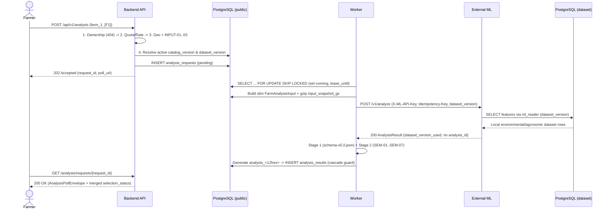
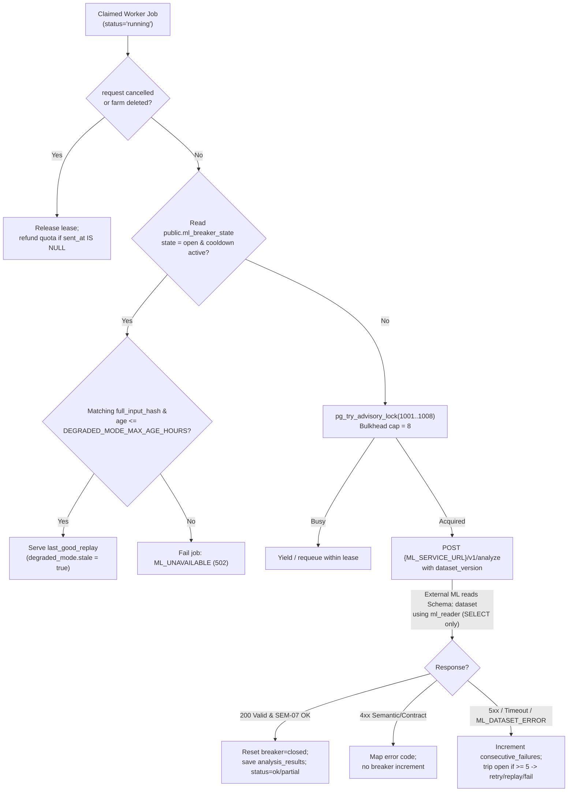
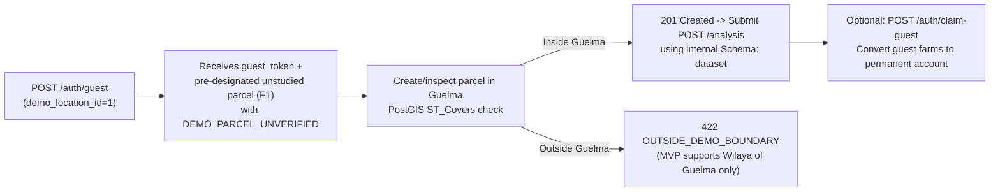

# FieldShift Planner — System Architecture Blueprint

**Version:** `v3.2` (Local Dataset-Driven Architecture)  
**Machine-Readable Contracts:** [OpenAPI 3.1.0 Spec](System%20Architecture%20Blueprint/openapi.yaml) (`/api/v1`) · [ML JSON Schema Draft 2020-12](System%20Architecture%20Blueprint/schema-v5.0.json)  
**Sibling Documents:** [Architecture Decision Records (ADR)](Architecture%20Decision%20Records%20(ADR).md) · [ENDPOINTS API & Database Specification](System%20Architecture%20Blueprint/FieldShift%20Planner%20—%20ENDPOINTS%20api%20&%20Database%20Specification.md) · [Visual Input / Output Specification](System%20Architecture%20Blueprint/Visual%20Input%20%20Output%20Specification.md)

---

## Contents

1. System Overview & Tech Stack (1.1 Problem Statement, Users & KPIs)
2. Big Picture Architecture & Responsibility Matrix
3. Backend Components
4. Workflows (W1 End-to-End Request · W2 Local `Schema: dataset` + Resilience · W3 `FarmAnalysisInput` Assembly · W4 Validation & 4.5 Agronomic Quality Plan)
5. Guest Demo Mode, Guelma MVP Boundary & Pre-Designated Unstudied Parcel
6. Database Summary & Local Compose Topology
7. API Surface Summary
8. Timeouts, Retries, Bulkheads, Circuit Breaker & Capacity Budgets
9. Spec Compliance Map
10. Repository Folder Structure
11. Key Decisions & Assumptions
12. Operations, Migrations, Security, Privacy, Observability & Testing (12.1 Data Minimization, Key Rotation & Retention)
13. Open Questions (`TBD` Registry)

---

## 1. System Overview & Tech Stack

FieldShift Planner is a crop-rotation planning backend and spatial API platform. Instead of calling third-party environmental APIs at request time, **all curated agronomic and environmental data lives inside a dedicated `Schema: dataset` in the system's PostgreSQL 16 + PostGIS 3.4 database**. The Backend manages farmers, spatial parcels, crop history, authentication, quotas, PostGIS boundary enforcement, async job queueing, and strict contract verification, while the External ML Service reads `Schema: dataset` directly through a restricted read-only PostgreSQL role (`ml_reader`) to generate multi-season rotation strategies.

| Layer | Choice | Role |
| --- | --- | --- |
| **API Framework** | FastAPI (Python async) | `/api/v1` REST endpoints, synchronous `INPUT-01..03` validation, cursor pagination |
| **Database & Geospatial** | PostgreSQL 16 + PostGIS 3.4 | `public` schema (**13** OLTP/resilience tables) + isolated `Schema: dataset` (tables **TBD**, `OQ-D1`) |
| **Migrations** | Alembic (one-shot `migrate` container) | Versioned DDL execution before `api` and `worker` readiness |
| **Async Job Queue** | PostgreSQL `FOR UPDATE SKIP LOCKED` workers | Durable analysis queue with lease expiry, heartbeats, cancellation, and cascade guards |
| **External ML Service** | `{ML_SERVICE_URL}` (`/v1/analyze`, `/v1/catalog`, `/v1/health`) | Computes crop-rotation strategies; reads PostgreSQL `Schema: dataset` via `ml_reader` (`SELECT` only) |
| **Contracts** | OpenAPI 3.1.0 (`openapi.yaml`) + JSON Schema Draft 2020-12 (`schema-v5.0.json`) | Single sources of truth for REST API and Backend ↔ ML wire payloads |

### 1.1 Problem Statement, Target Users & Measurable Success Criteria (KPIs)

Smallholder and medium farmers in Mediterranean/semi-arid regions (MVP centered on **Wilaya of Guelma, Algeria**: regional reference `~36.46° N, 7.43° E`; team demo parcel centroid `36.52° N, 7.52° E` — see `OQ-9`) lack multi-season decision tools that account for historical cropping patterns, irrigation constraints, and local soil/water reality without forcing manual scientific modeling.

| # | KPI | Target | Source / Status |
| :---: | --- | --- | --- |
| 1 | Async submit & end-to-end latency | `POST /api/v1/analysis` returns `202 Accepted` in `< 300 ms` p95; end-to-end result ready in `<= X s` (`X = TBD`, pending ML SLA) | `OQ-1` |
| 2 | Output structural integrity | `100%` of stored valid responses pass `schema-v5.0.json` + `SEM-01..SEM-07` (`dataset_version_used` exact match) | Automated tests |
| 3 | Evidence truthfulness & traceability | `0%` fabricated sources; raw farmer values in `evidence[]` match `FarmAnalysisInput` within `±TBD` tolerance and computed summaries carry `"derived": true` | `OQ-3`, `OQ-D5` |
| 4 | Geo-isolation & Demo honesty | `100%` of guest parcels outside Guelma PostGIS polygon rejected (`422 OUTSIDE_DEMO_BOUNDARY`); demo parcel consistently carries `DEMO_PARCEL_UNVERIFIED` until surveyed | `OQ-D8` |
| 5 | ML resilience under failure | Fault-injected ML outages trip PostgreSQL `ml_breaker_state`, protect latency via `ML_MAX_CONCURRENT_REQUESTS=8`, and transparently flag `last_good_replay` (`stale: true`) when eligible | `OQ-8` |
| 6 | Agronomic acceptance gate | `>= TBD%` pass rate across the 15-scenario golden benchmark reviewed by the Agronomy Owner | `OQ-6` |

---

## 2. Big Picture Architecture

```mermaid
flowchart LR
    Client["Web / Mobile Client"] -->|REST JSON /api/v1| API["FastAPI Backend (api container)"]
    API -->|OLTP R/W + PostGIS ST_Covers| PubDB[("PostgreSQL public schema\n13 tables")]
    PubDB -->|FOR UPDATE SKIP LOCKED| Worker["Background Worker (worker container)"]
    Worker -->|Read active dataset_version & catalog| PubDB
    Worker -->|HTTPS POST /v1/analyze\nFarmAnalysisInput + dataset_version| ML["External ML Service\n({ML_SERVICE_URL})"]
    ML -->|Read-only role: ml_reader\nSELECT only (statement_timeout)| DS[("PostgreSQL Schema: dataset\nTables TBD by ML Team")]
    DS -.->|Version tracked by| PubDB
    ML -->|AnalysisResult + dataset_version_used| Worker
    Worker -->|Stage 1 + Stage 2 Verify & Save| PubDB
```

### Responsibility Matrix ("Who Does What")

| Component | Owns | Explicitly Does NOT Own |
| --- | --- | --- |
| **Backend (`api` + `worker`)** | Auth & `refresh_tokens`, PostGIS Guelma boundary checks, `farm_id`/`field_id`/`analysis_id` generation, synchronous `INPUT-01..03`, `dataset_version` resolution, job queueing, Stage 1 & Stage 2 verification, `analysis_selections` | Agronomic optimization weights internals, feature engineering from `Schema: dataset`, mutating raw `result_json` |
| **External ML Service** | `{ML_SERVICE_URL}/v1/analyze`, `/v1/catalog`, `/v1/health`, reading curated `Schema: dataset` via `ml_reader`, scoring strategies and generating `AnalysisResult` + `dataset_version_used` | Accessing `public.*` tables (`REVOKE ALL`), minting `analysis_id`, enforcing user quotas or PostGIS boundaries |
| **PostgreSQL `public` Schema** | User accounts, rotating refresh families, Guelma PostGIS `MultiPolygon`, farms/fields/history, mirrored `crop_catalog`, `dataset_registry`, async jobs, immutable raw results, user selections, `ml_breaker_state` | Holding uncurated ML training arrays or raw ML internal weights |
| **PostgreSQL `Schema: dataset`** | Curated environmental/climate/satellite/soil datasets prepared by the ML team (`OQ-D1`) and indexed for read-only inference queries | Receiving writes from `api`, `worker`, or `ml_reader` during inference requests |

---

## 3. Backend Components

1. **`migrate` Service (One-Shot Init):** Runs `alembic upgrade head` (creates `public` **13** tables, `Schema: dataset`, read-only `ml_reader` role grants, PostGIS indexes) cleanly before app traffic starts.
2. **Auth & Account Lifecycle Module:** Argon2id password hashing, dual-key HS256 JWT verification (`JWT_SECRET_KEY` + `JWT_PREVIOUS_SECRET_KEY`), `refresh_tokens` rotation with reuse family revocation, guest sessions (`X-Guest-Token` SHA-256), `DELETE /auth/me` immediate cascade wipe, and `GET /auth/me/export`.
3. **Geospatial & Boundary Gate (`PostGIS`):** Evaluates `ST_Covers(demo_locations.boundary, fields.geom_point)` inside PostgreSQL — rejecting **guests** outside Wilaya of Guelma with `422 OUTSIDE_DEMO_BOUNDARY` and attaching `MVP_OUTSIDE_COVERAGE` notices for **registered users** outside Guelma. No external geocoding or NASA API is ever called.
4. **Catalog & Dataset Sync Manager:** Synchronizes `{ML_SERVICE_URL}/v1/catalog` every `ML_CATALOG_SYNC_HOURS=6` under single-leader `pg_try_advisory_lock(hashtext('catalog_sync'))` (retaining `N` and `N-1` versions); resolves the unique `is_active = true` row in `public.dataset_registry` for every analysis run (`503 DATASET_UNAVAILABLE` if absent).
5. **Async Job Worker & Cluster-Wide Resilience:** Claims `analysis_requests` via `FOR UPDATE SKIP LOCKED`, updates `heartbeat_at` & `lease_until`, enforces cluster-wide `ML_MAX_CONCURRENT_REQUESTS=8` via `pg_try_advisory_lock(1001..1008)`, manages shared `public.ml_breaker_state`, handles cooperative cancellation (`cancelled_at`), verifies outputs (`Stage 1 + Stage 2`), and writes `analysis_results` with Backend-generated `^analysis_[0-9a-f]{12}$`.

---

## 4. Workflows

### Workflow 1 — One Analysis Request, End to End (`POST /api/v1/analysis`)

Execution order on synchronous API admission is strictly deterministic:
1. **Authentication & Ownership:** Validate Bearer JWT / `X-Guest-Token`; verify caller owns `farm_id` and every `field_id` in `field_ids[]` (`404 NOT_FOUND` on any missing or foreign-owned record — never `403`).
2. **Quota & Rate-Limit:** Enforce per-minute / per-hour rate limits (`429 RATE_LIMIT_EXCEEDED`), then guest canonical quarter limits (`GUEST_MAX_ANALYSES=10` = `40` quarters; `4` full or `1` what-if matching recent `input_hash`; `403 GUEST_LIMIT_REACHED`).
3. **Geo Boundary & Input Rules (`INPUT-01..03`):** For guests, verify every selected field sits inside Guelma `demo_locations.boundary` (`422 OUTSIDE_DEMO_BOUNDARY`). Validate `sum(priorities.weights.*) == 100`, `target_crop_ids ∩ excluded_crop_ids == ∅`, and `INPUT-03` hemisphere/`start_season`/`planting_month` consistency (`400 INVALID_INPUT`).
4. **Catalog & Active Dataset Ready:** Confirm requested crops exist in active `crop_catalog` (`409 CATALOG_VERSION_MISMATCH` after sync check) and `public.dataset_registry` has an `is_active = true` version (`503 DATASET_UNAVAILABLE` if none).
5. **Enqueue (`202 Accepted`):** Persist `analysis_requests` row (`status = 'pending'`, `input_hash`, `full_input_hash`, pinned `dataset_version`, `warnings[]`) and return `poll_url`.



### Workflow 2 — Local `Schema: dataset` Resolution, Circuit Breaker & Worker Execution

All external HTTP calls to NASA, MODIS, SoilGrids, and SRTM are eliminated. Instead of per-request environmental fetching, every prediction is pinned to an immutable `dataset_version` inside PostgreSQL:



### Workflow 3 — Building `FarmAnalysisInput` & Snapshot Reproducibility

1. Worker reads `farms`, `fields`, `field_crop_history`, and caller's `planning` + `priorities` from PostgreSQL `public`.
2. **Data Minimization:** Never includes user `email`, `full_name`, `user_id`, `guest_token`, client IP, `field_crop_history.notes`, or backend notice `warnings[]`.
3. **Soil & Elevation Provenance:** Sets `fields[].soil.source` to `"farmer"` if soil parameters were provided, otherwise `"unknown"`. Leaves unstudied demo parcel flags (`is_unverified_demo_parcel`) intact so ML and Backend share transparency. Does **not** attach any inline weather/satellite time-series array inside `FarmAnalysisInput`; passes `dataset_version` so ML fetches dataset features locally from `Schema: dataset`.
4. **Snapshot Persistence:** Compresses the exact serialized `FarmAnalysisInput` wire JSON into `analysis_requests.input_snapshot_gz` for deterministic `SEM-04` auditing (`OQ-7` governs archival pruning).

### Workflow 4 — 2-Stage Checking of the ML Response

Every request passes through three explicit validation layers:

- **Layer 0 — Synchronous Pre-Queue Input Checks (`POST /analysis`, `400 INVALID_INPUT`):**
  - **`INPUT-01`:** `sum(priorities.weights.*) == 100`.
  - **`INPUT-02`:** `priorities.target_crop_ids ∩ priorities.excluded_crop_ids == ∅`.
  - **`INPUT-03`:** Hemisphere / `start_season` / `planting_month` consistency (`OQ-10` — applied when `planting_month` is non-null):

| `start_season` | Northern Hemisphere (`latitude >= 0`) Allowed Months | Southern Hemisphere (`latitude < 0`) Allowed Months |
| --- | --- | --- |
| `winter` | `12, 1, 2` | `6, 7, 8` |
| `spring` | `3, 4, 5` | `9, 10, 11` |
| `summer` | `6, 7, 8` | `12, 1, 2` |
| `autumn` | `9, 10, 11` | `3, 4, 5` |

- **Layer 1 — Worker Stage 1 Structural Check (`schema-v5.0.json`, Unknown Field Policy — `ADR-6`):**
  - Validates JSON syntax, `"^5\\.[0-9]+$"` major version, required fields, bounds, and conditional `ok`/`partial` rules (`status == 'ok'` requires exactly 1 `is_existing_rotation: true` baseline; `partial` requires `partial_reason`).
  - **Unknown Field Policy:** Because all ML-owned schemas allow additive minor properties (`additionalProperties: true`), unknown fields in `5.x` responses **never fail validation**; the worker logs extra key paths at `WARNING` level and increments `ml_unknown_fields_observed_total`. Any validation failure saves raw JSON in `analysis_results` with `validation_passed = false` and Backend-generated `analysis_id`.
- **Layer 2 — Worker Stage 2 Semantic Verification (`SEM-01`..`SEM-07`):**
  - **`SEM-01`:** Field strategies follow non-empty agronomic ordering, baseline uniqueness matches `status`, and no duplicate `strategy_id` exists per field.
  - **`SEM-02`:** 1:1 `field_id` alignment between request and response, and every strategy satisfies `len(seasons) == planning.horizon_seasons`.
  - **`SEM-03`:** Every `crop_id` returned matches `(catalog_version, crop_id)` in `public.crop_catalog` with matching `category`/`roles`.
  - **`SEM-04`:** Evidence provenance check — `data_source` must be `"farmer_input"` or `"dataset"`; raw farmer metrics (`soil_ph`, `organic_matter_percent`, `elevation_m`, `area_hectares`) must match `input_snapshot_gz` within `±TBD` tolerance (`OQ-3`), derived indicators set `"derived": true`, and `"dataset"` items carry dataset audit metadata (`OQ-D5`).
  - **`SEM-05`:** `suggested_strategy_id` exists in the enclosing field's `strategies[]`.
  - **`SEM-06`:** Every crop listed in `priorities.target_crop_ids` is evaluated in `requested_crop_results[]` with non-empty `explanation`.
  - **`SEM-07`:** `AnalysisResult.dataset_version_used == analysis_requests.dataset_version` (exact equality; mismatch fails job with `DATASET_VERSION_UNAVAILABLE` and triggers ops alert).

### 4.5 ML Agronomic Quality & Golden-Set Evaluation Plan

#### Validated Priority-Weight Pairs (`weights` sum strictly `= 100`)

Automated quality tests verify monotonic directional sensitivity between contrasting weight profiles:
- **Water-Saving Profile:** `{"water_saving": 80, "soil_improvement": 5, "income": 5, "risk_reduction": 5, "forage_value": 5}` (water-saving strategy must rank highest).
- **Income Profile:** `{"water_saving": 5, "soil_improvement": 5, "income": 80, "risk_reduction": 5, "forage_value": 5}` (cash-crop income strategy must outscore conservation baseline).

#### Priority-Weight to Strategy-Score Mapping (`schema-v5.0.json#/$defs/StrategyScores`)

| Farmer Input Priority (`PriorityWeights`) | Corresponding Output Metric(s) (`StrategyScores`) | Evaluation Sense |
| --- | --- | --- |
| `weights.water_saving` | `water_efficiency` | Higher weight must increase relative `priority_fit` for strategies with higher `water_efficiency` |
| `weights.soil_improvement` | `erosion_protection`, `organic_matter_gain`, `nitrogen_contribution` (+ lower `bare_field_days_per_year`) | Rewards legumes/cover crops and minimized fallow exposure |
| `weights.income` & `weights.forage_value` | `income_forage_value` | Interpreted alongside `market_preference` (`local_market` / `export` / `subsistence` / `mixed`) |
| `weights.risk_reduction` | `pest_cycle_disruption`, `erosion_protection` | Rewards multi-family break crops and lower drought stress exposure |
| *(Aggregate fit)* | `priority_fit` (`0..100`) | Weighted composite; tie-breaking & minimum score spread are **TBD (`OQ-11`)** |

#### Golden Benchmark Suite (`backend/tests/golden/`)
- Contains **15** deterministic regional test scenarios spanning irrigated/rainfed Guelma zones, coarse/clay soils, and cereal/legume/forage sequences.
- Designated Agronomy Owner and numerical per-scenario acceptance gates (`>= TBD%` pass rate) are tracked in **`OQ-6`**.

---

## 5. Guest Demo Mode, Guelma MVP Boundary & Pre-Designated Unstudied Parcel

### 5.1 Principle & Honest Degraded Mode

1. **Zero Pretend Precision:** All guest demo capabilities operate on local PostgreSQL/PostGIS data only. When the External ML Service is unreachable or `ml_breaker_state` is `open`, Backend never fabricates strategies; it only replays a prior validated result (`degraded_mode.kind = "last_good_replay"`, `stale = true`) if an identical `full_input_hash` exists within `DEGRADED_MODE_MAX_AGE_HOURS` (`OQ-8`).
2. **Pre-Designated Unstudied Demo Parcel (`is_unverified_demo_parcel: true`):** Starting a guest session via `POST /auth/guest` provides the project team's pre-designated parcel (`F1` at `36.52° N, 7.52° E`). Because field soil and historical measurements for that demo plot have **not yet been studied**, the system must **never** claim the parcel's data is surveyed or real; every response attaches `DEMO_PARCEL_UNVERIFIED` until real field data is added and verified (`OQ-D8`).

### 5.2 Guest vs Registered User

| Aspect | 🎭 Guest Session (`X-Guest-Token`) | 🔐 Registered User (`Bearer JWT`) |
| --- | --- | --- |
| **Geographic Scope** | Strictly limited to Wilaya of Guelma (`PostGIS ST_Covers(demo_locations.boundary, geom_point)`). Outside -> **`422 OUTSIDE_DEMO_BOUNDARY`**. | Any valid Earth coordinate allowed. Outside Guelma -> saves cleanly with non-blocking `MVP_OUTSIDE_COVERAGE` notice. |
| **Demo Parcel** | Receives pre-designated unstudied parcel (`DEMO_PARCEL_UNVERIFIED`) + can inspect/test other custom plots inside Guelma. | Starts empty; can import guest data anytime via `POST /auth/claim-guest`. |
| **Quotas & Expiry** | `3` farms, `5` fields/farm, `10` analyses (`40` canonical quarters), `7`-day expiry (`GUEST_SESSION_DAYS=7`). | Unlimited farms/fields; rate-limited (`RATE_LIMIT_ANALYSIS_PER_HOUR=10` = `40` quarters/h). |

### 5.3 Demo Locations & PostGIS Boundary (`demo_locations`)

- Seeded with Guelma (`id = 1`, `code = "guelma"`, `bbox: [7.00, 36.05, 7.90, 36.65]`, Wilaya reference `~36.46° N, 7.43° E`, unstudied team parcel centroid `36.52° N, 7.52° E`; official shapefile provenance confirmation tracked in `OQ-D7`).
- Boundary enforcement happens **100% locally in PostGIS** (`ST_Covers(demo_locations.boundary, geom_point)`). No external API is ever consulted for geocoding or boundary validation.

### 5.4 Guest Journey



---

## 6. Database Summary & Local Compose Topology

### 6.1 Local Development & Deployment Compose Blueprint

> [!NOTE]
> The Compose file below targets local/staging orchestration behind a TLS-terminating reverse proxy (`Caddy`/`Nginx`/`Traefik`); production deployments add automated `pg_dump`/PITR backups (schedule/RPO/RTO **`TBD — OQ-7`**), non-local `https://` enforcement on `ML_SERVICE_URL`, and ACL restriction on `GET /metrics`. Never label local Compose examples as standalone production-hardened.

```yaml
services:
  db:
    image: postgis/postgis:16-3.4
    environment:
      POSTGRES_DB: fieldshift
      POSTGRES_USER: fieldshift
      POSTGRES_PASSWORD: ${DB_PASSWORD}
    healthcheck:
      test: ["CMD-SHELL", "pg_isready -U fieldshift -d fieldshift"]
      interval: 5s
      timeout: 5s
      retries: 10
    volumes:
      - pgdata:/var/lib/postgresql/data

  migrate:
    build: ./backend
    env_file: .env
    command: ["alembic", "upgrade", "head"]
    restart: "no"
    depends_on:
      db:
        condition: service_healthy

  api:
    build: ./backend
    env_file: .env
    command: ["uvicorn", "app.main:app", "--host", "0.0.0.0", "--port", "8000"]
    depends_on:
      migrate:
        condition: service_completed_successfully
    healthcheck:
      test: ["CMD", "curl", "-fsS", "http://localhost:8000/api/v1/health?check=ready"]
      interval: 10s
      timeout: 5s
      retries: 5

  worker:
    build: ./backend
    env_file: .env
    command: ["python", "-m", "app.worker.runner"]
    depends_on:
      migrate:
        condition: service_completed_successfully
    healthcheck:
      test: ["CMD", "python", "-m", "app.worker.healthcheck"]
      interval: 15s
      timeout: 5s
      retries: 3
```

### 6.2 Entity Relationship Diagram (Single Source of Truth)

The authoritative 13-table `public` ERD (`users`, `refresh_tokens`, `demo_locations`, `guest_sessions`, `farms`, `fields`, `field_crop_history`, `crop_catalog`, `dataset_registry`, `analysis_requests`, `analysis_results`, `analysis_selections`, `ml_breaker_state`), complete SQL `CHECK` constraints/indexes, and `Schema: dataset` + `ml_reader` isolation DDL are maintained exclusively in [ENDPOINTS API & Database Specification — Section A](System%20Architecture%20Blueprint/FieldShift%20Planner%20—%20ENDPOINTS%20api%20&%20Database%20Specification.md).

---

## 7. API Surface Summary

Exact **34** Backend routes (`/api/v1`) and **3** External ML routes (`{ML_SERVICE_URL}`), specified completely in [openapi.yaml](System%20Architecture%20Blueprint/openapi.yaml) and [ENDPOINTS Section B](System%20Architecture%20Blueprint/FieldShift%20Planner%20—%20ENDPOINTS%20api%20&%20Database%20Specification.md):

- **Auth (9):** `POST /auth/guest`, `/register`, `/login`, `/refresh`, `/logout`, `GET /auth/me`, `DELETE /auth/me`, `GET /auth/me/export`, `POST /auth/claim-guest`.
- **Demo (4):** `GET /demo/locations`, `GET /demo/locations/{id}/boundary`, `GET /demo/session`, `DELETE /demo/session`.
- **Farms (6):** `GET`, `POST /farms`, `GET/PUT/PATCH/DELETE /farms/{farm_id}`.
- **Fields (6):** `GET`, `POST /farms/{farm_id}/fields`, `GET/PUT/PATCH/DELETE /farms/{farm_id}/fields/{field_id}`.
- **Analysis (6):** `POST /analysis`, `GET /analysis/requests/{request_id}`, `POST /analysis/requests/{request_id}/cancel`, `GET /analysis/{analysis_id}`, `PATCH /analysis/{analysis_id}/selection`, `GET /farms/{farm_id}/analyses`.
- **Catalog (1):** `GET /catalog`.
- **System (2):** `GET /health`, `GET /metrics` (`x-internal-only: true`).
- **External ML Sub-Contract (3):** `POST {ML_SERVICE_URL}/v1/analyze`, `GET {ML_SERVICE_URL}/v1/catalog`, `GET {ML_SERVICE_URL}/v1/health`.

---

## 8. Timeouts, Retries, Bulkheads, Circuit Breaker & Capacity Budgets

Only values pinned in design configuration are shown as fixed constants; unmeasured runtime latency/size targets are explicitly marked **`NOT SPECIFIED (TBD)`** and linked to Section 13:

| Stage / Resource | Budget / Limit | Source / Status |
| --- | --- | --- |
| `POST /api/v1/analysis` async enqueue (`202 Accepted`) | `< 300 ms` p95 target | §1.1 KPI #1 |
| PostGIS Guelma boundary check (`ST_Covers` on write/analysis) | Local DB index lookup | PostGIS `idx_demo_locations_boundary` |
| External ML `POST {ML_SERVICE_URL}/v1/analyze` timeout | Hard HTTP cap `ML_TIMEOUT_SECONDS = 60 s`; p95 SLA `NOT SPECIFIED (TBD)` | ENDPOINTS B.10 / `OQ-1` |
| Uncompressed `FarmAnalysisInput` payload limit | `ML_MAX_PAYLOAD_BYTES`: `NOT SPECIFIED (TBD)` (`Content-Encoding: gzip` used on wire) | ENDPOINTS C / `OQ-4` |
| Worker PostgreSQL job claim & lease | `WORKER_CONCURRENCY = 4` / container (`FOR UPDATE SKIP LOCKED`), `JOB_LEASE_SECONDS = 90 s`, `MAX_JOB_ATTEMPTS = 2` | ENDPOINTS C |
| Cluster-wide ML bulkhead concurrency cap | `ML_MAX_CONCURRENT_REQUESTS = 8` via `pg_try_advisory_lock(1001..1008)` | ADR-8 |
| Cluster-wide ML circuit breaker (`public.ml_breaker_state`) | Opens after `ML_CIRCUIT_BREAKER_THRESHOLD = 5` failures; half-open probe after `ML_BREAKER_COOLDOWN_SECONDS = 30 s` | ENDPOINTS A.4 / ADR-8 |
| External ML `ml_reader` query guard | `ML_DB_STATEMENT_TIMEOUT_MS`: `NOT SPECIFIED (TBD)`; `ML_DB_CONNECTION_LIMIT`: `NOT SPECIFIED (TBD)` | ENDPOINTS A.5 / `OQ-D4` |
| Stage 1 + Stage 2 verification + DB commit | `NOT SPECIFIED (TBD)` | Open Questions (`OQ-1`) |
| Test/CI-only `?wait=true` (`ALLOW_SYNC_WAIT=false` in prod) | `<= 58 s` (`SYNC_WAIT_TIMEOUT_SECONDS`); returns `504 JOB_TIMEOUT` if exceeded | ENDPOINTS B.7 |

---

## 9. Spec Compliance Map

| Requirement | Enforced In | Verification Artifact |
| --- | --- | --- |
| 100% local `Schema: dataset` (zero external weather/soil APIs) | `ENDPOINTS A.5`, `Blueprint §2–§4`, `ADR-1`, `ADR-4`, `ADR-5` | Automated schema & contract check (zero external environmental APIs) |
| ML `ml_reader` read-only isolation | `ENDPOINTS A.5` DDL, `Blueprint §12.1` | SQL privilege block (`REVOKE ALL ON SCHEMA public`) |
| Tolerant Reader on ML objects & Unknown Field Policy | `schema-v5.0.json`, `ADR-6`, `Blueprint §4 W4` | Automated schema & contract check (`5.1` extra field mutation passes) |
| Single public ID scheme (`farm_1`, `F1`, `analysis_<12hex>`) | `openapi.yaml`, `ENDPOINTS B.1–B.7`, `Visual I/O` | Automated schema & contract check (regex & negative checks) |
| Honest unstudied demo parcel & Guelma boundary | `demo_locations`, `POST /auth/guest`, `POST /fields`, `ADR-3` | Automated schema & contract check (GeoJSON + warning fixture checks) |

---

## 10. Folder Structure (Conceptual Implementation Target)

```text
fieldshift-planner/
├── SYSTEM DESGIN/
│   ├── SYSTEM DESGIN.md
│   └── SYSTEM DESGIN/
│       ├── Architecture Decision Records (ADR).md
│       ├── System Architecture Blueprint.md
│       └── System Architecture Blueprint/
│           ├── FieldShift Planner — ENDPOINTS api & Database Specification.md
│           ├── Visual Input  Output Specification.md
│           ├── openapi.yaml
│           └── schema-v5.0.json
└── backend/                         # Implementation target (not generated in doc-only phase)
    ├── app/
    │   ├── db/migrations/           # Alembic migrations (13 public tables + dataset schema + ml_reader)
    │   ├── api/v1/                  # FastAPI routers matching openapi.yaml (34 routes)
    │   ├── worker/                  # SKIP LOCKED runner, SEM-01..07 validator, breaker/advisory locks
    │   └── ml_client/               # {ML_SERVICE_URL} client, gzip wire encoder, unknown-field logger
    └── tests/golden/                # 15 agronomic golden scenarios (OQ-6)
```

---

## 11. Decisions & Assumptions

Architecture decisions and their full context/consequences live in [Architecture Decision Records (ADR)](Architecture%20Decision%20Records%20(ADR).md) (`ADR-0` through `ADR-9`):
- `ADR-0` (`Superseded`): Legacy v1 in-backend synchronous pipeline.
- `ADR-1`..`ADR-6` (`Accepted`): Async PostgreSQL dataset-backed architecture, external ML black-box boundary, Guelma PostGIS enforcement & unstudied demo parcel, async worker leases, dataset/farmer soil precedence, and rotating `refresh_tokens` + Unknown Field Policy.
- `ADR-7`..`ADR-9` (`Proposed`): `openapi.yaml` additive `/v1` governance, shared `ml_breaker_state` + `last_good_replay`, and local PostgreSQL `Schema: dataset` + `ml_reader` + `dataset_registry`.

---

## 12. Operations, Migrations, Security, Privacy, Observability & Testing

### 12.1 Privacy, Data Minimization, ML Key Rotation & Retention

1. **Data-Minimization Contract Sent to ML:** Worker constructs `FarmAnalysisInput` strictly with `schema_version`, `dataset_version`, `request_id`, `catalog_version`, `language`, `farm.{farm_id, farm_name, country, region, commune}`, `planning`, `priorities`, and `fields[].{field_id, field_name, is_unverified_demo_parcel, location, area_hectares, elevation_m, soil, water, crop_history[]}`. Backend **never** transmits user `email`, `full_name`, `user_id`, `guest_token`, client IP, `field_crop_history.notes`, or backend notice `warnings[]`.
2. **Database Isolation for External ML (`ml_reader`):** External ML authenticates to PostgreSQL using `ML_DATASET_DB_URL` (`role: ml_reader`), restricted exclusively to `USAGE` + `SELECT` on `Schema: dataset` (`REVOKE ALL ON SCHEMA public`, `REVOKE CREATE`, bounded by `ML_DB_STATEMENT_TIMEOUT_MS` and `ML_DB_CONNECTION_LIMIT`). Backend roles never expose PII tables to ML queries.
3. **ML Transport TLS & Dual-Key Rotation:** Non-local deployments require `https://` (`ML_SERVICE_URL`, optional mTLS) and support zero-downtime secret rollover using `ML_SERVICE_API_KEY` + `ML_SERVICE_PREVIOUS_API_KEY`.
4. **Retention & Deletion Guarantees:** Guest sessions expire after `GUEST_SESSION_DAYS = 7` (cascade delete on reaper cleanup or `DELETE /demo/session`). Registered users exercise `GET /auth/me/export` (full JSON export) and `DELETE /auth/me` (immediate transactional hard delete across `users`, `refresh_tokens`, `farms`, `fields`, `field_crop_history`, `analysis_requests` including `input_snapshot_gz`, `analysis_results`, and `analysis_selections`). Retention/pruning schedules for older `input_snapshot_gz` blobs and operational audit logs are **`TBD` (`OQ-7`)**.

---

## 13. Open Questions (`TBD` Registry)

Unverified domain, ML, geospatial, and operational targets remain explicitly `TBD` here so zero values are fabricated:

| ID | Topic | Open Question (`TBD`) | Owner | Impacted Docs |
| --- | --- | --- | --- | --- |
| `OQ-1` | External ML Latency SLA | Committed ML `p95`/`p99` inference latency (`X` s) for 1 field vs 10 fields and Stage 1/2 budget? | External ML Lead | Blueprint §1.1, §8 |
| `OQ-2` | ML Free-Text / Prompt-Injection Risk | Does External ML interpolate free-text fields (`farm_name`, `crop_name_raw`, etc.) into an LLM prompt requiring sanitization beyond `maxLength`? | External ML Lead | schema-v5.0.json, Blueprint §12.1 |
| `OQ-3` | `SEM-04` Numeric Tolerance | Exact `±TBD` tolerance when comparing raw `evidence[].observed_value` against farmer inputs? | Backend + ML Leads | Blueprint §4 W4, §1.1 |
| `OQ-4` | ML Payload Limit | Maximum uncompressed request body `ML_MAX_PAYLOAD_BYTES` (`TBD`) before history trimming? | Backend + ML Leads | ENDPOINTS B.10, C, Blueprint §8 |
| `OQ-5` | `ADR-0` History | Location and original creation date (`Date: TBD`) of the legacy v1 synchronous pipeline document? | Architecture Author | ADR.md (`ADR-0`) |
| `OQ-6` | Golden Suite & Pass Gate | Agronomy Reviewer name (`TBD`) and numeric pass thresholds (`>= TBD%`) for the 15 scenarios in `backend/tests/golden/`? | Agronomy Lead | Blueprint §1.1, §4.5 |
| `OQ-7` | Backups, RPO/RTO & Retention | `pg_dump` schedule, RPO (`TBD`), RTO (`TBD`), `input_snapshot_gz` archival TTL (`TBD`), and audit log retention (`TBD`)? | Infra / Security Lead | Blueprint §6.1, §12.1 |
| `OQ-8` | Degraded Replay Age & Deprecation Window (`ADR-7`) | `DEGRADED_MODE_MAX_AGE_HOURS` (`TBD`) for `last_good_replay` and minimum `Deprecation`/`Sunset` notice window (`TBD`)? | Backend Lead / Product Owner | ENDPOINTS C, ADR-7, ADR-8 |
| `OQ-9` | Guelma Coordinates | Confirm whether Guelma regional reference (`36.46° N, 7.43° E`) and demo parcel centroid (`36.52° N, 7.52° E`) update after parcel surveying? | Geospatial / Agronomy Team | Blueprint §1.1, §5.3 |
| `OQ-10` | Protected/Greenhouse `INPUT-03` Override | Should irrigated greenhouse crops bypass hemisphere/`start_season`/`planting_month` bounds in `INPUT-03`? | Agronomy Lead | Blueprint §4 W4 |
| `OQ-11` | Strategy Tie-Breaking | Minimum `priority_fit` separation threshold and deterministic tie-breaker between top strategies? | ML + Agronomy Leads | Blueprint §4.5 |
| `OQ-D1` | `Schema: dataset` Structure | Exact table names, columns, spatial keys, units, and update cadence inside PostgreSQL `Schema: dataset`? | ML Team | ENDPOINTS A.5, ADR-9 |
| `OQ-D2` | Dataset Geographic/Temporal Scope | Spatial & temporal bounds covered by the initial dataset release inside/outside Wilaya of Guelma? | ML + Data Owners | Blueprint §5, ADR-9 |
| `OQ-D3` | Dataset Versioning & Rollout | Version format conventions, `dataset_registry` promotion steps, and zero-downtime swap vs drain rules? | ML + Backend Leads | ENDPOINTS A.4, ADR-9 |
| `OQ-D4` | `ml_reader` Resource Caps | Exact `ML_DB_STATEMENT_TIMEOUT_MS` (`TBD`) and `ML_DB_CONNECTION_LIMIT` (`TBD`) values for production DB protection? | Backend / DBA Lead | ENDPOINTS A.5, C |
| `OQ-D5` | `SEM-04` Dataset Evidence Verification | Mechanism for Backend `SEM-04` to cross-verify ML `evidence[]` items claiming `"data_source": "dataset"`? | Backend + ML Leads | Blueprint §4 W4 |
| `OQ-D6` | Minimum Parcel History Threshold | Minimum dataset/history richness below which ML returns `422 INSUFFICIENT_DATA`? | ML + Agronomy Leads | ENDPOINTS B.10 |
| `OQ-D7` | Guelma Polygon Shapefile Source | Authoritative administrative shapefile source loaded into `demo_locations.boundary`? | Geospatial Owner | Blueprint §5.3 |
| `OQ-D8` | Unstudied Demo Parcel Field Survey | Target timeline and real surveyed values (`soil_ph`, organic matter, crop history) for `default_parcel_id`? | Project / Agronomy Team | Blueprint §5.1, ENDPOINTS A.3 |
