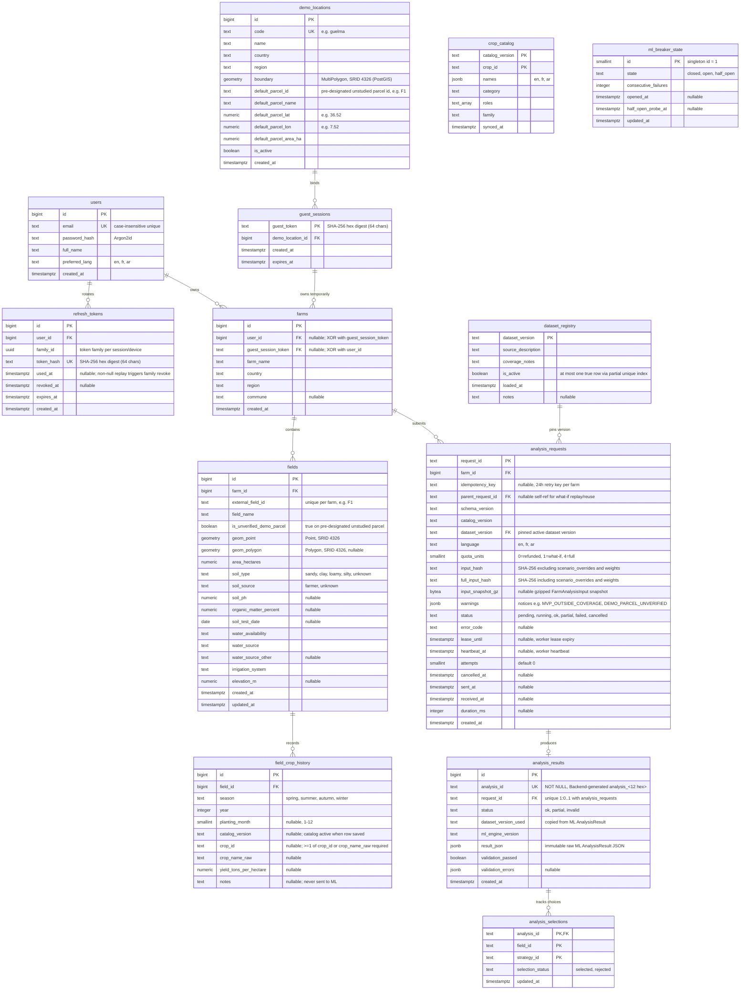

# FieldShift Planner — ENDPOINTS API & Database Specification

**Document Version:** `v3.2` (Dataset-Driven Local Architecture)  
**Machine-Readable Contracts:** [OpenAPI 3.1.0 Specification](openapi.yaml) (`/api/v1`) · [ML JSON Schema Draft 2020-12](schema-v5.0.json)  
**Related Docs:** [System Architecture Blueprint](../System%20Architecture%20Blueprint.md) · [Architecture Decision Records (ADR)](../Architecture%20Decision%20Records%20(ADR).md) · [Visual Input / Output Specification](Visual%20Input%20%20Output%20Specification.md)

---

## Contents

- A. Database ERD & Constraints
  - A.1 Diagram (`public` Schema — 13 Tables)
  - A.2 Relationships
  - A.3 Behavioral Rules
  - A.4 Explicit PostgreSQL DDL Constraints, Indexes & Alembic Rules
  - A.5 Isolated `Schema: dataset` & Read-Only Role `ml_reader`
- B. API Reference (`/api/v1` — 34 Backend Routes + 3 External ML Sub-Contract Routes)
  - B.1 Conventions, Error Envelope, 19 Error Codes, Notices & Enums
  - B.2 Endpoint Tree & Permission Matrix
  - B.3 Auth (9 endpoints)
  - B.4 Demo (4 endpoints)
  - B.5 Farms (6 endpoints)
  - B.6 Fields (6 endpoints)
  - B.7 Analysis (6 endpoints)
  - B.8 Catalog (1 endpoint)
  - B.9 Health & Metrics (2 endpoints)
  - B.10 External ML Service Sub-Contract (`{ML_SERVICE_URL}` — 3 endpoints)
- C. Environment Variables (`.env`) Reference (**40** variables)

---

# A. Database ERD & Constraints

All **13** application tables reside in PostgreSQL 16 + PostGIS 3.4 inside the `public` schema, while the curated environmental/agronomic ML dataset resides inside the separate PostgreSQL `dataset` schema (tables/columns **TBD** by the ML Team — see Blueprint Open Question `OQ-D1`) tracked by `public.dataset_registry`. External environmental APIs (`NASA POWER`, `MODIS`, `SoilGrids`, `SRTM`) and their cache tables are completely removed. This section (`A.1–A.5`) is the single authoritative source of truth for the database schema.

## A.1 Diagram (`public` Schema — 13 Tables)



## A.2 Relationships

| Parent -> Child | Cardinality | Meaning | On Parent Delete |
| --- | --- | --- | --- |
| `users` -> `refresh_tokens` | 1 : N | Rotating refresh tokens grouped by device `family_id` | Tokens cascade-deleted |
| `demo_locations` -> `guest_sessions` | 1 : N | Guest session bound to Guelma MVP boundary & demo parcel | Restricted while sessions exist |
| `users` -> `farms` | 1 : N | Registered user owns farms | Farms cascade-deleted |
| `guest_sessions` -> `farms` | 1 : N | Guest session temporarily owns farms | Farms cascade-deleted |
| `farms` -> `fields` | 1 : N | A farm contains one or more spatial fields | Fields cascade-deleted |
| `fields` -> `field_crop_history` | 1 : N | Historical seasons/crops planted on a field | Crop history cascade-deleted |
| `farms` -> `analysis_requests` | 1 : N | Analysis requests scoped to a farm | Requests cascade-deleted |
| `dataset_registry` -> `analysis_requests` | 1 : N | Pinned `dataset_version` selected at dispatch time | Restricted while requests reference version |
| `analysis_requests` -> `analysis_results` | 1 : 0..1 | Immutable raw ML answer (saved even when validation fails) | Result cascade-deleted |
| `analysis_results` -> `analysis_selections` | 1 : N | User strategy choices (`selected`/`rejected`) merged at read time | Selections cascade-deleted |
| *(Standalone)* `crop_catalog` | — | Local mirror of ML crop catalog (`N` and `N-1` kept) | — |
| *(Standalone)* `ml_breaker_state` | — | Cluster-wide PostgreSQL singleton row (`id = 1`) for ML circuit breaker | — |

## A.3 Behavioral Rules

| Rule |
| --- |
| **Ownership XOR (`farms`):** Exactly one of `user_id` or `guest_session_token` is non-null. Surrogate `bigint id` is never exposed on `/farms` or `/fields` endpoints; public string IDs are `"farm_" || farms.id` and `fields.external_field_id` (`"F1"`). |
| **Guelma MVP Boundary & Pre-Designated Unstudied Demo Parcel (`demo_locations`):** Holds the Wilaya of Guelma PostGIS `MultiPolygon` (`boundary`) plus coordinates/metadata for the project team's pre-designated demo parcel (`F1` at `36.52° N, 7.52° E`). Real agronomic/field measurements for that parcel have **not yet been studied** (`OQ-D8`) and will be inserted later; `is_unverified_demo_parcel = true` surfaces warning `DEMO_PARCEL_UNVERIFIED`. Guests can also test any custom coordinate inside Guelma (`ST_Covers(boundary, geom_point)`). |
| **Refresh Token Family Rotation (`refresh_tokens`):** Refreshing a token marks the presented row `used_at = now()` and issues a successor in the same `family_id`. Presenting any row with `used_at IS NOT NULL` or `revoked_at IS NOT NULL` revokes the entire `family_id` and returns `401 UNAUTHORIZED`. |
| **Catalog History Integrity (`crop_catalog`, `field_crop_history`):** No FK exists between `field_crop_history.crop_id` and `crop_catalog`. Historical rows record `catalog_version` active at save time and retain optional `crop_name_raw` fallback so catalog upgrades never invalidate historical plots. |
| **Dataset Pinned Versioning (`dataset_registry`, `analysis_requests`, `analysis_results`):** Worker resolves the single active `dataset_version` in `dataset_registry` (`is_active = true`), stores it on `analysis_requests.dataset_version`, sends it in `FarmAnalysisInput.dataset_version`, and verifies `AnalysisResult.dataset_version_used == dataset_version` (`SEM-07`). |
| **Immutable ML Output (`analysis_results` & `analysis_selections`):** `analysis_results.result_json` is write-once. Strategy choices live in `analysis_selections` with a partial unique index ensuring at most one `'selected'` strategy per `(analysis_id, field_id)`. |
| **Worker Cascade Guard:** Before inserting into `analysis_results`, the worker verifies inside a transaction that `analysis_requests.request_id` still exists and `status = 'running'`, preventing orphan writes if the caller cancelled or deleted the farm mid-run. If a worker detects `cancelled_at IS NOT NULL` (or farm deletion) while waiting on `{ML_SERVICE_URL}/v1/analyze`, it immediately aborts the in-flight HTTP request stream (`AbortController.abort()` / socket close) and releases its PostgreSQL session advisory lock `pg_advisory_unlock(1001..1008)` in its `finally` block before exiting. |

## A.4 Explicit PostgreSQL DDL Constraints, Indexes & Alembic Rules

Schema migrations are managed exclusively via **Alembic** (`backend/app/db/migrations/`) executed by a dedicated one-shot `migrate` service (`alembic upgrade head`) before `api` or `worker` containers become ready. Every column explicitly specifies `NULL` or `NOT NULL`.

```sql
-- 1. users
CREATE TABLE public.users (
  id             bigserial PRIMARY KEY,
  email          text NOT NULL,
  password_hash  text NOT NULL,
  full_name      text NOT NULL,
  preferred_lang text NOT NULL DEFAULT 'en' CHECK (preferred_lang IN ('en', 'fr', 'ar')),
  created_at     timestamptz NOT NULL DEFAULT now()
);
CREATE UNIQUE INDEX uq_users_email_lower ON public.users (LOWER(email));

-- 2. refresh_tokens
CREATE TABLE public.refresh_tokens (
  id         bigserial PRIMARY KEY,
  user_id    bigint NOT NULL REFERENCES public.users(id) ON DELETE CASCADE,
  family_id  uuid NOT NULL,
  token_hash text NOT NULL UNIQUE CHECK (char_length(token_hash) = 64),
  used_at    timestamptz NULL,
  revoked_at timestamptz NULL,
  expires_at timestamptz NOT NULL,
  created_at timestamptz NOT NULL DEFAULT now()
);
CREATE INDEX idx_refresh_tokens_user_family ON public.refresh_tokens (user_id, family_id);

-- 3. demo_locations (Wilaya of Guelma boundary + pre-designated unstudied parcel metadata)
CREATE TABLE public.demo_locations (
  id                     bigserial PRIMARY KEY,
  code                   text NOT NULL UNIQUE,
  name                   text NOT NULL,
  country                text NOT NULL,
  region                 text NOT NULL,
  boundary               geometry(MultiPolygon, 4326) NOT NULL,
  default_parcel_id      text NOT NULL DEFAULT 'F1',
  default_parcel_name    text NOT NULL,
  default_parcel_lat     numeric(9, 6) NOT NULL,
  default_parcel_lon     numeric(9, 6) NOT NULL,
  default_parcel_area_ha numeric(10, 2) NOT NULL CHECK (default_parcel_area_ha > 0),
  is_active              boolean NOT NULL DEFAULT true,
  created_at             timestamptz NOT NULL DEFAULT now()
);
CREATE INDEX idx_demo_locations_boundary ON public.demo_locations USING GIST (boundary);

-- 4. guest_sessions
CREATE TABLE public.guest_sessions (
  guest_token      text PRIMARY KEY CHECK (char_length(guest_token) = 64),
  demo_location_id bigint NOT NULL REFERENCES public.demo_locations(id) ON DELETE RESTRICT,
  created_at       timestamptz NOT NULL DEFAULT now(),
  expires_at       timestamptz NOT NULL
);

-- 5. farms
CREATE TABLE public.farms (
  id                  bigserial PRIMARY KEY,
  user_id             bigint NULL REFERENCES public.users(id) ON DELETE CASCADE,
  guest_session_token text NULL REFERENCES public.guest_sessions(guest_token) ON DELETE CASCADE,
  farm_name           text NOT NULL CHECK (char_length(farm_name) BETWEEN 1 AND 120),
  country             text NOT NULL CHECK (char_length(country) BETWEEN 1 AND 80),
  region              text NOT NULL CHECK (char_length(region) BETWEEN 1 AND 80),
  commune             text NULL CHECK (commune IS NULL OR char_length(commune) <= 120),
  created_at          timestamptz NOT NULL DEFAULT now(),
  CONSTRAINT chk_farms_single_owner CHECK ((user_id IS NOT NULL) <> (guest_session_token IS NOT NULL))
);

-- 6. fields
CREATE TABLE public.fields (
  id                        bigserial PRIMARY KEY,
  farm_id                   bigint NOT NULL REFERENCES public.farms(id) ON DELETE CASCADE,
  external_field_id         text NOT NULL CHECK (char_length(external_field_id) BETWEEN 1 AND 64),
  field_name                text NOT NULL CHECK (char_length(field_name) BETWEEN 1 AND 120),
  is_unverified_demo_parcel boolean NOT NULL DEFAULT false,
  geom_point                geometry(Point, 4326) NOT NULL,
  geom_polygon              geometry(Polygon, 4326) NULL,
  area_hectares             numeric(10, 4) NOT NULL CHECK (area_hectares > 0 AND area_hectares <= 10000),
  soil_type                 text NOT NULL CHECK (soil_type IN ('sandy', 'clay', 'loamy', 'silty', 'unknown')),
  soil_source               text NOT NULL DEFAULT 'unknown' CHECK (soil_source IN ('farmer', 'unknown')),
  soil_ph                   numeric(4, 2) NULL CHECK (soil_ph IS NULL OR (soil_ph >= 3.0 AND soil_ph <= 11.0)),
  organic_matter_percent    numeric(5, 2) NULL CHECK (organic_matter_percent IS NULL OR (organic_matter_percent >= 0 AND organic_matter_percent <= 100)),
  soil_test_date            date NULL,
  water_availability        text NOT NULL CHECK (water_availability IN ('abundant', 'moderate', 'limited', 'very_limited', 'rainfed_only')),
  water_source              text NOT NULL CHECK (water_source IN ('rainwater', 'groundwater', 'well', 'dam_reservoir', 'irrigation_network', 'other', 'unknown')),
  water_source_other        text NULL CHECK (water_source_other IS NULL OR char_length(water_source_other) <= 200),
  irrigation_system         text NOT NULL CHECK (irrigation_system IN ('rainfed', 'drip', 'sprinkler', 'flood', 'other', 'unknown')),
  elevation_m               numeric(7, 2) NULL CHECK (elevation_m IS NULL OR (elevation_m BETWEEN -500 AND 9000)),
  created_at                timestamptz NOT NULL DEFAULT now(),
  updated_at                timestamptz NOT NULL DEFAULT now(),
  UNIQUE (farm_id, external_field_id)
);
CREATE INDEX idx_fields_geom_point   ON public.fields USING GIST (geom_point);
CREATE INDEX idx_fields_geom_polygon ON public.fields USING GIST (geom_polygon);

-- 7. field_crop_history
CREATE TABLE public.field_crop_history (
  id                     bigserial PRIMARY KEY,
  field_id               bigint NOT NULL REFERENCES public.fields(id) ON DELETE CASCADE,
  season                 text NOT NULL CHECK (season IN ('spring', 'summer', 'autumn', 'winter')),
  year                   integer NOT NULL CHECK (year BETWEEN 1980 AND 2100),
  planting_month         smallint NULL CHECK (planting_month IS NULL OR (planting_month BETWEEN 1 AND 12)),
  catalog_version        text NULL,
  crop_id                text NULL CHECK (crop_id IS NULL OR char_length(crop_id) BETWEEN 1 AND 64),
  crop_name_raw          text NULL CHECK (crop_name_raw IS NULL OR char_length(crop_name_raw) BETWEEN 1 AND 120),
  yield_tons_per_hectare numeric(8, 3) NULL CHECK (yield_tons_per_hectare IS NULL OR yield_tons_per_hectare >= 0),
  notes                  text NULL CHECK (notes IS NULL OR char_length(notes) <= 500),
  UNIQUE (field_id, year, season),
  CONSTRAINT chk_history_crop_identifier CHECK (crop_id IS NOT NULL OR crop_name_raw IS NOT NULL)
);

-- 8. crop_catalog
CREATE TABLE public.crop_catalog (
  catalog_version text NOT NULL,
  crop_id         text NOT NULL,
  names           jsonb NOT NULL,
  category        text NOT NULL CHECK (category IN ('cereals', 'legumes', 'oilseeds', 'vegetables', 'forage', 'cover_crops', 'fallow')),
  roles           text[] NOT NULL,
  family          text NOT NULL,
  synced_at       timestamptz NOT NULL DEFAULT now(),
  PRIMARY KEY (catalog_version, crop_id)
);

-- 9. dataset_registry
CREATE TABLE public.dataset_registry (
  dataset_version    text PRIMARY KEY CHECK (char_length(dataset_version) BETWEEN 1 AND 64),
  source_description text NOT NULL,
  coverage_notes     text NOT NULL,
  is_active          boolean NOT NULL DEFAULT false,
  loaded_at          timestamptz NOT NULL DEFAULT now(),
  notes              text NULL
);
CREATE UNIQUE INDEX uq_dataset_registry_single_active ON public.dataset_registry (is_active) WHERE is_active = true;

-- 10. analysis_requests
CREATE TABLE public.analysis_requests (
  request_id        text PRIMARY KEY,
  farm_id           bigint NOT NULL REFERENCES public.farms(id) ON DELETE CASCADE,
  idempotency_key   text NULL,
  parent_request_id text NULL REFERENCES public.analysis_requests(request_id) ON DELETE SET NULL,
  schema_version    text NOT NULL,
  catalog_version   text NOT NULL,
  dataset_version   text NOT NULL REFERENCES public.dataset_registry(dataset_version) ON DELETE RESTRICT,
  language          text NOT NULL CHECK (language IN ('en', 'fr', 'ar')),
  quota_units       smallint NOT NULL DEFAULT 4 CHECK (quota_units IN (0, 1, 4)),
  input_hash        text NOT NULL CHECK (char_length(input_hash) = 64),
  full_input_hash   text NOT NULL CHECK (char_length(full_input_hash) = 64),
  input_snapshot_gz bytea NULL,
  warnings          jsonb NOT NULL DEFAULT '[]'::jsonb,
  status            text NOT NULL CHECK (status IN ('pending', 'running', 'ok', 'partial', 'failed', 'cancelled')),
  error_code        text NULL,
  lease_until       timestamptz NULL,
  heartbeat_at      timestamptz NULL,
  attempts          smallint NOT NULL DEFAULT 0 CHECK (attempts >= 0),
  cancelled_at      timestamptz NULL,
  sent_at           timestamptz NULL,
  received_at       timestamptz NULL,
  duration_ms       integer NULL CHECK (duration_ms IS NULL OR duration_ms >= 0),
  created_at        timestamptz NOT NULL DEFAULT now()
);
CREATE UNIQUE INDEX uq_analysis_idempotency ON public.analysis_requests (farm_id, idempotency_key) WHERE idempotency_key IS NOT NULL;
CREATE INDEX idx_analysis_queue ON public.analysis_requests (status, lease_until, created_at);

-- 11. analysis_results (write-once raw ML JSON)
CREATE TABLE public.analysis_results (
  id                   bigserial PRIMARY KEY,
  analysis_id          text NOT NULL UNIQUE DEFAULT ('analysis_' || substr(replace(gen_random_uuid()::text, '-', ''), 1, 12))
                       CHECK (analysis_id ~ '^analysis_[0-9a-f]{12}$'),
  request_id           text NOT NULL UNIQUE REFERENCES public.analysis_requests(request_id) ON DELETE CASCADE,
  status               text NOT NULL CHECK (status IN ('ok', 'partial', 'invalid')),
  dataset_version_used text NOT NULL,
  ml_engine_version    text NOT NULL,
  result_json          jsonb NOT NULL,
  validation_passed    boolean NOT NULL,
  validation_errors    jsonb NULL,
  created_at           timestamptz NOT NULL DEFAULT now()
);

-- 12. analysis_selections
CREATE TABLE public.analysis_selections (
  analysis_id      text NOT NULL REFERENCES public.analysis_results(analysis_id) ON DELETE CASCADE,
  field_id         text NOT NULL,
  strategy_id      text NOT NULL,
  selection_status text NOT NULL CHECK (selection_status IN ('selected', 'rejected')),
  updated_at       timestamptz NOT NULL DEFAULT now(),
  PRIMARY KEY (analysis_id, field_id, strategy_id)
);
CREATE UNIQUE INDEX idx_one_selected_strategy_per_field
  ON public.analysis_selections (analysis_id, field_id)
  WHERE selection_status = 'selected';

-- 13. ml_breaker_state
CREATE TABLE public.ml_breaker_state (
  id                   smallint PRIMARY KEY DEFAULT 1 CHECK (id = 1),
  state                text NOT NULL DEFAULT 'closed' CHECK (state IN ('closed', 'open', 'half_open')),
  consecutive_failures integer NOT NULL DEFAULT 0 CHECK (consecutive_failures >= 0),
  opened_at            timestamptz NULL,
  half_open_probe_at   timestamptz NULL,
  updated_at           timestamptz NOT NULL DEFAULT now()
);
```

## A.5 Isolated `Schema: dataset` & Read-Only Role `ml_reader`

PostgreSQL separates application state (`public`) from the ML team's environmental/agronomic training & inference dataset (`dataset`):

```sql
CREATE SCHEMA IF NOT EXISTS dataset;

-- Tables, columns, indices, and units inside `dataset` are TBD by the ML Team (Open Question OQ-D1).
-- Example access control enforced via Alembic initialization migration:

CREATE ROLE ml_reader WITH LOGIN PASSWORD '<ML_READER_PASSWORD>'
  CONNECTION LIMIT 10; -- exact ML_DB_CONNECTION_LIMIT TBD (OQ-D4)

REVOKE ALL ON SCHEMA public FROM ml_reader;
REVOKE ALL ON ALL TABLES IN SCHEMA public FROM ml_reader;

GRANT USAGE ON SCHEMA dataset TO ml_reader;
GRANT SELECT ON ALL TABLES IN SCHEMA dataset TO ml_reader;
ALTER DEFAULT PRIVILEGES IN SCHEMA dataset GRANT SELECT ON TABLES TO ml_reader;
REVOKE CREATE ON SCHEMA dataset FROM ml_reader;

ALTER ROLE ml_reader SET statement_timeout = '5000ms'; -- exact ML_DB_STATEMENT_TIMEOUT_MS TBD (OQ-D4)
```

---

# B. API Reference

## B.1 Conventions

### Base, Format, Access Types

- **Base URL:** `/api/v1` (REST contract pinned in [openapi.yaml](openapi.yaml)).
- **Payload Format:** JSON (`Content-Type: application/json`), UTF-8.
- **Public IDs:** Farms always use `"farm_1"` (`"farm_" + farms.id`), fields use per-farm string `field_id` (`"F1"`), and analyses use Backend-generated `^analysis_[0-9a-f]{12}$` (`"analysis_4f9a8c120e3b"`). Database bigint keys are strictly internal.
- **Access Markers:** `🌐 Public` · `🎭 Guest (X-Guest-Token)` · `🔐 Bearer (Authorization: Bearer <access_jwt>)` · `🔓 Both`.

### Ownership

- Foreign-owned resources **always return `404 NOT_FOUND` (never `403`)** so resource IDs cannot be enumerated.
- `403 Forbidden` is used exclusively for `GUEST_LIMIT_REACHED` (guest quota exhaustion).

### Pagination, Filtering, Rate Limits, Bulkhead & What-If Quotas

- **Cursor Pagination:** Default `limit=20` (range `1..100`) on `GET /farms`, `GET /farms/{farm_id}/fields`, `GET /farms/{farm_id}/analyses`, and `GET /catalog`. Responses use `{ "items": [...], "next_cursor": string | null, "has_more": boolean }`.
- **Canonical Guest Usage Quarters:** Every full analysis costs **`4` quarters** (`1.0` analysis). A "what-if" parameter tweak matching a recent request's `input_hash` (same farm/fields/planning excluding `scenario_overrides` and `priorities.weights`) costs **`1` quarter** (`0.25` analysis). Failed external ML errors (`502`/`504`) refund `quota_units = 0` up to `GUEST_MAX_ML_REFUNDS=3`. `GUEST_MAX_ANALYSES=10` equals **`40` canonical quarters**. `RATE_LIMIT_ANALYSIS_PER_HOUR=10` (`40` quarters/h) and `ANALYSIS_PER_IP_HOUR=15` (`60` quarters/h) use the same quarter accounting.
- **Shared Bulkhead & Circuit Breaker:** `ml_breaker_state` (`id = 1`) and session-level PostgreSQL advisory locks (`pg_try_advisory_lock(1001..1008)`) coordinate concurrency (`ML_MAX_CONCURRENT_REQUESTS=8`) across all `worker` containers.
- **Synchronous Wait Guard:** `ALLOW_SYNC_WAIT` defaults to `false` in production; `?wait=true` is reserved for local test/CI harnesses and is bounded by `SYNC_WAIT_TIMEOUT_SECONDS=58`.

### Request & Deprecation Headers

| Header | Used On | Purpose |
| --- | --- | --- |
| `Authorization` | Authenticated endpoints | `Bearer <access_jwt>` |
| `X-Guest-Token` | Guest endpoints | Raw guest token (Backend hashes via SHA-256) |
| `X-Request-Id` | All endpoints | Client/proxy correlation UUID (echoed on response) |
| `Idempotency-Key` | `POST /analysis` | 24 h duplicate submission protection per farm |
| `Deprecation`, `Sunset` | Deprecated routes/fields (when applicable) | Returned per `ADR-7` (`Accepted`); notice duration **TBD (`OQ-8`)** |

### Error Envelope (All Endpoints)

```json
{
  "error": {
    "code": "INVALID_INPUT",
    "message": "sum(priorities.weights.*) must equal 100 (got 95).",
    "details": [
      { "field": "priorities.weights", "reason": "weights_sum_mismatch" }
    ],
    "request_id": "req_8f12c09a"
  }
}
```

### Error Codes (**19** Canonical Codes Matching `openapi.yaml`)

| Code | HTTP | Meaning |
| --- | :---: | --- |
| `INVALID_INPUT` | `400` | Schema/syntax failure or `INPUT-01..03` validation failure |
| `UNAUTHORIZED` | `401` | Missing, expired, invalid, or reused token/session |
| `GUEST_LIMIT_REACHED` | `403` | Guest exceeded `GUEST_MAX_FARMS`, `GUEST_MAX_FIELDS_PER_FARM`, or `GUEST_MAX_ANALYSES` (`40` quarters) |
| `NOT_FOUND` | `404` | Resource missing or owned by another user/guest |
| `CONFLICT` | `409` | Duplicate email, duplicate `field_id`, duplicate history `(year, season)`, or non-cancellable terminal job |
| `CATALOG_VERSION_MISMATCH` | `409` | Requested crop/version missing after ML catalog sync |
| `OUTSIDE_DEMO_BOUNDARY` | `422` | Guest field coordinate falls outside Guelma PostGIS `boundary` |
| `INSUFFICIENT_DATA` | `422` | External ML cannot generate plans from submitted history/dataset coverage |
| `RATE_LIMIT_EXCEEDED` | `429` | Per-minute CRUD or per-hour analysis/IP rate limit exceeded (`Retry-After` header set) |
| `INTERNAL_ERROR` | `500` | Unhandled backend failure or exhausted `413` retry |
| `ML_UNAVAILABLE` | `502` | Circuit breaker open, bulkhead saturated, ML `500`/`503`/`429`, or auth mismatch |
| `ML_INVALID_RESPONSE` | `502` | External ML output failed Stage 1 schema or Stage 2 `SEM-02..SEM-06` checks (saved with `validation_passed=false`) |
| `ML_CONTRACT_ERROR` | `502` | External ML returned `400 INVALID_INPUT` rejecting Backend's schema-valid request |
| `DATASET_VERSION_UNAVAILABLE` | `502` | External ML rejected `dataset_version` or returned `dataset_version_used != dataset_version` (`SEM-07`) |
| `ML_DATASET_ERROR` | `502` | External ML failed querying PostgreSQL `Schema: dataset` via `ml_reader` |
| `SERVICE_UNAVAILABLE` | `503` | PostgreSQL/PostGIS unreachable (`GET /health`) or readiness failure |
| `DATASET_UNAVAILABLE` | `503` | No row with `is_active = true` in `public.dataset_registry` |
| `ML_TIMEOUT` | `504` | External ML exceeded `ML_TIMEOUT_SECONDS=60` |
| `JOB_TIMEOUT` | `504` | Sync test wait (`?wait=true`) exceeded `SYNC_WAIT_TIMEOUT_SECONDS=58` (job continues asynchronously) |

### Notices (Non-Blocking `warnings[]`)

| Code | Emitted When | Message |
| --- | --- | --- |
| `DEMO_PARCEL_UNVERIFIED` | Field has `is_unverified_demo_parcel: true` or inside `POST /auth/guest` & `GET /demo/session` | `"This demo parcel is pre-designated by the project team; its real field measurements have not yet been studied and will be added later."` |
| `MVP_OUTSIDE_COVERAGE` | Registered user creates/updates a field outside Wilaya of Guelma `boundary` | `"Field coordinates fall outside the Guelma MVP boundary. Saved under registered account; dataset coverage for this zone is unverified."` |

### Enums (`CropCategory` Unified `forage` Definition)

- **`SoilType`:** `sandy`, `clay`, `loamy`, `silty`, `unknown`
- **`SoilSource`:** `farmer`, `unknown` *(all external API sources removed)*
- **`WaterAvailability`:** `abundant`, `moderate`, `limited`, `very_limited`, `rainfed_only`
- **`WaterSource`:** `rainwater`, `groundwater`, `well`, `dam_reservoir`, `irrigation_network`, `other`, `unknown`
- **`IrrigationSystem`:** `rainfed`, `drip`, `sprinkler`, `flood`, `other`, `unknown`
- **`Season`:** `spring`, `summer`, `autumn`, `winter`
- **`CropCategory`:** `cereals`, `legumes`, `oilseeds`, `vegetables`, `forage`, `cover_crops`, `fallow` *(covers both grazed green forage and conserved fodder/hay)*
- **`CropRole`:** `cash_crop`, `nitrogen_fixer`, `forage`, `cover_crop`, `break_crop`, `main_crop`, `fallow`

---

## B.2 Endpoint Tree & Permission Matrix

Exact **34** Backend routes under `/api/v1` (plus **3** External ML routes under `{ML_SERVICE_URL}` in `B.10`):

```text
Auth (9)
  POST   /auth/guest
  POST   /auth/register
  POST   /auth/login
  POST   /auth/refresh
  POST   /auth/logout
  GET    /auth/me
  DELETE /auth/me
  GET    /auth/me/export
  POST   /auth/claim-guest

Demo (4)
  GET    /demo/locations
  GET    /demo/locations/{id}/boundary
  GET    /demo/session
  DELETE /demo/session

Farms (6)
  GET    /farms
  POST   /farms
  GET    /farms/{farm_id}
  PUT    /farms/{farm_id}
  PATCH  /farms/{farm_id}
  DELETE /farms/{farm_id}

Fields (6)
  GET    /farms/{farm_id}/fields
  POST   /farms/{farm_id}/fields
  GET    /farms/{farm_id}/fields/{field_id}
  PUT    /farms/{farm_id}/fields/{field_id}
  PATCH  /farms/{farm_id}/fields/{field_id}
  DELETE /farms/{farm_id}/fields/{field_id}

Analysis (6)
  POST   /analysis
  GET    /analysis/requests/{request_id}
  POST   /analysis/requests/{request_id}/cancel
  GET    /analysis/{analysis_id}
  PATCH  /analysis/{analysis_id}/selection
  GET    /farms/{farm_id}/analyses

Catalog (1)
  GET    /catalog

System (2)
  GET    /health
  GET    /metrics
```

| Endpoint Group | Public | Guest (`X-Guest-Token`) | User (`Bearer`) | Notes |
| --- | :---: | :---: | :---: | --- |
| `POST /auth/guest`, `register`, `login`, `refresh` | ✅ | — | — | Session/token issuance |
| `POST /auth/logout`, `GET /auth/me`, `DELETE /auth/me`, `GET /auth/me/export` | — | — | ✅ | Authenticated user only |
| `POST /auth/claim-guest` | — | ✅ (header) | ✅ (header) | Requires both Bearer + `X-Guest-Token` |
| `GET /demo/locations`, `GET /demo/locations/{id}/boundary` | ✅ | ✅ | ✅ | Guelma MVP zone discovery |
| `GET /demo/session`, `DELETE /demo/session` | — | ✅ | — | Guest session inspection/teardown |
| `/farms/*`, `/farms/{farm_id}/fields/*`, `/analysis/*`, `GET /catalog` | — | ✅ | ✅ | Owner-scoped (`404` across owners); guest bounded by PostGIS Guelma |
| `GET /health` | ✅ | ✅ | ✅ | Liveness / dependency readiness |
| `GET /metrics` | Internal ACL | — | — | Marked `x-internal-only: true`; blocked at public reverse proxy |

---

## B.3 Auth (9 Endpoints)

### `POST /auth/guest`

| Item | Value |
| --- | --- |
| **Purpose** | Create an anonymous 7-day guest session bound to Guelma and return the pre-designated unstudied demo parcel preview |
| **Auth** | 🌐 Public (`GUEST_CREATE_PER_IP_HOUR=5`) |
| **Request** | `{ "demo_location_id": 1 }` (`1` = Guelma MVP zone) |

**Success** `201 Created`:

```json
{
  "guest_token": "gst_9b44f7c10a8e2130d5c89e4b",
  "expires_at": "2026-11-21T10:00:00Z",
  "demo_location": { "id": 1, "code": "guelma", "name": "Guelma", "country": "Algeria", "region": "Guelma" },
  "demo_parcel": {
    "field_id": "F1",
    "field_name": "Guelma Team Demo Parcel (Unstudied)",
    "location": { "latitude": 36.52, "longitude": 7.52 },
    "area_hectares": 12.5,
    "is_unverified_demo_parcel": true,
    "warnings": [
      {
        "code": "DEMO_PARCEL_UNVERIFIED",
        "message": "This demo parcel is pre-designated by the project team; its real field measurements have not yet been studied and will be added later.",
        "fields": ["F1"]
      }
    ]
  }
}
```

### `POST /auth/register`

| Item | Value |
| --- | --- |
| **Purpose** | Register a user account with Argon2id password hash and issue token pair + refresh family |
| **Auth** | 🌐 Public |
| **Request** | `{ "email": "amina@example.dz", "password": "...", "full_name": "Amina Benali", "preferred_lang": "fr" }` |
| **Success** `201 Created` | Returns `{ "user": {...}, "access_token": "...", "refresh_token": "...", "token_type": "bearer", "expires_in": 3600 }` |
| **Errors** | `400 INVALID_INPUT` (weak password / invalid email), `409 CONFLICT` (duplicate email) |

### `POST /auth/login`

| Item | Value |
| --- | --- |
| **Purpose** | Authenticate email/password and create a new `refresh_tokens` family |
| **Auth** | 🌐 Public |
| **Request** | `{ "email": "amina@example.dz", "password": "..." }` |
| **Success** `200 OK` | Returns `{ "access_token": "...", "refresh_token": "...", "token_type": "bearer", "expires_in": 3600 }` |
| **Errors** | `401 UNAUTHORIZED` |

### `POST /auth/refresh`

| Item | Value |
| --- | --- |
| **Purpose** | Single-use refresh rotation using `public.refresh_tokens` with replay family revocation |
| **Auth** | 🌐 Public |
| **Request** | `{ "refresh_token": "..." }` |
| **Success** `200 OK` | Returns rotated `{ "access_token": "...", "refresh_token": "...", "token_type": "bearer", "expires_in": 3600 }` |
| **Errors** | `401 UNAUTHORIZED` (expired, revoked, or already `used_at IS NOT NULL` — revokes entire `family_id`) |

### `POST /auth/logout`

| Item | Value |
| --- | --- |
| **Purpose** | Revoke active refresh token family (`revoked_at = now()`) |
| **Auth** | 🔐 Bearer |
| **Request** | Optional `{ "refresh_token": "..." }` (defaults to revoking caller's current family) |
| **Success** `204 No Content` | — |

### `GET /auth/me`

| Item | Value |
| --- | --- |
| **Purpose** | Read authenticated user profile |
| **Auth** | 🔐 Bearer |
| **Success** `200 OK` | `{ "id": 12, "email": "amina@example.dz", "full_name": "Amina Benali", "preferred_lang": "fr", "created_at": "2026-11-14T10:00:00Z" }` |

### `DELETE /auth/me`

| Item | Value |
| --- | --- |
| **Purpose** | Immediately hard-delete user account and cascade-purge all personal data |
| **Auth** | 🔐 Bearer |
| **Success** `204 No Content` | Transactionally removes `users`, `refresh_tokens`, `farms`, `fields`, `field_crop_history`, `analysis_requests` (including `input_snapshot_gz`), `analysis_results`, and `analysis_selections`. |
| **Errors** | `401 UNAUTHORIZED` |

### `GET /auth/me/export`

| Item | Value |
| --- | --- |
| **Purpose** | Portability export of all data owned by the authenticated user |
| **Auth** | 🔐 Bearer |
| **Success** `200 OK` | Returns `{ "exported_at": "...", "user": {...}, "farms": [...], "fields": [...], "analysis_requests": [...], "analysis_results": [...], "analysis_selections": [...] }`. |

### `POST /auth/claim-guest`

| Item | Value |
| --- | --- |
| **Purpose** | Transfer farms and analysis history from an `X-Guest-Token` session into the signed-in user account and delete the guest session |
| **Auth** | 🔐 Bearer + `X-Guest-Token` |
| **Success** `200 OK` | `{ "claimed_farms_count": 1 }` |
| **Errors** | `401 UNAUTHORIZED` |

---

## B.4 Demo (4 Endpoints)

### `GET /demo/locations`

| Item | Value |
| --- | --- |
| **Purpose** | List active MVP demo zones (paginated via `limit`, `cursor`; always uses `items[]`, never `locations[]`) |
| **Auth** | 🌐 Public |
| **Success** `200 OK` | `{ "items": [{ "id": 1, "code": "guelma", "name": "Guelma", "country": "Algeria", "region": "Guelma" }], "next_cursor": null, "has_more": false }` |

### `GET /demo/locations/{id}/boundary`

| Item | Value |
| --- | --- |
| **Purpose** | Return GeoJSON Feature of the active MVP administrative boundary (`[lon, lat]`) stored in PostGIS `demo_locations.boundary` |
| **Auth** | 🌐 Public |
| **Path Params** | `id` (integer) |

**Success** `200 OK`:

```json
{
  "type": "Feature",
  "properties": { "id": 1, "code": "guelma", "name": "Guelma" },
  "geometry": {
    "type": "MultiPolygon",
    "coordinates": [[[[7.12, 36.08], [7.38, 36.05], [7.68, 36.07], [7.90, 36.22], [7.88, 36.48], [7.72, 36.63], [7.42, 36.65], [7.14, 36.58], [7.00, 36.36], [7.12, 36.08]]]]
  },
  "bbox": [7.00, 36.05, 7.90, 36.65]
}
```

### `GET /demo/session`

| Item | Value |
| --- | --- |
| **Purpose** | Return guest expiry, Guelma binding, unstudied demo parcel preview, limits, and canonical quarter usage |
| **Auth** | 🎭 Guest (`X-Guest-Token`) |

**Success** `200 OK`:

```json
{
  "demo_location": { "id": 1, "code": "guelma", "name": "Guelma", "country": "Algeria", "region": "Guelma" },
  "demo_parcel": {
    "field_id": "F1",
    "field_name": "Guelma Team Demo Parcel (Unstudied)",
    "location": { "latitude": 36.52, "longitude": 7.52 },
    "area_hectares": 12.5,
    "is_unverified_demo_parcel": true,
    "warnings": [
      {
        "code": "DEMO_PARCEL_UNVERIFIED",
        "message": "This demo parcel is pre-designated by the project team; its real field measurements have not yet been studied and will be added later.",
        "fields": ["F1"]
      }
    ]
  },
  "created_at": "2026-11-14T10:00:00Z",
  "expires_at": "2026-11-21T10:00:00Z",
  "limits": { "max_farms": 3, "max_fields_per_farm": 5, "max_analyses": 10, "max_analysis_quarters": 40 },
  "usage": { "farms": 1, "fields": 1, "analysis_quarters": 5, "analyses": 1.25 }
}
```

*(Note: `usage.analysis_quarters` is the canonical integer counter; `usage.analyses = analysis_quarters / 4.0` is derived for UI display.)*

### `DELETE /demo/session`

| Item | Value |
| --- | --- |
| **Purpose** | End guest session early and cascade-delete all guest farms, fields, requests, and results |
| **Auth** | 🎭 Guest (`X-Guest-Token`) |
| **Success** `204 No Content` | — |

---

## B.5 Farms (6 Endpoints)

### `GET /farms`

| Item | Value |
| --- | --- |
| **Purpose** | List caller-owned farms (paginated `items[]`) |
| **Auth** | 🔓 Both |
| **Query Params** | `limit` (`1..100`, default `20`), `cursor`, `country`, `region`, `search` |
| **Success** `200 OK` | `{ "items": [FarmPublic...], "next_cursor": null, "has_more": false }` |

### `POST /farms`

| Item | Value |
| --- | --- |
| **Purpose** | Create a farm owned by caller and return public string `farm_id` |
| **Auth** | 🔓 Both |
| **Request** | `{ "farm_name": "Ferme Guelma Nord", "country": "Algeria", "region": "Guelma", "commune": "Heliopolis" }` |
| **Success** `201 Created` | `{ "farm_id": "farm_1", "farm_name": "Ferme Guelma Nord", "country": "Algeria", "region": "Guelma", "commune": "Heliopolis", "field_count": 0, "created_at": "2026-11-14T10:05:00Z" }` |
| **Errors** | `400 INVALID_INPUT`, `403 GUEST_LIMIT_REACHED`, `429 RATE_LIMIT_EXCEEDED` |

### `GET /farms/{farm_id}`

| Item | Value |
| --- | --- |
| **Purpose** | Fetch one caller-owned farm by string `farm_id` (`^farm_[0-9]+$`) |
| **Auth** | 🔓 Both |
| **Success** `200 OK` | `FarmPublic` |
| **Errors** | `404 NOT_FOUND` (missing or foreign owner) |

### `PUT /farms/{farm_id}` & `PATCH /farms/{farm_id}`

| Item | Value |
| --- | --- |
| **Purpose** | Full replacement (`PUT`) or partial update (`PATCH`) of a caller-owned farm |
| **Auth** | 🔓 Both |
| **Success** `200 OK` | Updated `FarmPublic` |
| **Errors** | `400 INVALID_INPUT`, `404 NOT_FOUND` |

### `DELETE /farms/{farm_id}`

| Item | Value |
| --- | --- |
| **Purpose** | Delete a caller-owned farm and cascade fields, crop history, requests, results, and selections |
| **Auth** | 🔓 Both |
| **Success** `204 No Content` | — |
| **Errors** | `404 NOT_FOUND` |

---

## B.6 Fields (6 Endpoints)

### `GET /farms/{farm_id}/fields`

| Item | Value |
| --- | --- |
| **Purpose** | List fields belonging to caller-owned `farm_id` |
| **Auth** | 🔓 Both |
| **Query Params** | `limit`, `cursor`, `soil_type`, `water_availability` |
| **Success** `200 OK` | `{ "items": [FieldPublic...], "next_cursor": null, "has_more": false }` |

### `POST /farms/{farm_id}/fields`

| Item | Value |
| --- | --- |
| **Purpose** | Add a spatial field to an owned farm; PostGIS validates coordinates against Guelma boundary (`ST_Covers`) |
| **Auth** | 🔓 Both |

**Request Body:**

```json
{
  "field_id": "F1",
  "field_name": "North Parcel",
  "is_unverified_demo_parcel": false,
  "location": { "latitude": 36.52, "longitude": 7.52, "boundary": null },
  "area_hectares": 12.5,
  "elevation_m": 280.0,
  "soil": {
    "soil_type": "loamy",
    "soil_ph": 7.1,
    "organic_matter_percent": 1.8,
    "soil_test_date": "2026-09-10"
  },
  "water": {
    "availability": "moderate",
    "source": "well",
    "source_other": null,
    "irrigation_system": "drip"
  },
  "crop_history": [
    {
      "season": "autumn",
      "year": 2025,
      "planting_month": 11,
      "crop_id": "durum_wheat",
      "crop_name_raw": "Durum Wheat",
      "yield_tons_per_hectare": 3.4,
      "notes": null
    }
  ]
}
```

*(Server rules: `soil.source` is `"farmer"` if the farmer specifies soil type or lab values, otherwise `"unknown"`. If `is_unverified_demo_parcel: true`, `warnings[]` includes `DEMO_PARCEL_UNVERIFIED`. For **guest** sessions outside Guelma PostGIS `boundary`, returns `422 OUTSIDE_DEMO_BOUNDARY` with message `"The current MVP version supports the Wilaya of Guelma only. Please select a field inside the highlighted Guelma boundary or register an account."` For **registered** users outside Guelma, field saves `201 Created` with warning `MVP_OUTSIDE_COVERAGE`.)*

**Success** `201 Created` returns `FieldPublic`.  
**Errors:** `400 INVALID_INPUT`, `403 GUEST_LIMIT_REACHED`, `404 NOT_FOUND`, `409 CONFLICT` (duplicate `field_id`), `422 OUTSIDE_DEMO_BOUNDARY`.

### `GET /farms/{farm_id}/fields/{field_id}`

| Item | Value |
| --- | --- |
| **Purpose** | Read full field definition including `crop_history[]` and dynamic notices (`warnings[]`) |
| **Auth** | 🔓 Both |
| **Path Params** | `farm_id` (`^farm_[0-9]+$`), `field_id` (`"F1"`) |
| **Success** `200 OK` | `FieldDetailPublic` |
| **Errors** | `404 NOT_FOUND` |

### `PUT /farms/{farm_id}/fields/{field_id}` & `PATCH /farms/{farm_id}/fields/{field_id}`

| Item | Value |
| --- | --- |
| **Purpose** | Replace (`PUT`) or partially update (`PATCH`) an owned field (re-runs PostGIS boundary check on location changes) |
| **Auth** | 🔓 Both |
| **Success** `200 OK` | Updated `FieldDetailPublic` |
| **Errors** | `400 INVALID_INPUT`, `404 NOT_FOUND`, `409 CONFLICT`, `422 OUTSIDE_DEMO_BOUNDARY` |

### `DELETE /farms/{farm_id}/fields/{field_id}`

| Item | Value |
| --- | --- |
| **Purpose** | Delete a field and its `field_crop_history` rows from an owned farm |
| **Auth** | 🔓 Both |
| **Success** `204 No Content` | — |
| **Errors** | `404 NOT_FOUND` |

---

## B.7 Analysis (6 Endpoints)

### `POST /analysis`

| Item | Value |
| --- | --- |
| **Purpose** | Validate caller input synchronously (`INPUT-01..03`), pin active `dataset_version`, enqueue durable PostgreSQL worker job, and return `202 Accepted` |
| **Auth** | 🔓 Both |
| **Query Params** | `wait` (`boolean`, default `false`; test/CI only when `ALLOW_SYNC_WAIT=true`) |
| **Headers** | Optional `Idempotency-Key` (24 h deduplication per farm) |

**Request Body:**

```json
{
  "farm_id": "farm_1",
  "language": "en",
  "planning": {
    "start_year": 2027,
    "start_season": "spring",
    "horizon_seasons": 4,
    "scenario_overrides": { "temp_delta_c": 0.0, "precip_pct_delta": 0.0 }
  },
  "priorities": {
    "weights": {
      "water_saving": 30,
      "soil_improvement": 25,
      "income": 25,
      "risk_reduction": 10,
      "forage_value": 10
    },
    "market_preference": "mixed",
    "target_crop_ids": ["chickpea"],
    "excluded_crop_ids": [],
    "equipment_constraints": []
  },
  "field_ids": ["F1"]
}
```

**Success** `202 Accepted` (default async):

```json
{
  "request_id": "550e8400-e29b-41d4-a716-446655440000",
  "status": "pending",
  "poll_url": "/api/v1/analysis/requests/550e8400-e29b-41d4-a716-446655440000",
  "poll_interval_ms": 2000,
  "warnings": []
}
```

**Errors:** `400 INVALID_INPUT` (`INPUT-01..03`), `403 GUEST_LIMIT_REACHED`, `404 NOT_FOUND`, `409 CATALOG_VERSION_MISMATCH` / `CONFLICT`, `422 OUTSIDE_DEMO_BOUNDARY`, `429 RATE_LIMIT_EXCEEDED`, `503 DATASET_UNAVAILABLE`, `504 JOB_TIMEOUT` (only if `?wait=true` & `ALLOW_SYNC_WAIT=true`).

### `GET /analysis/requests/{request_id}`

| Item | Value |
| --- | --- |
| **Purpose** | Poll async request status; returns `Retry-After: 2` header while `pending`/`running` and full result + selections + `degraded_mode` on completion |
| **Auth** | 🔓 Both |

**Success** `200 OK` (completed):

```json
{
  "request_id": "550e8400-e29b-41d4-a716-446655440000",
  "status": "ok",
  "poll_interval_ms": null,
  "analysis_id": "analysis_4f9a8c120e3b",
  "warnings": [],
  "degraded_mode": null,
  "error": null,
  "result": { "...": "AnalysisResult JSON matching schema-v5.0.json (with read-time selection_status merged from analysis_selections)" }
}
```

### `POST /analysis/requests/{request_id}/cancel`

| Item | Value |
| --- | --- |
| **Purpose** | Cooperatively cancel a `pending` or in-flight `running` analysis job |
| **Auth** | 🔓 Both |
| **Success** `200 OK` | `{ "request_id": "550e8400-e29b-41d4-a716-446655440000", "status": "cancelled" }` *(cancelling a `running` job sets `cancelled_at = now()`, causing the worker to abort the in-flight `{ML_SERVICE_URL}/v1/analyze` HTTP stream and release `pg_advisory_unlock(1001..1008)` immediately; refunds `quota_units = 0` if `sent_at IS NULL`)* |
| **Errors** | `404 NOT_FOUND`, `409 CONFLICT` (already terminal: `ok`, `partial`, `failed`, or `cancelled`) |

### `GET /analysis/{analysis_id}`

| Item | Value |
| --- | --- |
| **Purpose** | Fetch a saved, validated analysis envelope with read-time selections and any `degraded_mode` metadata |
| **Auth** | 🔓 Both |
| **Success** `200 OK` | `{ "analysis_id": "analysis_4f9a8c120e3b", "request_id": "550e8400-e29b-41d4-a716-446655440000", "status": "ok", "dataset_version": "2026.11-guelma-v1", "warnings": [], "degraded_mode": null, "result": {...} }` |
| **Errors** | `404 NOT_FOUND` |

### `PATCH /analysis/{analysis_id}/selection`

| Item | Value |
| --- | --- |
| **Purpose** | Persist user strategy decision (`selected` or `rejected`) in `public.analysis_selections` |
| **Auth** | 🔓 Both |
| **Request** | `{ "field_id": "F1", "strategy_id": "S2_water_resilient", "selection_status": "selected" }` |
| **Success** `200 OK` | `{ "analysis_id": "analysis_4f9a8c120e3b", "field_id": "F1", "strategy_id": "S2_water_resilient", "selection_status": "selected" }` |
| **Errors** | `400 INVALID_INPUT` (unknown `field_id` or `strategy_id`), `404 NOT_FOUND` |

### `GET /farms/{farm_id}/analyses`

| Item | Value |
| --- | --- |
| **Purpose** | List saved analysis runs for `farm_id` (`items[]` paginated) |
| **Auth** | 🔓 Both |
| **Query Params** | `limit`, `cursor`, `status` (`pending`, `running`, `ok`, `partial`, `failed`, `cancelled`) |
| **Success** `200 OK` | `{ "items": [FarmAnalysisSummary...], "next_cursor": null, "has_more": false }` |

---

## B.8 Catalog (1 Endpoint)

### `GET /catalog`

| Item | Value |
| --- | --- |
| **Purpose** | Query locally mirrored crop catalog in PostgreSQL (`items[]` envelope, default `limit=20`) |
| **Auth** | 🔓 Both |
| **Query Params** | `limit` (`1..100`, default `20`), `cursor`, `category`, `role`, `lang` (`en`, `fr`, `ar`), `version` |
| **Success** `200 OK` | `{ "catalog_version": "2026.11", "synced_at": "2026-11-14T08:00:00Z", "items": [CropItem...], "next_cursor": null, "has_more": false }` |
| **Errors** | `404 NOT_FOUND` (requested `version` absent), `502 ML_UNAVAILABLE` (if initial empty catalog bootstrap fails) |

---

## B.9 Health & Metrics (2 Endpoints)

### `GET /health`

| Item | Value |
| --- | --- |
| **Purpose** | Liveness, readiness, and dependency check: queries PostgreSQL, `dataset_registry`, `crop_catalog`, active worker leases/heartbeats, and `ml_breaker_state` |
| **Auth** | 🌐 Public |
| **Query Params** | `check` (`live`, `ready`, `dependencies`; default `dependencies`) |

**Success** `200 OK` (`ok` or `degraded` when PostgreSQL + active dataset are up, even if External ML is unreachable):

```json
{
  "status": "ok",
  "db": { "connected": true, "postgis_version": "3.4 USE_GEOS=1" },
  "dataset": { "active_version": "2026.11-guelma-v1", "loaded_at": "2026-11-14T06:00:00Z" },
  "catalog": { "version": "2026.11", "synced_at": "2026-11-14T08:00:00Z" },
  "worker_queue": { "active_workers": 2, "pending_jobs": 0, "stale_leases": 0 },
  "ml_service": { "reachable": true, "circuit_breaker": "closed", "consecutive_failures": 0, "ml_engine_version": "agro-ml-2.1.0" }
}
```

**Errors:** `503 SERVICE_UNAVAILABLE` (PostgreSQL/PostGIS down), `503 DATASET_UNAVAILABLE` (no `is_active = true` row in `dataset_registry`).

### `GET /metrics`

| Item | Value |
| --- | --- |
| **Purpose** | Prometheus exposition format metrics (`x-internal-only: true` in `openapi.yaml`; reverse proxy blocks external public access) |
| **Auth** | Internal network / scrape ACL |
| **Success** `200 OK` | `text/plain` Prometheus counters/histograms (`analysis_requests_total`, `ml_request_duration_seconds`, `ml_breaker_state`, `worker_active_leases`, `ml_unknown_fields_observed_total`) |

---

## B.10 External ML Service Sub-Contract (`{ML_SERVICE_URL}`)

External ML connects to **3** internal/service routes and reads curated local data directly from PostgreSQL `Schema: dataset` via `ML_DATASET_DB_URL` (`ml_reader`, `REVOKE ALL ON SCHEMA public`):

| Method & Path | Purpose | Timeout / Auth | Notes |
| --- | --- | --- | --- |
| `POST {ML_SERVICE_URL}/v1/analyze` | Receive `FarmAnalysisInput` (`schema_version`, `dataset_version`, farm/fields/soil/water/history, `planning`, `priorities`), query `Schema: dataset` using `ml_reader`, return `AnalysisResult` (`dataset_version_used`, NO `analysis_id`) | `X-ML-API-Key` + `Idempotency-Key: <request_id>` + optional `Content-Encoding: gzip`; `ML_TIMEOUT_SECONDS=60` | ML ignores unknown optional fields on minor `5.x` upgrades (`ADR-6`) |
| `GET {ML_SERVICE_URL}/v1/catalog` | Return master `CropCatalog` JSON (`catalog_version`, `crops[]`) | `X-ML-API-Key`; `ML_CATALOG_TIMEOUT_SECONDS=5` | Synced every `ML_CATALOG_SYNC_HOURS=6` under single-leader advisory lock |
| `GET {ML_SERVICE_URL}/v1/health` | Return ML service readiness & active `ml_engine_version` + `dataset_versions_supported` | `X-ML-API-Key`; `ML_HEALTH_TIMEOUT_SECONDS=3` | Polled for `GET /health` dependency status |

### External ML Error Response Contract (`POST {ML_SERVICE_URL}/v1/analyze`)

| ML HTTP & Code | Retry Policy | Circuit Breaker | Backend Mapped `error_code` (and Degraded Fallback) |
| --- | --- | :---: | --- |
| `400 INVALID_INPUT` | No retry; critical ops alert | No | `ML_CONTRACT_ERROR` (`502`) |
| `401` / `403 AUTH_FAILED` | Retry once with `ML_SERVICE_PREVIOUS_API_KEY` if set during rotation; else critical alert | No | `ML_UNAVAILABLE` (`502`) |
| `409 CATALOG_VERSION_MISMATCH` | Acquire `pg_try_advisory_lock(hashtext('catalog_sync'))`, sync `/v1/catalog`, retry once if crops still valid | No | `CATALOG_VERSION_MISMATCH` (`409`) |
| `409` / `422 DATASET_VERSION_UNAVAILABLE` | No retry; alert data/ops | No | `DATASET_VERSION_UNAVAILABLE` (`502`) |
| `413 PAYLOAD_TOO_LARGE` | Trim older `crop_history` annotations beyond recent window & retry once inside lease; else fail | No | `INTERNAL_ERROR` (`500`) |
| `422 INSUFFICIENT_DATA` | No retry | No | `INSUFFICIENT_DATA` (`422`) |
| `429 RATE_LIMITED` | Respect `Retry-After <= 5 s` inside remaining lease (`1` retry), else fail | No | `ML_UNAVAILABLE` (`502`) |
| `500 INTERNAL_ERROR` (non-dataset) / `503 OVERLOADED` | Retry `ML_MAX_RETRIES=1` (2 s backoff + jitter or `Retry-After <= 5 s`) using same `Idempotency-Key` | **Yes** (`+1`) | `ML_UNAVAILABLE` (`502`), or `last_good_replay` if eligible |
| `500` / `502 ML_DATASET_ERROR` | No retry; DB dataset query issue on `Schema: dataset` | **Yes** (`+1`) | `ML_DATASET_ERROR` (`502`) |
| Network timeout (`> ML_TIMEOUT_SECONDS`) | Retry `ML_MAX_RETRIES=1` with same `Idempotency-Key` | **Yes** (`+1`) | `ML_TIMEOUT` (`504`), or `last_good_replay` if eligible |
| `200 OK` failing Stage 1/2 (`schema-v5.0.json` or `SEM-02..SEM-07`) | Save `analysis_results` (`validation_passed=false`, Backend-generated `analysis_id`); no retry | No (`SEM-07` alerts ops) | `ML_INVALID_RESPONSE` (`502`) or `DATASET_VERSION_UNAVAILABLE` (`502` on `SEM-07`) |

---

# C. Environment Variables (`.env`) Reference

Referenced by `docker-compose.yml` (`env_file: .env`) across `migrate`, `api`, `worker`, `redis`, and `ml-service` (where indicated) — exact **`40`** keys:

| Variable | Example / Default | Purpose |
| --- | --- | --- |
| `DATABASE_URL` | `postgresql+asyncpg://fieldshift:***@db:5432/fieldshift` | PostGIS connection URI for `migrate`, `api`, & `worker` (`public` schema) |
| `DB_PASSWORD` | `<strong random secret>` | PostgreSQL admin/app password for `db` service |
| `REDIS_URL` | `redis://redis:6379/0` | Backend-only Redis connection URI for atomic time-window rate limiting & guest quota cache |
| `ML_DATASET_DB_URL` | `postgresql://ml_reader:***@db:5432/fieldshift` | Read-only PostgreSQL URI for External ML querying `Schema: dataset` |
| `ML_READER_PASSWORD` | `<strong random secret>` | Password for read-only PostgreSQL role `ml_reader` |
| `ML_DB_STATEMENT_TIMEOUT_MS` | `5000` (tuning `TBD` — `OQ-D4`) | Per-query SQL timeout for `ml_reader` against `Schema: dataset` (`OQ-D4`) |
| `ML_DB_CONNECTION_LIMIT` | `10` (tuning `TBD` — `OQ-D4`) | Connection pool cap on PostgreSQL role `ml_reader` (`OQ-D4`) |
| `JWT_SECRET_KEY` | `<256-bit random secret>` | Primary HS256 signing key for user access JWTs |
| `JWT_PREVIOUS_SECRET_KEY` | `<optional previous key>` | Dual-key verification window during zero-downtime JWT rotation |
| `JWT_ACCESS_EXPIRES_SECONDS` | `3600` | Access JWT lifetime (`1 h`) |
| `JWT_REFRESH_EXPIRES_SECONDS` | `2592000` | Rotating `refresh_tokens` lifetime (`30 d`) |
| `GUEST_SESSION_DAYS` | `7` | Default guest session lifetime |
| `GUEST_MAX_FARMS` | `3` | Max farms per guest session |
| `GUEST_MAX_FIELDS_PER_FARM` | `5` | Max fields per guest farm |
| `GUEST_MAX_ANALYSES` | `10` | Equivalent max full analyses per guest (`40` canonical quarters) |
| `GUEST_MAX_ML_REFUNDS` | `3` | Max refunded external ML errors (`502`/`504`) per guest session |
| `GUEST_BURST_PER_MIN` | `30` | Guest CRUD requests/min burst limit |
| `GUEST_CREATE_PER_IP_HOUR` | `5` | Max `POST /auth/guest` calls per IP per hour |
| `RATE_LIMIT_CRUD_PER_MIN` | `60` | Registered user CRUD requests/min limit |
| `RATE_LIMIT_ANALYSIS_PER_HOUR` | `10` | Registered user hourly analysis ceiling (`40` quarters/h) |
| `ANALYSIS_PER_IP_HOUR` | `15` | IP-level hourly analysis abuse ceiling (`60` quarters/h) |
| `ML_SERVICE_URL` | `https://ml.fieldshift.internal` | Base HTTPS URL for External ML service |
| `ML_SERVICE_API_KEY` | `<shared service secret>` | Active `X-ML-API-Key` header sent to `{ML_SERVICE_URL}` |
| `ML_SERVICE_PREVIOUS_API_KEY` | `<optional previous secret>` | Previous key accepted during zero-downtime ML API key rotation |
| `ML_TIMEOUT_SECONDS` | `60` | Hard HTTP timeout for `POST {ML_SERVICE_URL}/v1/analyze` |
| `ML_MAX_RETRIES` | `1` | Max transport/5xx retries per job using same `Idempotency-Key` |
| `ML_MAX_PAYLOAD_BYTES` | `524288` (tuning `TBD` — `OQ-4`) | Max uncompressed `FarmAnalysisInput` size in bytes before trimming (`OQ-4`) |
| `ML_CATALOG_TIMEOUT_SECONDS` | `5` | HTTP timeout for `GET {ML_SERVICE_URL}/v1/catalog` |
| `ML_HEALTH_TIMEOUT_SECONDS` | `3` | HTTP timeout for `GET {ML_SERVICE_URL}/v1/health` |
| `ML_CATALOG_SYNC_HOURS` | `6` | Background crop catalog sync interval |
| `ML_CIRCUIT_BREAKER_THRESHOLD` | `5` | Consecutive ML 5xx/dataset/timeouts before opening `ml_breaker_state` |
| `ML_BREAKER_COOLDOWN_SECONDS` | `30` | Cooldown window before Half-Open probe in `ml_breaker_state` |
| `ML_MAX_CONCURRENT_REQUESTS` | `8` | Cluster-wide worker semaphore cap via PostgreSQL advisory locks |
| `DEGRADED_MODE_MAX_AGE_HOURS` | `72` (tuning `TBD` — `OQ-8`) | Max age of prior result eligible for `last_good_replay` degraded mode (`OQ-8`) |
| `ALLOW_SYNC_WAIT` | `false` | Enables test/CI `?wait=true` (`false` in production) |
| `SYNC_WAIT_TIMEOUT_SECONDS` | `58` | Inline wait cap when `ALLOW_SYNC_WAIT=true` (`504 JOB_TIMEOUT` if exceeded) |
| `WORKER_CONCURRENCY` | `4` | Concurrent jobs per `worker` container (`SKIP LOCKED`) |
| `JOB_LEASE_SECONDS` | `90` | PostgreSQL job lease window before stale reclaim |
| `MAX_JOB_ATTEMPTS` | `2` | Max attempts per `analysis_requests` row after worker crash/lease expiry |
| `CORS_ALLOWED_ORIGINS` | `http://localhost:5173` | Allowed frontend CORS origins |
