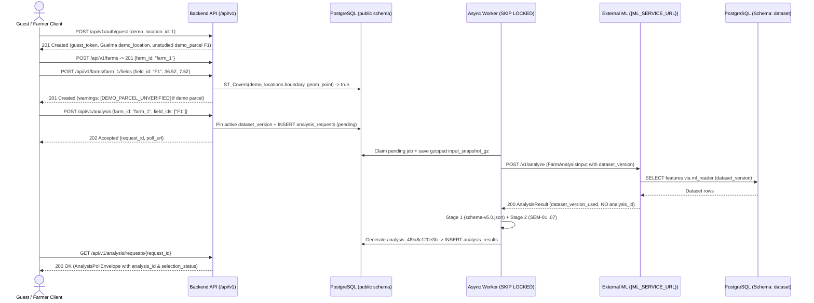

# Visual Input / Output Specification — Input/Output Test (API + Database)

**Contract Baseline:** `ENDPOINTS v3.2` (`34` Backend Endpoints + `3` External ML Endpoints)  
**Machine-Readable Contracts:** [OpenAPI 3.1.0 Spec](openapi.yaml) · [ML JSON Schema Draft 2020-12](schema-v5.0.json)  
**Companion Specs:** [ENDPOINTS API & Database Specification](FieldShift%20Planner%20—%20ENDPOINTS%20api%20&%20Database%20Specification.md) · [System Architecture Blueprint](../System%20Architecture%20Blueprint.md)

---

## Contents

1. Flow Diagram
2. Core Contract & Local-Dataset Design Principles
3. Field Mapping: Input/Output <-> Database (`public` & `Schema: dataset`)
4. Test 1: Start Guest Session (`POST /auth/guest`)
5. Test 2: Create Farm & Field (`POST /farms`, `POST /farms/{farm_id}/fields`)
6. Test 3: Submit Analysis Request (`POST /analysis`)
7. Test 4: Resolve Active `dataset_version` & Snapshot `FarmAnalysisInput`
8. Tests 5–7: ML Call, Validation (`Stage 1 + SEM-01..07`) & Poll Response
9. Fixtures (`9.1 input.json`, `9.2 input_setif.json`, `9.3 output.json`, `9.4 catalog.json`)
10. Edge Cases, Cancel, Dataset Mismatch (`SEM-07`), Degraded Mode & Mutation Checks
11. Verified Contract & Schema Conformance Checklist

---

## 1. Flow Diagram



---

## 2. Core Contract & Local-Dataset Design Principles

1. **Zero External Environmental APIs:** Inline weather/satellite time-series objects were removed completely from `FarmAnalysisInput`. External ML reads local data directly from PostgreSQL `Schema: dataset` via read-only role `ml_reader`, pinned per request via `dataset_version` (`SEM-07`).
2. **Single String ID Scheme:** Public REST payloads and ML wire inputs use `"farm_1"` (`farm_id`), `"F1"` (`field_id`), and Backend-generated `"analysis_4f9a8c120e3b"` (`^analysis_[0-9a-f]{12}$`). Surrogate bigint PKs never appear in API contracts.
3. **`analysis_id` Ownership:** `AnalysisResult` (`§9.3`) omits `analysis_id`. Backend generates `analysis_4f9a8c120e3b` on every `analysis_results` insert (including invalid ML payloads saved with `validation_passed: false`).
4. **Honest Pre-Designated Unstudied Demo Parcel (`is_unverified_demo_parcel`):** Team demo parcel `F1` starts with `soil.source: "unknown"`, `soil_type: "unknown"`, `elevation_m: null`, and notice `DEMO_PARCEL_UNVERIFIED` until surveyed (`OQ-D8`).
5. **Tolerant Reader:** Minor `"5.x"` additions in ML responses (`AnalysisResult`, `Strategy`, `CropItem`, etc.) are logged as warnings and accepted (`additionalProperties: true`).

---

## 3. Field Mapping: Input/Output <-> Database

### Input (`FarmAnalysisInput` -> DB Columns)

| Contract Field (`schema-v5.0.json`) | PostgreSQL Source | Notes |
| --- | --- | --- |
| `schema_version` | `analysis_requests.schema_version` | `"5.0"` (`^5\.[0-9]+$`) |
| `request_id` | `analysis_requests.request_id` | UUID v4 |
| `catalog_version` | `crop_catalog.catalog_version` | Active catalog pinned at submit |
| `dataset_version` | `dataset_registry.dataset_version` | Unique row with `is_active = true` |
| `farm.farm_id` | `"farm_" \|\| farms.id` | Never raw bigint |
| `fields[].field_id` | `fields.external_field_id` | Per-farm string `"F1"` |
| `fields[].is_unverified_demo_parcel` | `fields.is_unverified_demo_parcel` | `true` for pre-designated unstudied parcel |
| `fields[].soil.source` | `fields.soil_source` | Strictly `"farmer"` or `"unknown"` |
| `fields[].crop_history[]` | `field_crop_history` | `notes` never transmitted; `>= 1` of `crop_id` / `crop_name_raw` required |

### Output (`AnalysisResult` -> DB Columns)

| Source Field | PostgreSQL Target | Notes |
| --- | --- | --- |
| *(Backend Generated)* | `analysis_results.analysis_id` | `^analysis_[0-9a-f]{12}$` (absent from `AnalysisResult`) |
| `dataset_version_used` | `analysis_results.dataset_version_used` | Checked equal to `analysis_requests.dataset_version` (`SEM-07`) |
| Entire ML JSON body | `analysis_results.result_json` | Immutable write-once JSONB |
| *(Merged on Read)* | `analysis_selections` | Read-time overlay sets `selection_status` (`suggested`/`selected`/`rejected`) |

---

## 4. Test 1: Start Guest Session (`POST /auth/guest`)

**Request:**
```json
{ "demo_location_id": 1 }
```

**Response (`201 Created`):**
```json
{
  "guest_token": "gst_9b44f7c10a8e2130d5c89e4b",
  "expires_at": "2026-11-21T10:00:00Z",
  "demo_location": { "id": 1, "code": "guelma", "name": "Guelma", "country": "Algeria", "region": "Guelma" },
  "demo_parcel": {
    "field_id": "F1",
    "field_name": "Guelma Team Demo Parcel (Unstudied)",
    "location": { "latitude": 36.52, "longitude": 7.52 },
    "area_hectares": 12.5,
    "is_unverified_demo_parcel": true,
    "warnings": [
      {
        "code": "DEMO_PARCEL_UNVERIFIED",
        "message": "This demo parcel is pre-designated by the project team; its real field measurements have not yet been studied and will be added later.",
        "fields": ["F1"]
      }
    ]
  }
}
```

---

## 5. Test 2: Create Farm & Field (`POST /farms`, `POST /farms/farm_1/fields`)

1. `POST /api/v1/farms` returns `201 Created` with `"farm_id": "farm_1"`.
2. `POST /api/v1/farms/farm_1/fields` for team demo parcel (`36.52° N, 7.52° E`, `is_unverified_demo_parcel: true`): PostGIS `ST_Covers(demo_locations.boundary, geom_point)` is `true` -> `201 Created` with `soil.source: "unknown"` and `warnings: [{"code": "DEMO_PARCEL_UNVERIFIED", ...}]`.
3. **Outside Boundary Check (Setif `36.19° N, 5.41° E`):**
   - For **Guest:** PostGIS `ST_Covers` is `false` -> `422 OUTSIDE_DEMO_BOUNDARY`.
   - For **Registered User:** saves `201 Created` with `warnings: [{"code": "MVP_OUTSIDE_COVERAGE", ...}]`.

---

## 6. Test 3: Submit Analysis Request (`POST /analysis`)

**Request (`farm_1`, `["F1"]`):**
```json
{
  "farm_id": "farm_1",
  "language": "en",
  "planning": {
    "start_year": 2027,
    "start_season": "spring",
    "horizon_seasons": 4,
    "scenario_overrides": { "temp_delta_c": 0.0, "precip_pct_delta": 0.0 }
  },
  "priorities": {
    "weights": {
      "water_saving": 30,
      "soil_improvement": 25,
      "income": 25,
      "risk_reduction": 10,
      "forage_value": 10
    },
    "market_preference": "mixed",
    "target_crop_ids": ["chickpea"],
    "excluded_crop_ids": [],
    "equipment_constraints": []
  },
  "field_ids": ["F1"]
}
```

**Response (`202 Accepted`):**
```json
{
  "request_id": "550e8400-e29b-41d4-a716-446655440000",
  "status": "pending",
  "poll_url": "/api/v1/analysis/requests/550e8400-e29b-41d4-a716-446655440000",
  "poll_interval_ms": 2000,
  "warnings": [
    {
      "code": "DEMO_PARCEL_UNVERIFIED",
      "message": "This demo parcel is pre-designated by the project team; its real field measurements have not yet been studied and will be added later.",
      "fields": ["F1"]
    }
  ]
}
```

---

## 7. Test 4: Resolve Active `dataset_version` & Snapshot `FarmAnalysisInput`

- Worker claims `"550e8400-e29b-41d4-a716-446655440000"` using `FOR UPDATE SKIP LOCKED`.
- Reads active `public.dataset_registry.dataset_version` (`"2026.11-guelma-v1"`). Zero external NASA/MODIS/SoilGrids/SRTM network requests occur.
- Builds `FarmAnalysisInput` (`§9.1`), compresses it to `analysis_requests.input_snapshot_gz`, and prepares HTTP call to `{ML_SERVICE_URL}/v1/analyze`.

---

## 8. Tests 5–7: ML Call, Validation (`Stage 1 + SEM-01..07`) & Poll Response

### Test 5: ML Call (`POST {ML_SERVICE_URL}/v1/analyze`)
- Backend sends `FarmAnalysisInput` (`§9.1`, `dataset_version: "2026.11-guelma-v1"`) with `X-ML-API-Key` and `Idempotency-Key: 550e8400-e29b-41d4-a716-446655440000`.
- External ML queries PostgreSQL `Schema: dataset` via read-only role `ml_reader` and returns `AnalysisResult` (`§9.3`).

### Test 6: 2-Stage Validation & Save (`SEM-01..SEM-07`)
1. **Stage 1 (`schema-v5.0.json`):** Validates structure, `ok`/`partial` baseline rule, and applies Unknown Field Policy (minor extra keys logged, never fail).
2. **Stage 2 (`SEM-01..07`):**
   - **Dataset-Backed Prediction & `SEM-07` Check:** Confirms `AnalysisResult.dataset_version_used == "2026.11-guelma-v1"` (`analysis_requests.dataset_version`). Mismatch fails job with `502 DATASET_VERSION_UNAVAILABLE` and saves raw body with `validation_passed: false`.
   - **`SEM-04`:** Confirms raw `farmer_input` evidence matches `input_snapshot_gz` within `±TBD` tolerance (`OQ-3`) and aggregate metrics carry `"derived": true`.
3. Backend generates `"analysis_id": "analysis_4f9a8c120e3b"` and inserts raw JSON into `public.analysis_results`.

### Test 7: Response (`GET /api/v1/analysis/requests/550e8400-e29b-41d4-a716-446655440000`)

```json
{
  "request_id": "550e8400-e29b-41d4-a716-446655440000",
  "status": "ok",
  "poll_interval_ms": null,
  "analysis_id": "analysis_4f9a8c120e3b",
  "warnings": [
    {
      "code": "DEMO_PARCEL_UNVERIFIED",
      "message": "This demo parcel is pre-designated by the project team; its real field measurements have not yet been studied and will be added later.",
      "fields": ["F1"]
    }
  ],
  "degraded_mode": null,
  "error": null,
  "result": { "...": "Validated AnalysisResult matching Fixture 9.3 (with selection_status merged on read)" }
}
```

---

## 9. Fixtures

### 9.1 `input.json` (Guest, Guelma Pre-Designated Unstudied Parcel)

```json
{
  "schema_version": "5.0",
  "request_id": "550e8400-e29b-41d4-a716-446655440000",
  "catalog_version": "2026.11",
  "dataset_version": "2026.11-guelma-v1",
  "language": "en",
  "farm": {
    "farm_id": "farm_1",
    "farm_name": "Ferme Guelma Demo",
    "country": "Algeria",
    "region": "Guelma",
    "commune": "Guelma"
  },
  "planning": {
    "start_season": "spring",
    "start_year": 2027,
    "horizon_seasons": 4,
    "cycle_mode": "annual_rotation",
    "planting_month": 3,
    "scenario_overrides": {
      "temp_delta_c": 0.0,
      "precip_pct_delta": 0.0
    }
  },
  "priorities": {
    "weights": {
      "water_saving": 30,
      "soil_improvement": 25,
      "income": 25,
      "risk_reduction": 10,
      "forage_value": 10
    },
    "market_preference": "mixed",
    "target_crop_ids": ["chickpea"],
    "excluded_crop_ids": [],
    "equipment_constraints": []
  },
  "fields": [
    {
      "field_id": "F1",
      "field_name": "Guelma Team Demo Parcel (Unstudied)",
      "is_unverified_demo_parcel": true,
      "location": {
        "latitude": 36.52,
        "longitude": 7.52,
        "boundary": null
      },
      "area_hectares": 12.5,
      "elevation_m": null,
      "crop_history": [
        {
          "season": "autumn",
          "year": 2025,
          "planting_month": 11,
          "crop_id": "durum_wheat",
          "crop_name_raw": "Durum Wheat",
          "catalog_version": "2026.11",
          "yield_tons_per_hectare": null
        },
        {
          "season": "autumn",
          "year": 2024,
          "planting_month": 11,
          "crop_id": "barley",
          "crop_name_raw": "Barley",
          "catalog_version": "2026.11",
          "yield_tons_per_hectare": null
        }
      ],
      "soil": {
        "soil_type": "unknown",
        "source": "unknown",
        "soil_ph": null,
        "organic_matter_percent": null,
        "soil_test_date": null
      },
      "water": {
        "availability": "moderate",
        "source": "well",
        "source_other": null,
        "irrigation_system": "drip"
      }
    }
  ]
}
```

### 9.2 `input_setif.json` (Registered User Outside Guelma Coverage, Edge Case Only)

```json
{
  "schema_version": "5.0",
  "request_id": "660e8400-e29b-41d4-a716-446655440099",
  "catalog_version": "2026.11",
  "dataset_version": "2026.11-guelma-v1",
  "language": "fr",
  "farm": {
    "farm_id": "farm_2",
    "farm_name": "Exploitation Hauts Plateaux Setif",
    "country": "Algeria",
    "region": "Setif",
    "commune": "Ain Arnat"
  },
  "planning": {
    "start_season": "autumn",
    "start_year": 2027,
    "horizon_seasons": 4,
    "cycle_mode": "annual_rotation",
    "planting_month": 11,
    "scenario_overrides": {
      "temp_delta_c": 1.0,
      "precip_pct_delta": -10.0
    }
  },
  "priorities": {
    "weights": {
      "water_saving": 40,
      "soil_improvement": 20,
      "income": 20,
      "risk_reduction": 10,
      "forage_value": 10
    },
    "market_preference": "local_market",
    "target_crop_ids": ["durum_wheat"],
    "excluded_crop_ids": [],
    "equipment_constraints": []
  },
  "fields": [
    {
      "field_id": "F1",
      "field_name": "Parcelle Sud",
      "is_unverified_demo_parcel": false,
      "location": {
        "latitude": 36.19,
        "longitude": 5.41,
        "boundary": null
      },
      "area_hectares": 18.0,
      "elevation_m": 980.0,
      "crop_history": [
        {
          "season": "autumn",
          "year": 2025,
          "planting_month": 11,
          "crop_id": null,
          "crop_name_raw": "Ble dur local",
          "catalog_version": null,
          "yield_tons_per_hectare": 2.6
        }
      ],
      "soil": {
        "soil_type": "clay",
        "source": "farmer",
        "soil_ph": 7.6,
        "organic_matter_percent": 1.4,
        "soil_test_date": "2026-08-20"
      },
      "water": {
        "availability": "limited",
        "source": "groundwater",
        "source_other": null,
        "irrigation_system": "sprinkler"
      }
    }
  ]
}
```

### 9.3 `output.json` (`AnalysisResult` Returned by ML `/v1/analyze` — No `analysis_id`)

```json
{
  "schema_version": "5.0",
  "request_id": "550e8400-e29b-41d4-a716-446655440000",
  "dataset_version_used": "2026.11-guelma-v1",
  "generated_at": "2026-11-14T10:06:12Z",
  "status": "ok",
  "language": "en",
  "ml_engine_version": "agro-ml-2.1.0",
  "overall_summary": "Rotating spring chickpea and forage vetch into cereal-dominated parcel F1 reduces multi-year moisture depletion and breaks cereal disease cycles.",
  "disclaimer": "Recommendations depend on the unverified demo parcel inputs supplied and dataset_version 2026.11-guelma-v1; verify soil chemistry locally prior to planting.",
  "field_plans": [
    {
      "field_id": "F1",
      "field_name": "Guelma Team Demo Parcel (Unstudied)",
      "status": "ok",
      "partial_reason": null,
      "field_insights": {
        "bare_field_periods": [
          {
            "start_month": 7,
            "end_month": 10,
            "evidence": "Summer fallow gap observed between cereal harvests."
          }
        ],
        "stress_periods": [
          {
            "type": "drought",
            "months": [6, 7, 8],
            "severity": "medium",
            "evidence": "Seasonal water deficit pattern in local dataset for zone F1."
          }
        ],
        "climate_trend_summary": "Dataset zone 2026.11-guelma-v1 indicates recurring dry summer months with moderate spring variability."
      },
      "strategies": [
        {
          "strategy_id": "S1_baseline_cereal",
          "name": "Existing Cereal Baseline",
          "is_existing_rotation": true,
          "description": "Continues historical autumn cereal dominance as the comparison baseline.",
          "seasons": [
            { "order": 1, "season": "spring", "year": 2027, "planting_month": 3, "crop_id": "fallow", "crop_name": "Bare Fallow", "category": "fallow", "role": "fallow", "selection_status": "suggested", "notes": null },
            { "order": 2, "season": "autumn", "year": 2027, "planting_month": 11, "crop_id": "durum_wheat", "crop_name": "Durum Wheat", "category": "cereals", "role": "main_crop", "selection_status": "suggested", "notes": null },
            { "order": 3, "season": "spring", "year": 2028, "planting_month": 3, "crop_id": "fallow", "crop_name": "Bare Fallow", "category": "fallow", "role": "fallow", "selection_status": "suggested", "notes": null },
            { "order": 4, "season": "autumn", "year": 2028, "planting_month": 11, "crop_id": "barley", "crop_name": "Barley", "category": "cereals", "role": "main_crop", "selection_status": "suggested", "notes": null }
          ],
          "scores": {
            "water_efficiency": 52,
            "erosion_protection": 48,
            "organic_matter_gain": 35,
            "nitrogen_contribution": 25,
            "pest_cycle_disruption": 30,
            "income_forage_value": 58,
            "priority_fit": 49,
            "bare_field_days_per_year": 140
          },
          "confidence": "medium",
          "explanation": {
            "reasons": [
              { "code": "BASELINE_CONTINUITY", "text": "Reflects prior autumn wheat/barley cropping history.", "params": { "prior_crops": 2 } }
            ],
            "evidence": [
              {
                "data_source": "farmer_input",
                "parameter": "water_availability",
                "observed_value": "moderate",
                "unit": null,
                "period": null,
                "derived": false,
                "interpretation": "Farmer-reported moderate well availability with drip irrigation."
              }
            ],
            "benefits": [
              { "benefit_id": "B0", "title": "Familiar machinery workflow", "description": "Requires no immediate equipment change." }
            ],
            "risks": [
              { "risk_id": "R0", "title": "Cereal monoculture pathogen carryover", "description": "Consecutive cereals increase root disease pressure.", "severity": "high", "likelihood": "medium", "mitigation": "Introduce a legume break crop." }
            ],
            "assumptions": ["Parcel F1 field parameters remain unstudied until surveyed."],
            "information_gaps": ["Missing laboratory soil pH and organic matter measurements."],
            "needs_local_review": ["Verify soil texture and organic matter on parcel F1."]
          }
        },
        {
          "strategy_id": "S2_water_resilient",
          "name": "Chickpea & Drip Forage Balanced Rotation",
          "is_existing_rotation": false,
          "description": "Introduces nitrogen-fixing chickpea and conserved forage vetch alongside durum wheat.",
          "seasons": [
            { "order": 1, "season": "spring", "year": 2027, "planting_month": 3, "crop_id": "chickpea", "crop_name": "Chickpea", "category": "legumes", "role": "nitrogen_fixer", "selection_status": "suggested", "notes": null },
            { "order": 2, "season": "autumn", "year": 2027, "planting_month": 11, "crop_id": "durum_wheat", "crop_name": "Durum Wheat", "category": "cereals", "role": "cash_crop", "selection_status": "suggested", "notes": null },
            { "order": 3, "season": "spring", "year": 2028, "planting_month": 3, "crop_id": "vetch_forage", "crop_name": "Vetch Forage", "category": "forage", "role": "forage", "selection_status": "suggested", "notes": null },
            { "order": 4, "season": "autumn", "year": 2028, "planting_month": 11, "crop_id": "barley", "crop_name": "Barley", "category": "cereals", "role": "break_crop", "selection_status": "suggested", "notes": null }
          ],
          "scores": {
            "water_efficiency": 82,
            "erosion_protection": 76,
            "organic_matter_gain": 74,
            "nitrogen_contribution": 80,
            "pest_cycle_disruption": 85,
            "income_forage_value": 78,
            "priority_fit": 84,
            "bare_field_days_per_year": 55
          },
          "confidence": "medium",
          "explanation": {
            "reasons": [
              { "code": "TARGET_CROP_MATCH", "text": "Includes farmer requested crop chickpea in season 1.", "params": { "crop_id": "chickpea" } }
            ],
            "evidence": [
              {
                "data_source": "dataset",
                "parameter": "precipitation",
                "observed_value": 312,
                "unit": "mm/year",
                "period": "dataset-zone-baseline",
                "derived": true,
                "interpretation": "Mean annual dataset precipitation aligns with spring chickpea establishment."
              },
              {
                "data_source": "dataset",
                "parameter": "precipitation_anomaly",
                "observed_value": -18,
                "unit": "% vs historical mean",
                "period": "dataset-dry-quantile",
                "derived": true,
                "interpretation": "Drier years favor drought-tolerant legumes over fallow cereals."
              }
            ],
            "benefits": [
              { "benefit_id": "B1", "title": "Biological nitrogen fixation", "description": "Spring chickpea lowers synthetic nitrogen demand for autumn wheat." }
            ],
            "risks": [
              { "risk_id": "R1", "title": "Soil chemistry uncertainty", "description": "Unstudied parcel soil pH could affect legume nodulation.", "severity": "medium", "likelihood": "medium", "mitigation": "Collect topsoil lab sample before spring sowing." }
            ],
            "assumptions": ["Drip irrigation system remains operational for supplemental spring moisture."],
            "information_gaps": ["Parcel F1 awaits physical soil sampling (`is_unverified_demo_parcel: true`)."],
            "needs_local_review": ["Confirm chickpea seed variety suitability with local extension service."]
          }
        },
        {
          "strategy_id": "S3_income_diversified",
          "name": "Market Cereal & Legume Cash Focus",
          "is_existing_rotation": false,
          "description": "Prioritizes market revenue with alternating durum wheat and chickpea cycles.",
          "seasons": [
            { "order": 1, "season": "spring", "year": 2027, "planting_month": 3, "crop_id": "chickpea", "crop_name": "Chickpea", "category": "legumes", "role": "cash_crop", "selection_status": "suggested", "notes": null },
            { "order": 2, "season": "autumn", "year": 2027, "planting_month": 11, "crop_id": "durum_wheat", "crop_name": "Durum Wheat", "category": "cereals", "role": "cash_crop", "selection_status": "suggested", "notes": null },
            { "order": 3, "season": "spring", "year": 2028, "planting_month": 3, "crop_id": "sunflower", "crop_name": "Sunflower", "category": "oilseeds", "role": "break_crop", "selection_status": "suggested", "notes": null },
            { "order": 4, "season": "autumn", "year": 2028, "planting_month": 11, "crop_id": "durum_wheat", "crop_name": "Durum Wheat", "category": "cereals", "role": "cash_crop", "selection_status": "suggested", "notes": null }
          ],
          "scores": {
            "water_efficiency": 70,
            "erosion_protection": 72,
            "organic_matter_gain": 64,
            "nitrogen_contribution": 68,
            "pest_cycle_disruption": 79,
            "income_forage_value": 88,
            "priority_fit": 77,
            "bare_field_days_per_year": 75
          },
          "confidence": "medium",
          "explanation": {
            "reasons": [
              { "code": "MIXED_MARKET_REVENUE", "text": "Balances pulse and oilseed break crops around cash wheat.", "params": { "cash_seasons": 4 } }
            ],
            "evidence": [
              {
                "data_source": "farmer_input",
                "parameter": "water_availability",
                "observed_value": "moderate",
                "unit": null,
                "period": null,
                "derived": false,
                "interpretation": "Moderate well irrigation supports spring oilseed establishment."
              }
            ],
            "benefits": [
              { "benefit_id": "B2", "title": "High gross revenue potential", "description": "Maximize marketed crop share across 4 seasons." }
            ],
            "risks": [
              { "risk_id": "R2", "title": "Higher irrigation demand in summer", "description": "Oilseed phase demands reliable mid-season watering.", "severity": "medium", "likelihood": "low", "mitigation": "Schedule drip irrigation during flowering." }
            ],
            "assumptions": ["No soil salinity issues on unstudied parcel F1."],
            "information_gaps": ["Exact well summer yield rate not measured."],
            "needs_local_review": ["Verify local buyer uptake for spring oilseed."]
          }
        }
      ],
      "suggested_strategy_id": "S2_water_resilient",
      "requested_crop_results": [
        {
          "requested_crop_id": "chickpea",
          "outcome": "included",
          "included_in_strategy_ids": ["S2_water_resilient", "S3_income_diversified"],
          "replaced_by_crop_id": null,
          "explanation": "Chickpea fits spring 2027 well as a nitrogen-fixing legume breaking historical autumn cereal dominance.",
          "comparison": [],
          "evidence": []
        }
      ],
      "data_quality": {
        "completeness_score": 0.45,
        "confidence_note": "Reduced completeness because parcel F1 is an unverified demo parcel with unknown soil chemistry.",
        "missing_data": ["soil_ph", "organic_matter_percent", "elevation_m"],
        "warnings": ["DEMO_PARCEL_UNVERIFIED: Parcel measurements have not yet been studied."],
        "limitations": ["Predictions rely on dataset_version 2026.11-guelma-v1 regional signals rather than verified soil sampling on F1."]
      }
    }
  ],
  "data_quality": {
    "completeness_score": 0.45,
    "confidence_note": "Farm-level confidence reflects 1 unverified demo parcel.",
    "missing_data": ["F1.soil_ph", "F1.organic_matter_percent"],
    "warnings": ["DEMO_PARCEL_UNVERIFIED"],
    "limitations": ["Awaiting field survey data for pre-designated parcel F1."]
  }
}
```

### 9.4 `catalog.json` (External ML `{ML_SERVICE_URL}/v1/catalog` Wire Payload)

> [!NOTE]
> `schema-v5.0.json#/$defs/CropCatalog` defines the upstream **`GET {ML_SERVICE_URL}/v1/catalog`** contract which returns **`crops[]`**. When Backend serves **`GET /api/v1/catalog`**, [openapi.yaml](openapi.yaml) wraps rows from `public.crop_catalog` into **`items[]`** (cursor-paginated, default `limit=20`). Note that conserved hay and grazed green forage share the unified `"forage"` category.

```json
{
  "catalog_version": "2026.11",
  "synced_at": "2026-11-14T08:00:00Z",
  "crops": [
    {
      "crop_id": "durum_wheat",
      "display_name": "Durum Wheat",
      "names": { "en": "Durum Wheat", "fr": "Blé dur", "ar": "قمح صلب" },
      "category": "cereals",
      "roles": ["main_crop", "cash_crop"],
      "family": "Poaceae"
    },
    {
      "crop_id": "barley",
      "display_name": "Barley",
      "names": { "en": "Barley", "fr": "Orge", "ar": "شعير" },
      "category": "cereals",
      "roles": ["main_crop", "break_crop"],
      "family": "Poaceae"
    },
    {
      "crop_id": "chickpea",
      "display_name": "Chickpea",
      "names": { "en": "Chickpea", "fr": "Pois chiche", "ar": "حمص" },
      "category": "legumes",
      "roles": ["nitrogen_fixer", "cash_crop"],
      "family": "Fabaceae"
    },
    {
      "crop_id": "vetch_forage",
      "display_name": "Vetch Forage",
      "names": { "en": "Vetch Forage", "fr": "Vesce fourragère", "ar": "بيقية علفية" },
      "category": "forage",
      "roles": ["forage", "nitrogen_fixer"],
      "family": "Fabaceae"
    },
    {
      "crop_id": "sunflower",
      "display_name": "Sunflower",
      "names": { "en": "Sunflower", "fr": "Tournesol", "ar": "دوار الشمس" },
      "category": "oilseeds",
      "roles": ["cash_crop", "break_crop"],
      "family": "Asteraceae"
    },
    {
      "crop_id": "fallow",
      "display_name": "Bare Fallow",
      "names": { "en": "Bare Fallow", "fr": "Jachère", "ar": "أرض بور" },
      "category": "fallow",
      "roles": ["fallow"],
      "family": "None"
    }
  ]
}
```

---

## 10. Edge Cases, Cancel, Dataset Mismatch (`SEM-07`), Degraded Mode & Mutation Checks

| # | Case / Mutation | Expected Outcome | Reference |
| :---: | --- | --- | --- |
| 1 | `sum(priorities.weights.*) != 100` on `POST /analysis` | Rejected synchronously `400 INVALID_INPUT` before DB enqueue | `INPUT-01` |
| 2 | `planting_month: 8` with `start_season: "winter"` at `latitude: 36.52` or overlapping `target`/`excluded` crops | Rejected synchronously `400 INVALID_INPUT` | `INPUT-02`, `INPUT-03` |
| 3 | Guest creates 4th farm or exceeds 40 analysis quarters | **`403 GUEST_LIMIT_REACHED`** (never `429`; `429` reserved for `RATE_LIMIT_EXCEEDED`) | `ENDPOINTS B.1 / B.4` |
| 4 | ML returns corrupt JSON or fails Stage 1 / Stage 2 (`SEM-01..07`) | Backend still generates `analysis_<12hex>`, writes raw JSON with `validation_passed: false`, fails job `502 ML_INVALID_RESPONSE` | `ENDPOINTS A.4 / B.10` |
| 5 | Caller calls `POST /analysis/requests/{id}/cancel` | `200 OK {status: "cancelled"}` (refunds quota if `sent_at IS NULL`); `409 CONFLICT` if already `ok`/`partial`/`failed`/`cancelled` | `ENDPOINTS B.7` |
| 6 | Foreign owner `GET /farms/farm_99` vs Guest Setif field write | Foreign owner always **`404 NOT_FOUND`**; Guest outside Guelma **`422 OUTSIDE_DEMO_BOUNDARY`** | `ENDPOINTS B.1 / ADR-3` |
| 7 | `dataset_version_used != dataset_version` (`SEM-07`) or no active dataset | `502 DATASET_VERSION_UNAVAILABLE` (`SEM-07`) / `503 DATASET_UNAVAILABLE` | `ADR-9` |
| 8 | `schema_version: "5.1"` + unknown extra ML property vs `"6.0"` | `"5.1"` **PASSES** (logged warning under Unknown Field Policy); `"6.0"` **FAILS**; outage replay sets `degraded_mode.stale = true` | `ADR-6 / ADR-8` |

---

## 11. Verified Contract & Schema Conformance Checklist

Validated against the machine-readable contracts (`schema-v5.0.json` and `openapi.yaml`):
- JSON Schema Draft 2020-12 compiles cleanly and rejects unknown root objects while keeping `FarmAnalysisInput`, `AnalysisResult`, and `CropCatalog` strictly disjoint (`oneOf` + `not`).
- Fixtures `9.1`, `9.2`, `9.3`, and `9.4` validate cleanly against `schema-v5.0.json` without any inline environmental arrays or external NASA/SoilGrids keys.
- `openapi.yaml` resolves all relative `$ref: ./schema-v5.0.json#/$defs/...` pointers and matches all **34** backend routes and **19** error codes in `ENDPOINTS`.
- All Guelma polygon checks (`36.52° N, 7.52° E` inside vs `36.19° N, 5.41° E` outside) hold cleanly in PostGIS GeoJSON.
