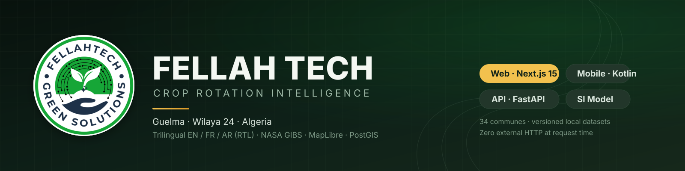
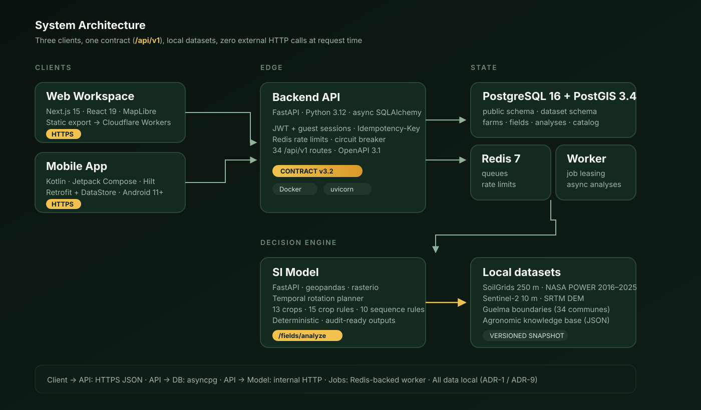

# FELLAH TECH — Documentation Hub

> Engineering documentation for the FELLAH TECH crop-rotation platform.
> Start here, then follow the module you need.

<p align="center">
  
</p>

---

## 1. What this system does

FELLAH TECH turns a farmer-drawn parcel into a **multi-season crop-rotation plan** for the Wilaya of Guelma, Algeria. The farmer supplies only what they know — the polygon, water access, planning window, and optionally remembered crop history. Everything technical (soil, climate, terrain, remote sensing) is resolved server-side from versioned local datasets.

The platform is split into four deliverables that share one contract (`/api/v1`):

| Module | Directory | Responsibility |
| --- | --- | --- |
| Web workspace | [`../frontend`](../frontend) | GIS border editor, dashboards, intelligence studio, comparison views |
| REST API | [`../backend`](../backend) | Auth, farms/fields CRUD, async analyses, catalog, quotas, rate limits |
| Decision engine | [`../Feild-Shift-SI-Model`](../Feild-Shift-SI-Model) | Temporal rotation planner, constraint rules, evidence and readiness |
| Android app | [`../mobile`](../mobile) | Field capture and analysis on mobile |

---

## 2. Architecture at a glance

<p align="center">
  
</p>

```
Client (Next.js / Android)
   │  HTTPS  JSON
   ▼
FastAPI backend  ── asyncpg ──▶ PostgreSQL 16 + PostGIS 3.4
   │      │                        ├─ public schema (farms, fields, analyses)
   │      │                        └─ dataset schema (read-only spatial data)
   │      └── Redis 7 ──▶ worker (job leasing, async analyses)
   │
   └── internal HTTP ──▶ SI Model (FastAPI + geopandas + rasterio)
                              └── versioned local datasets
```

**Request path for an analysis**

1. `POST /api/v1/analysis` with the minimal farmer contract.
2. The API rejects any technical input (`soil_ph`, `ndvi`, `rainfall_mm`, …) at the schema boundary.
3. Payload is hashed → idempotent retries return the same request instead of duplicating work.
4. Job is queued in Redis and leased by a worker; the worker calls the SI model.
5. The SI model validates the polygon against Guelma boundaries, resolves commune overlap, soil and climate context, and runs the temporal planner.
6. Results are persisted with provenance, readiness flags, and version stamps; the client polls `GET /analysis/requests/{id}`.

---

## 3. Documentation map

### System design (normative)

| Document | Contents |
| --- | --- |
| [`SYSTEM DESGIN.md`](../SYSTEM%20DESGIN/SYSTEM%20DESGIN.md) | Master index |
| [System Architecture Blueprint](../SYSTEM%20DESGIN/SYSTEM%20DESGIN/System%20Architecture%20Blueprint.md) | Components, responsibilities, data flow |
| [Architecture Decision Records](../SYSTEM%20DESGIN/SYSTEM%20DESGIN/Architecture%20Decision%20Records%20%28ADR%29.md) | ADR-1..9, including local-dataset-only decisions |
| [ENDPOINTS & Database Specification](../SYSTEM%20DESGIN/SYSTEM%20DESGIN/System%20Architecture%20Blueprint/FieldShift%20Planner%20%E2%80%94%20ENDPOINTS%20api%20%26%20Database%20Specification.md) | 34 routes, 13 tables, error catalogue, settings |
| [OpenAPI 3.1](../SYSTEM%20DESGIN/SYSTEM%20DESGIN/System%20Architecture%20Blueprint/openapi.yaml) | Machine-readable REST contract |
| [ML wire schema v5.0](../SYSTEM%20DESGIN/SYSTEM%20DESGIN/System%20Architecture%20Blueprint/schema-v5.0.json) | Backend ⇄ SI model payload contract |

### Implementation & operations

| Document | Contents |
| --- | --- |
| [`impl/00-spec-digest.md`](impl/00-spec-digest.md) | Normative digest: routes, tables, errors, env vars, rule IDs |
| [`impl/01-audit-and-gaps.md`](impl/01-audit-and-gaps.md) | Cross-spec audit and gap reconciliation |
| [`impl/02-implementation-plan.md`](impl/02-implementation-plan.md) | Milestones M0–M13, pitfalls, test strategy |
| [`impl/DECISIONS.md`](impl/DECISIONS.md) | Implementation decisions `IMPL-001..IMPL-023` |
| [`impl/DESIGN_ISSUES.md`](impl/DESIGN_ISSUES.md) | Spec discrepancies `DI-01..DI-17` |
| [`impl/TRACEABILITY.md`](impl/TRACEABILITY.md) | Requirement → code → test matrix |
| [`impl/RUNBOOK.md`](impl/RUNBOOK.md) | Deploy, secret rotation, Redis inspection, backup/restore |
| [`impl/BACKLOG.md`](impl/BACKLOG.md) | Open questions and TODO index |

### Module documentation

| Module | Documents |
| --- | --- |
| Frontend | [`../frontend/docs.md`](../frontend/docs.md) — stack inventory, feature notes, submission text |
| Mobile | [`../mobile/docs/api-ui-integration-map.md`](../mobile/docs/api-ui-integration-map.md), [`backend-integration-audit.md`](../mobile/docs/backend-integration-audit.md), [`ml-contract-v5.0.json`](../mobile/docs/ml-contract-v5.0.json) |
| SI model | [`../Feild-Shift-SI-Model/docs/`](../Feild-Shift-SI-Model/docs/), [`DEPLOY_HF.md`](../Feild-Shift-SI-Model/DEPLOY_HF.md) |

---

## 4. Local development

### Backend

```bash
cp .env.example .env
docker compose --profile dev up -d --build db redis migrate api mock-ml worker
curl "http://127.0.0.1:8000/api/v1/health?check=ready"
```

`mock-ml` replaces the real decision engine for local wiring tests; set `ML_PROVIDER_MODE=mock` and `ML_SERVICE_URL=http://mock-ml:8090` in `.env`. Mock mode is refused when `APP_ENV=production`.

### Frontend

```bash
cd frontend && npm install && npm run dev
```

Next.js rewrites `/api/v1/:path*` to `API_UPSTREAM_URL` (default `http://localhost:8000`) during development. Static export has no proxy, so production builds must set `NEXT_PUBLIC_API_BASE_URL`.

### SI model

```bash
cd Feild-Shift-SI-Model
python3 -m venv .venv && ./.venv/bin/pip install -r requirements.txt
./.venv/bin/uvicorn src.api.app:app --host 0.0.0.0 --port 8000
```

### Android

```properties
# mobile/local.properties
sdk.dir=/path/to/Android/Sdk
fieldshift.api.baseUrl=http://10.0.2.2:8000/api/v1/
```

```bash
cd mobile && ./gradlew :app:installDebug
```

---

## 5. Deployment matrix

| Piece | Target | Command / notes |
| --- | --- | --- |
| Web | Cloudflare Workers (static assets) | `NEXT_OUTPUT_EXPORT=true NEXT_PUBLIC_API_BASE_URL=… npm run build && npx wrangler deploy` |
| Backend | Docker host | `docker compose up -d db redis migrate api worker` |
| SI model | Docker / Python host | `docker build` from its `Dockerfile`, or `uvicorn src.api.app:app` |
| Mobile | Android APK | `./gradlew :app:assembleDebug` |

Environment requirements are documented in [`.env.example`](../.env.example): 40 normative variables plus 7 companion settings.

---

## 6. Verification checkpoints

| Check | Command | Expected |
| --- | --- | --- |
| API readiness | `curl "http://127.0.0.1:8000/api/v1/health?check=ready"` | `status: ok`, PostGIS version, worker count |
| Analysis round trip | `POST /api/v1/analysis` then poll | `ANAL_*` id, 3-season plan, provenance |
| Frontend types | `cd frontend && npm run typecheck` | no errors |
| Frontend tests | `cd frontend && npm test` | all Vitest suites pass |
| Backend tests | `cd backend && pytest` | contract + golden + integration suites pass |
| Static export | `NEXT_OUTPUT_EXPORT=true npm run build` | routes exported to `out/` |
| Mobile build | `./gradlew :app:assembleDebug` | APK in `app/build/outputs/apk/debug/` |

---

## 7. Known constraints

- **PostGIS is mandatory** for the backend; a plain PostgreSQL instance will fail spatial validation.
- **Mock ML is development-only** — `APP_ENV=production` + `ML_PROVIDER_MODE=mock` is rejected by design.
- **Static export loses the API proxy**; browsers call the API cross-origin, so CORS must include the web origin.
- **Guest sessions** are quota-limited (farms, fields, analyses) and expire after `GUEST_SESSION_DAYS`.
- **Demo parcel `F1`** is flagged `DEMO_PARCEL_UNVERIFIED` until real soil sampling is supplied.

---

<p align="center"><sub>Keep this hub in sync when adding routes, modules, or deployment targets.</sub></p>
