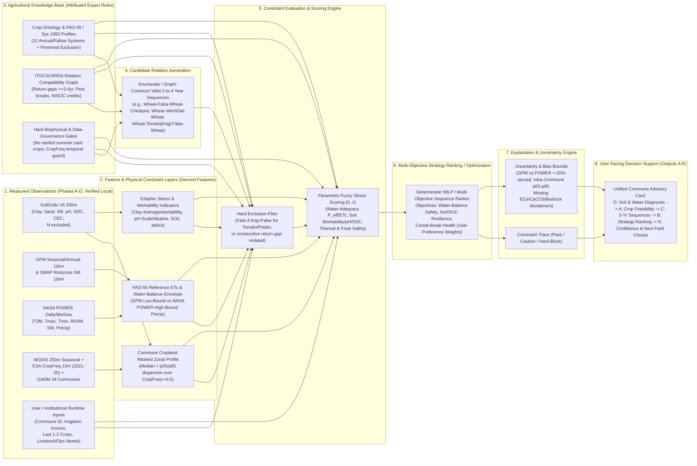

# Proposed Modeling Architecture — Field Shift (Guelma Wilaya)

**Design Paradigm:** **Hybrid Physics-Informed Knowledge + Continuous Parametric Suitability + Constrained Multi-Year Sequence Optimization with Explicit Uncertainty & Scale Governance**  
**Strict Principle:** Clean separation across **Measured Observations**, **Derived Features**, **Expert Agronomic Rules**, and **Optimization Outputs** — zero black-box ML target fabrication.

---

## 1. End-to-End Conceptual Architecture

---

## 2. Explicit Separation of Artifact Types

| Layer | Strict Category | Contents & Provenance Rules | Forbidden Mixing |
|---|---|---|---|
| **Layer 1** | **Measured / Integrated Observations** | `commune_static_soil_and_land_features.csv`, `commune_seasonal_panel_2016_2025.csv`, `nasa_power_daily_canonical.csv`, aligned `CropFreq`, plus runtime user inputs (`irrigation_access`, `previous_crop_t1`, `livestock_forage_need`). | Never overwrite with rule outputs or unverified assumptions. |
| **Layer 2** | **Derived Physical Features** | Penman-Monteith `ETo` (`mm/day`), seasonal crop demand $ET_c = K_c \cdot ET_o$, effective precipitation envelope (`GPM` conservative bound vs `NASA POWER` upper bound), seasonal climatic water deficit, spring/summer heat-day counts (`Tmax > 32°C / 35°C`), frost-risk day counts (`Tmin < 2°C`), and intra-commune `p05/p50/p95` cropland soil intervals. | Never claim derived $ET_c$ ratios equal measured `qx/ha` crop yields. |
| **Layer 3** | **Expert Agronomic Knowledge Base** | Attributed thresholds & transition rules in YAML/JSON compiled from [crop_system_inventory.csv](file:///home/lokman/Desktop/FeildShit-SI-Model/docs/phaseE/crop_system_inventory.csv) and [agronomic_constraints_framework.csv](file:///home/lokman/Desktop/FeildShit-SI-Model/docs/phaseE/agronomic_constraints_framework.csv). Every rule stores `citation`, `evidence_level` (`LOCAL_VERIFIED` vs `HYPOTHESIS`), and `trigger_threshold`. | Zero hardcoded anonymous magic numbers without source metadata. |
| **Layers 4–6** | **Generated Sequences & Optimization Outputs** | Feasible 2–4 year rotation plans ranked over **non-economic agronomic & hydro-resilience objectives** (`water_safety_score`, `soil_restoration_score`, `disease_break_score`), explicitly separated from runtime inputs & raw raster data. | Never present uncalibrated proxy scores as financial Net Profit (`DA/ha`) or guaranteed yield (`qx/ha`). |

---

## 3. Recommended Coherent Output Combination (Mapping Outputs A–E)

Instead of choosing only one isolated output type, Field Shift should produce a **coupled 5-part decision object (D → A → C → B → E)** per Commune (or user-verified plot scenario):

1. **[D] Water & Soil Constraint Assessment (Foundation Diagnostic)**
   - **Inputs:** Commune cropland `SoilGrids (p05/p50/p95)`, seasonal `GPM`/`NASA POWER`/`SMAP` regimes (`normal`, `dry-2022`, `wet-2019`), declared `irrigation_status`.
   - **Outputs:** Structured diagnostic flags (e.g., `Low_Cropland_SOC < 18 g/kg`, `Heavy_Clay_Workability_Risk`, `High_Spring_Rainfall_Volatility`, `Alkaline_pH_Potato_Warning`, `Missing_Salinity_Test_Warning`).
2. **[A] Crop Suitability & Feasibility Filter (Single-Season Gate)**
   - **Inputs:** Constraint layer + Crop Ontology + User `irrigation_status`.
   - **Outputs:** Categorical feasibility (`SUITABLE`, `SUITABLE_WITH_MANAGEMENT`, `MARGINAL_STRESS_RISK`, `HARD_EXCLUDED`) + limiting factor code for each of the 12 annual systems (`Olive` permanently excluded from annual switching).
3. **[C] Multi-Year Crop Sequence Generator (`2–4` Years)**
   - **Inputs:** Seasonally feasible crops + ITGC/ICARDA rotation rules + user `crop_t_minus_1`, `crop_t_minus_2`.
   - **Outputs:** All biologically valid sequences avoiding consecutive cereal/pulse/Solanaceae traps (e.g., `Durum Wheat -> Faba Bean -> Durum Wheat -> Winter Chickpea`, `Barley -> Vetch-Oat -> Barley`, or `Durum Wheat -> Processing Tomato [Irrig] -> Faba Bean`).
4. **[B] Strategy Ranking Across Climate Scenarios**
   - **Inputs:** Feasible sequences evaluated under **both** historical wet/normal years and dry stress (`2022` `404 mm` GPM baseline), plus `GPM` vs `NASA POWER` sensitivity envelope.
   - **Outputs:** Top `3–5` ranked rotation strategies comparing trade-offs across: *(i) Drought/Water Safety*, *(ii) Soil Organic Matter & N-Break Benefit*, and *(iii) Fit to Farmer Profile (Rainfed Cereal-Livestock vs. Irrigated Cash)*.
5. **[E] Explainability, Confidence & Pre-Action Verification Card**
   - **Outputs:** Plain-language trace showing **why** Option #1 beat Continuous Wheat or Bare Fallow, **which scenario flipped the ranking** (if `GPM` vs `NASA POWER` disagrees), explicit **`COARSER_CLIMATE_11KM_SUPPORT`** warning, and mandatory **on-farm checks before planting** (e.g., soil `ECe`/drainage test, Ascochyta-resistant seed check for winter chickpea, Bouhamdane dam quota check for tomato).

---

## 4. Handling Uncertainty, Multi-Scale Warnings & Missing Variables

- **Precipitation Cross-Product Envelope (`-132 mm/yr` GPM vs POWER Gap):** Every seasonal water-balance score is evaluated **twice**: under conservative **GPM (`11 km`)** and wetter **NASA POWER (`55–69 km`)** regimes. Recommendations are labeled **`ROBUST_BOTH_DATASETS`** vs. **`PRECIP_SENSITIVE_VERIFY_LOCAL_GAUGE`** when the two climate sources disagree on suitability!
- **Explicit Spatial Dispersion:** Commune evaluations propagate `[p05, p50, p95]` of `SoilGrids 250 m` cropland pixels rather than collapsing intra-commune soils to one mean.
- **Unobserved Variables Trigger Mandatory Advisories (Never Silent Defaults):** Missing `ECe` salinity triggers a mandatory irrigation perimeter water/soil EC warning; missing `bed_depth/drainage` attaches visual drainage verification notes for Chickpea/Lentil; `SoilGrids Nitrogen` remains completely detached from scoring formulas.
