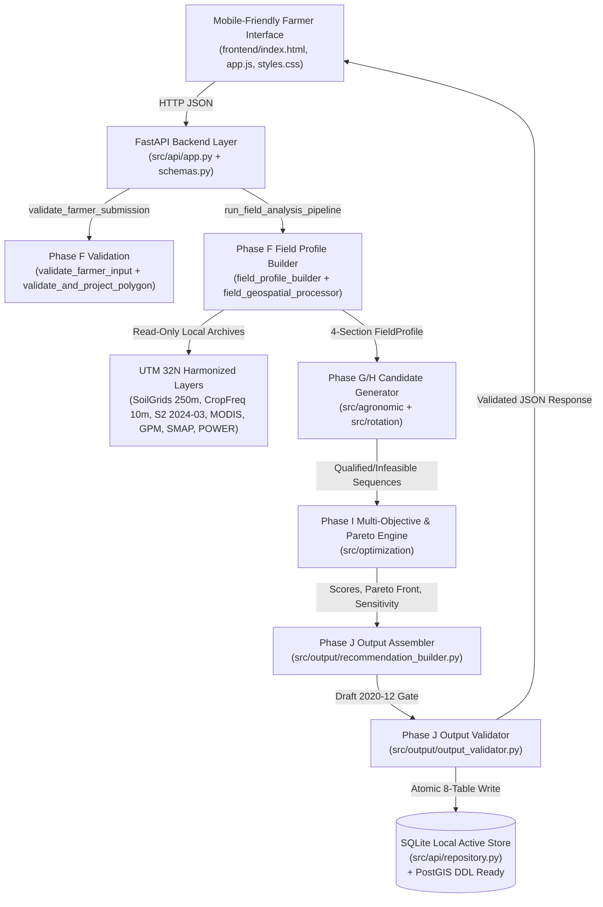

# Phase L — End-to-End System Architecture

> **System:** Field Shift — Guelma Wilaya Crop Rotation Decision-Support System (`FieldShift-PhaseFJ-1.0.0`)  
> **Architectural Principle:** Pure orchestration around validated Phase D–J scientific engines without duplicating agronomic logic or modifying scientific models.

---

## 1. End-to-End Integration Pipeline

---

## 2. Implemented Layers & Clear Separation of Concerns

1. **Farmer Interface ([`frontend/`](file:///home/lokman/Desktop/FeildShit-SI-Model/frontend/index.html)):**
   - Captures ONLY farmer-known geometry, operational water access, remembered crop history, planning horizon, and preferences.
   - Serves an interactive offline-resilient HTML5 Wilaya canvas seeded with [`guelma_wilaya_boundary.geojson`](file:///home/lokman/Desktop/FeildShit-SI-Model/guelma_wilaya_boundary.geojson) (no blocked online CDN dependency for field pilots).
   - Never calculates scores or overrides constraint rules; renders `Recommended`, `Conditionally Recommended`, `Insufficient Evidence / Unknown`, and `Infeasible` cards strictly from Phase J outputs.
2. **Backend API & Schema Boundary ([`src/api/app.py`](file:///home/lokman/Desktop/FeildShit-SI-Model/src/api/app.py), [`src/api/schemas.py`](file:///home/lokman/Desktop/FeildShit-SI-Model/src/api/schemas.py)):**
   - Validates incoming payloads strictly (`ConfigDict(extra="forbid")` + `FORBIDDEN_TECHNICAL_KEYS`), preserving `null` vs `[]` via `model_fields_set`.
   - Synchronous (`def`) FastAPI handlers dispatch blocking `rasterio`/`geopandas` extractions to Starlette's worker threadpool safely.
   - Maps validation exceptions cleanly to HTTP `422`, missing analyses to `404`, and contract violations to `500`.
3. **Orchestration Service ([`src/api/pipeline_service.py`](file:///home/lokman/Desktop/FeildShit-SI-Model/src/api/pipeline_service.py)):**
   - Computes content-addressed `payload_sha256` and `analysis_id = ANAL_<sha256[:16]>` covering geometry + water + history + planning + preferences + language (closing the Phase J `_deterministic_request_id` hash collision gap discovered during the architecture audit).
   - Executes Phases F -> G/H -> I -> J sequentially, passing explicit `request_id=analysis_id` into `build_final_recommendation(...)`, then runs `validate_final_recommendation(...)` before persistence or return.
4. **Persistence Repository ([`src/api/repository.py`](file:///home/lokman/Desktop/FeildShit-SI-Model/src/api/repository.py), [`db/schema_postgis.sql`](file:///home/lokman/Desktop/FeildShit-SI-Model/db/schema_postgis.sql)):**
   - Active default runtime: `SQLiteAnalysisRepository` implementing all 8 relational entities locally with foreign keys and atomic transactions.
   - Production DDL ready: `db/schema_postgis.sql` + `PostgresPostGISRepository` adapter (`DISCONNECTED` locally because host PostGIS extension & `psycopg` are not installed).

---

## 3. Disconnected / Deferred Components (Honest Operational Status)

| Component | Current Status | Reason / Deployment Requirement |
|---|---|---|
| **PostgreSQL + PostGIS Runtime** | `DISCONNECTED` | PostgreSQL 18.6 runs locally, but host `postgis` extension files & `psycopg` driver are absent (`SQLiteAnalysisRepository` is active). |
| **User Authentication / RBAC** | `DISCONNECTED` | Single-tenant `farmers_users` default (`USR_ANONYMOUS_PILOT`); pilot deployment needs OAuth2/JWT advisor login before multi-farmer persistence. |
| **Google Earth Engine Tasks** | `DISCONNECTED` (By Policy) | Zero GEE tasks submitted; operates strictly over local harmonized Phase A–D archives. |
| **Native `fr` / `ar` Explanation Translation** | `PARTIAL` (Metadata Only) | `language` parameter flows to schema envelope (`"en" \| "fr" \| "ar"`), while rule/objective explanation prose remains English (`FieldShift-PhaseFJ-1.0.0`). |
| **Real-World Farmgate Yield & Salinity Telemetry** | `NOT_INTEGRATED` | Local DEM slope, lab `ECe`/`CaCO3`/`Olsen-P`, and farmgate crop price/cost budgets remain `UNKNOWN` (`CONDITIONAL` readiness). |
